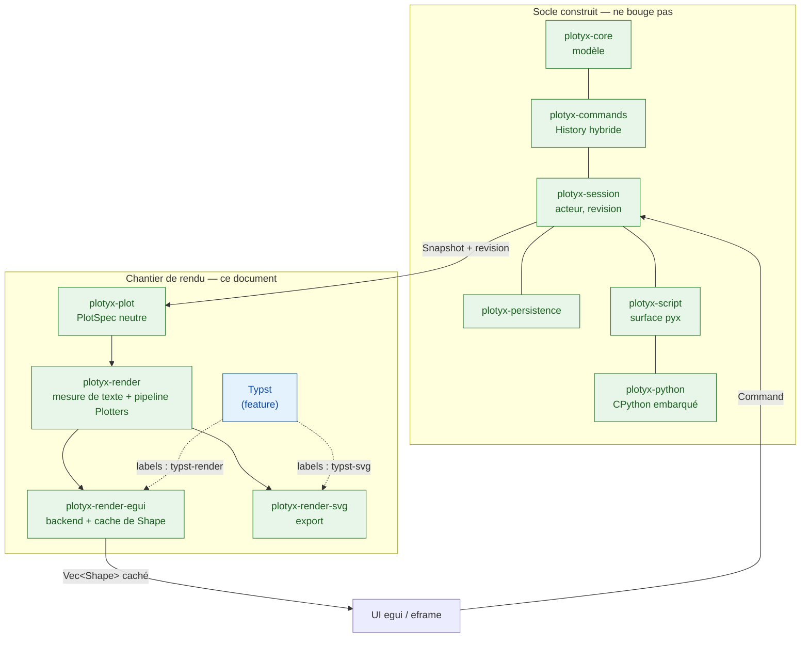

# Architecture retenue — rendu et interface (chantier hors socle)

Statut : **arrêtée le 2026-09-10.** Ce document **amende le §12 du
`cahier-des-charges-technique.md`** (« Hors périmètre — décisions déjà
prises pour la suite »), premier point : le renderer n'est plus Matplotlib.
Il ne touche à **aucune** des quatre décisions du §2 de ce cahier des
charges, et à aucune ligne du socle déjà construit.

Comme partout ailleurs dans ce dossier, les options écartées restent
écrites, avec leur raison : `options-explorees.md`. Le *quand* est dans
`roadmap-rendu.md` (séquencement « le contrat d'abord », arrêté le
2026-09-10) ; **ce document-ci fait foi** en cas de divergence entre les
deux.

---

## 1. Ce que cette bascule change — et ce qu'elle ne change pas

Le renderer était **déjà hors du socle**. La revue du 2026-09-08 (spec §2.5)
avait fait passer le plan de 9 à 7 crates en sortant `plot` et `render-mpl` :
les deux seuls crates qu'un changement de moteur de rendu aurait touchés
n'ont jamais été écrits.

**Intacts, sans une ligne à reprendre** — les huit crates construits sont
tous en amont du choix de rendu, et aucun ne nomme Matplotlib :

| Crate | Pourquoi il ne bouge pas |
|---|---|
| `plotyx-core` | modèle pur, zéro dépendance UI (vérifié par test) |
| `plotyx-commands` | historique hybride, ne connaît que `core` |
| `plotyx-session` | l'acteur, ne connaît pas Python et encore moins le rendu |
| `plotyx-persistence` | frontière `save`/`load` |
| `plotyx-python` | interpréteur embarqué, **ne connaît pas le modèle** |
| `plotyx-script` | surface `pyx`, écrit par le bus de commandes |
| `plotyx-cli`, `plotyx-app` | binaires ; `plotyx-app` est déjà sur `eframe` 0.36.2 |

**Ce qui change** : la case « renderer » du §12, jamais codée. Rien d'autre.

**Bénéfice de calendrier** : la fenêtre est celle où le socle est fini et le
chantier de rendu pas commencé. Elle ne se représentera pas.

---

## 2. Cahier des charges

- **Rendu 100 % Rust natif** — le moteur de tracé ne passe plus par Python
  (voir §2.1 pour ce que cela ne veut *pas* dire)
- Interaction souris complète : zoom, pan, sélection de points
- Fenêtres flottantes type OriginLab / ChemDraw (multi-panels)
- Undo/Redo robuste
- Rendu qualité publication, export vectoriel (SVG/PDF) — l'anti-aliasing
  écran n'est pas critique
- **Pas de gestion d'images** ; un peu de 3D à prévoir
- Volume : jusqu'à ~500 spectres de 600 points, fluide jusqu'à ~100 courbes
- Export prioritaire : SVG et PDF (PNG via conversion externe si besoin)
- Fitting traité séparément (hors scope)

### 2.1 Correction de prémisse — PyO3 reste, et l'argument contre lui était faux

Une version antérieure de ce document justifiait le « 100 % Rust » par
*« pas de Python embarqué — l'interpréteur externe posait problème pour le
Ctrl+Z / Ctrl+Y »*. **Cette prémisse est fausse pour PlotYx**, et il faut
qu'elle cesse de circuler avant qu'elle ne justifie une décision qu'elle ne
soutient pas.

Ce qui est construit n'est pas un interpréteur externe : c'est CPython
**dans le processus** (PyO3 0.29.2, ni sous-processus ni IPC), et les
écritures d'un script passent par **le même bus de commandes que l'UI**,
donc dans la même pile d'historique. C'est le critère de fin du socle, et
il est tenu et testé :

- `crates/plotyx-script/tests/script.rs:552` —
  `undo_depuis_python_defait_les_ecritures_puis_rend_false`
- `crates/plotyx-script/src/selftest.rs:340` — `step_edit_undo_redo`
- `crates/plotyx-script/src/surface.rs:179` — « Il n'y a **qu'une seule
  pile** dans la session : `pyx.undo()` annule aussi le `Ctrl+Z` »

Le problème invoqué est donc **déjà résolu, pas contourné**. L'objection
visait les wrappers Matplotlib *en sous-processus* (`plotpy`,
`rust-plotter`), à juste titre — mais elle ne s'applique pas ici.

**Conséquence.** PyO3 est conservé, et sa justification ne change pas : la
spec §2.3 avait déjà acté que PyO3 était passé de *conséquence du renderer*
à **objectif autonome**. Il tient par un contrat externe indépendant du
rendu — `cahier-des-charges-api-script.md` §8 fait de la compatibilité des
scripts déjà écrits et de l'accès à numpy un engagement.

Ce qui disparaît avec Matplotlib, c'est uniquement le **renderer** Python,
pas la console de script ni la surface `plotyx.api`.

---

## 3. Stack retenue

| Composant | Solution retenue | État |
|---|---|---|
| UI | egui + eframe | **déjà en place** (0.36.2) |
| Graphiques 2D/3D | **Plotters** + **backend egui écrit par nous** (§4) | à écrire |
| Fenêtres flottantes / multi-panels | Viewports natifs egui (`egui_tool_windows` en option pour des panneaux internes) | à écrire |
| Undo/Redo | **`plotyx-commands::History`** — déjà construit | **fait** |
| Notations scientifiques et texte riche | **Typst embarqué** via un `World` custom (crate `typst` 0.15.1), derrière un *feature flag* (§7) | à écrire |
| Export final | SVG natif de Plotters → PDF via `svg2pdf` 0.13.0 (§5) | à écrire |
| Mesure du texte | **une seule `epaint::Fonts`**, partagée écran + export, headless (§4.3) | à écrire |
| Script / numpy | **PyO3 conservé** (§2.1) | **fait** |
| Fitting | à définir séparément | — |

---

## 4. Le backend egui — écrit, pas importé

**Décision.** Écrire nous-mêmes l'implémentation de
`plotters_backend::DrawingBackend` sur egui, plutôt que dépendre
d'`egui-plotter`.

**Pourquoi.** Trois raisons, dans l'ordre de poids :

1. **`egui-plotter` ne compile pas avec notre egui.** `egui-plotter` 0.6.0
   dépend d'`egui` **0.32.1** ; le fork `egui-plotter-fork` 0.35.0 dépend
   d'`egui` **0.35**. `plotyx-app` est sur **0.36.2**. Aucun des deux ne
   passe en l'état, et figer egui à 0.35 serait une régression sur une
   machine où un défaut Wayland de `winit`/`eframe` est déjà documenté
   (spec §9).
2. **La surface à écrire est petite** (§4.1) — plus petite que le crate,
   parce qu'il porte des choses dont nous n'avons pas l'usage.
3. **Profil de risque.** Mono-mainteneur, en retard d'une version d'egui :
   c'est exactement le critère qui nous a fait écarter `latex-rust` et ReX
   pour le rendu mathématique. L'appliquer ici aussi.

### 4.1 La surface exacte du trait

`DrawingBackend` n'exige que **quatre** méthodes : `get_size`,
`ensure_prepared`, `present`, `draw_pixel`. Tout le reste a une
implémentation par défaut qui retombe sur la rasterisation pixel par pixel.
Pour un backend vectoriel, on en surcharge **huit**, et chacune tombe sur
une `egui::Shape` presque en un pour un :

| plotters | egui |
|---|---|
| `draw_line` | `Shape::LineSegment` |
| `draw_path` | `Shape::Path` |
| `draw_rect` | `Shape::Rect` |
| `draw_circle` | `Shape::Circle` |
| `fill_polygon` | `Shape::Path` fermé |
| `draw_text` | `Shape::Text` — `FontTransform` ne vaut que 0/90/180/270, `TextShape::angle` est un `f32` libre : la conversion est triviale |
| `estimate_text_size` | `Fonts::layout` (mais lire §4.3) |
| `blit_bitmap` | **laissée en défaut** — le cahier des charges dit « pas de gestion d'images » |

**Chiffrage.** Sur les 553 lignes de `backend.rs` du fork, ~208 sont des
newtypes `EguiBackendCoord`/`EguiBackendColor` avec huit surcharges
d'opérateurs, et ~70 le `bg_image`/`BgImageSize` dont nous n'avons pas
l'usage. Le dessin réel fait ~220 lignes. **Compter 250 à 300 lignes**
écrites pour nos besoins, contre ~1 000 lignes vendorisées à maintenir.

### 4.2 La décision de conception : un `Vec<Shape>`, pas un `Painter`

**Décision.** Le backend collecte dans un `&mut Vec<Shape>`. Il ne tient
**pas** de `Painter`.

**Pourquoi.** egui est en mode immédiat : il repeint à chaque mouvement de
souris. `egui-plotter` tient un `&'a Painter` et dessine dedans — donc tout
le pipeline Plotters (`ChartBuilder`, axes, ticks, 300 000 points) est
rejoué à **chaque frame**, même quand rien n'a changé. Avec un collecteur,
on met en cache, et une frame sans changement coûte
`painter.extend(cache.iter().cloned())`.

`epaint` bénit explicitement ce stockage, avec **une** exception
documentée dans sa source :

> *You should generally recreate your Shapes each frame, but storing them
> should also be fine with one exception: `Shape::Text` depends on the
> current `pixels_per_point` (dpi scale) and so must be recreated every
> time `pixels_per_point` changes.*

**D'où la clé de cache** : `(revision du Snapshot, rect, pixels_per_point)`.
La révision existe déjà — c'est le compteur monotone de `plotyx-session`,
et c'est son usage prévu (spec §6.1 : « un client sait si son instantané est
périmé en comparant la `revision` »). **Le renderer devient un client de
plus du même protocole**, au même titre que l'UI et le fil de script.

Effet de bord bienvenu : `ensure_prepared` et `present` deviennent des
no-ops, là où un backend à texture ferait de `present` un point d'upload.

**Le chiffre qui tranche** — 500 spectres × 600 points = 300 000 points :

| | mémoire | dépend de la résolution ? |
|---|---|---|
| cache `Vec<Shape>` | 300 k × `Pos2` (8 o) = **2,4 Mo**, + 500 × 64 o de `Shape` = 32 Ko | **non** |
| texture RGBA 1600×1200 | **7,7 Mo**, par vue et par graphe | oui |

(`Shape` fait 64 octets — `epaint` a une assertion de test dessus.)

> **Mesuré en R0 (0.3, 2026-09-10) : 2 432 000 octets, soit 2,432 Mo.** Le
> chiffre ci-dessus est confirmé au chiffre près, `size_of::<Shape>()` = 64
> octets compris.

Le cache vectoriel est ~3× moins cher **et** indépendant de la résolution.
Ce renversement enterre au passage les deux points de vigilance hérités du
plan Matplotlib (spec §12) : **le budget de 141 ms et la mise à jour
partielle de texture n'ont plus d'objet** — il n'y a plus ni buffer RGBA ni
upload.

**Limite assumée, à ne pas redécouvrir.** Cacher les `Shape` économise le
pipeline Plotters, **pas la tessellation** : egui retriangule à chaque
frame. Si cela coince à 300 k points, deux leviers, dans cet ordre :

1. **décimer avant de tracer** (LTTB) — c'est ce que `plotkit` offrait
   gratuitement et que ce choix nous fait perdre ; à écrire une fois ;
2. cacher un cran plus loin en `Shape::Mesh(Arc<Mesh>)` — mais ~14 Mo pour
   300 k points (600 k `Vertex` à 20 o + indices `u32`), donc **plus cher
   que la texture**. C'est un bouton, pas un défaut.

> **Corrigé par la mesure R0 du 2026-09-10 — deux erreurs, et un levier
> oublié.**
>
> *L'estimation du levier 2 était fausse d'un facteur 3.* Une polyligne
> anti-crénelée produit **4 sommets par point**, pas 2 — deux pour le trait,
> deux pour la frange — et les indices n'avaient pas été comptés. Mesuré à
> 300 k points : 1 200 000 sommets, 5 397 000 indices, **45,6 Mo**. Le cache
> `Mesh` n'est donc pas « ~2× la texture RGBA », il est **~6×**. Sans
> feathering : 19,2 Mo, ce qui reste 1,4× le chiffre annoncé. Le classement
> (vectoriel < Mesh) tient ; l'écart est bien plus grand. **L'upload de
> 45,6 Mo par frame n'a pas été chronométré** (aucun affichage dans
> l'environnement de mesure) : à chiffrer avant d'appuyer sur ce bouton.
>
> *Il existe un troisième levier, absent de cette liste.* Le feathering pèse
> **78 % du coût de tessellation** : 22,1 ms avec, **4,88 ms sans**, sur le
> même graphe. Désactivé, ce cas repasse **sous le seuil de 8 ms**.
> `TessellationOptions::feathering` devient donc un levier à part entière —
> à arbitrer contre la qualité visuelle, éventuellement conditionné à la
> densité ou limité à la durée d'un drag. Il entre en R5 aux côtés du LTTB.
>
> *Et le coût mesuré dépasse la frame.* 22,1 ms de tessellation seule à
> 300 k points, c'est déjà plus qu'une frame à 60 Hz (16,7 ms), avant tout
> upload GPU et tout dessin d'UI. Le coût est linéaire à **~75 ns/point**,
> avec un surcoût par polyligne ; la barre des 8 ms tombe vers **110 000
> points**.

### 4.3 `draw_text` — le point de contact avec Typst, et le seul piège

Plotters appelle `draw_text` pour **chaque** tick, titre d'axe et entrée de
légende. Deux régimes, à séparer nettement :

- **texte ordinaire** (chiffres des ticks, noms de série) → `Shape::Text`
  via les fonts egui. Net, HiDPI, cohérent avec le reste de l'UI, gratuit.
  **Ne pas le faire passer par Typst** : ce serait une compilation Typst
  par tick ;
- **notation scientifique** (λ, indices, exposants, fractions) → Typst →
  `typst-render` en RGBA → texture → `Shape::Mesh`, caché par hash de
  formule **et** `pixels_per_point`.

> **Invariant non négociable.** `estimate_text_size` doit mesurer **par le
> même chemin que celui qui dessinera**. Un label parti chez Typst mais
> mesuré par `Fonts::layout` fait mal placer les axes par Plotters — et le
> défaut se manifeste comme un décalage de mise en page, jamais comme une
> erreur. C'est le seul endroit de ce chantier où un bug est silencieux ;
> il mérite un test dédié dès la première version.
>
> **Le mécanisme qui le tient** (précisé le 2026-09-10 après vérification
> dans la source) : **une seule instance d'`epaint::Fonts`, partagée par
> les deux backends**. `Fonts::new(TextOptions, FontDefinitions)` se
> construit sans `Context`, sans fenêtre et sans GPU — donc l'export
> headless (CLI, script) mesure exactement comme l'écran, non pas « de la
> même façon » mais **avec le même objet**. Ne pas tenter de réimplémenter
> la mesure avec un crate de fonts tiers : epaint 0.36 shape via `skrifa`
> + `harfrust`, et reproduire son résultat au pixel près n'est pas un
> exercice qu'on gagne.
>
> **Mesuré en R0 (0.1, 2026-09-10) — tenu, et plus facile à tenir que
> décrit.** 540 comparaisons (30 chaînes réelles × 3 `pixels_per_point` × 3
> tailles × 2 familles) entre une `Fonts` construite à la main et le chemin
> `Context` : **écart maximal 0,000000 px**, égalité exacte. Le harnais
> portait un témoin positif — famille remplacée par une autre police — qui
> dépasse de 216 px, donc l'égalité n'est pas un artefact de mesure.
>
> Trois précisions que la mesure apporte, et qui **assouplissent**
> l'invariant :
>
> 1. **Les métriques de texte sont indépendantes de `pixels_per_point`**
>    (et du hinting, et du *subpixel binning*) : le cache d'avances d'epaint
>    est clé par `(char, LocationHash)`, le hinting ne touche que le contour
>    rastérisé. Il ne faut donc **pas** partager *le même objet* `Fonts` —
>    il suffit de partager les mêmes `FontDefinitions`. Le danger réel n'est
>    pas « deux instances », c'est « deux jeux de polices ». Un test de dix
>    lignes suffit à le garder.
> 2. **`Fonts` n'est ni `Clone`, ni utilisable par `&self`** (`layout` prend
>    `&mut self`). Une instance réellement partagée serait un
>    `Mutex<Fonts>`, pas un `Arc<Fonts>` — raison de plus de partager la
>    *définition* plutôt que l'objet. Le commentaire « Cheap to clone » de
>    la source d'`epaint` est un vestige.
> 3. **La signature réelle en 0.36.2 est `Fonts::new(TextOptions,
>    FontDefinitions)` — deux arguments**, le `pixels_per_point` passant par
>    `with_pixels_per_point() -> FontsView`. Et `Context::run` s'appelle
>    `run_ui`.
>
> Reste non vérifié : le **branchement** sur Plotters. R0 valide que l'outil
> de mesure existe et qu'il est fidèle, pas que `estimate_text_size` le
> consomme correctement — c'est la tâche R4.4.
>
> **Corrigé par R4 le 2026-09-12 — la précision 1 est vraie des avances,
> fausse de la hauteur de ligne.** En écrivant le test qui devait entériner
> l'indépendance au `pixels_per_point`, R4 a constaté qu'elle ne tient pas
> pour la hauteur : `epaint` cale la hauteur d'une ligne sur la grille de
> pixels **physiques** (`text_layout.rs` : `max_row_height =
> point_scale.round_to_pixel(max_row_height)`). Mesuré à 9,7 pt de corps,
> un galley fait 11 points de haut à `pixels_per_point = 1,0` et 12 à 1,25.
> R0 ne pouvait pas le voir : elle comparait des avances de glyphes, pas des
> rectangles de galley.
>
> Ce n'est pas un détail, parce que `DrawingArea::titled` fait descendre le
> haut de la zone de tracé de la hauteur du titre : **la figure exportée
> aurait dépendu de l'écran de celui qui l'exporte**, sans qu'aucune erreur
> ne soit levée — précisément le mode de panne que ce paragraphe existe pour
> empêcher.
>
> **Règle retenue, tenue par construction** : on **mesure** toujours à
> `pixels_per_point = 1,0` (`plotyx_render::text::MEASUREMENT_PIXELS_PER_POINT`),
> on ne **dessine** qu'au `pixels_per_point` réel. Le trait `TextSource` a
> donc deux méthodes, `measure` et `layout`, et non une. Prix payé : au plus
> un pixel physique d'écart entre la boîte réservée et les glyphes sur un
> écran HiDPI — sans effet sur la géométrie, le texte étant ancré et non
> étiré. Le fait est verrouillé *dans le sens de l'affirmation* par un test
> (`plotyx-render/src/text.rs`) : si `epaint` changeait d'avis, le test
> tomberait et la règle pourrait disparaître.
>
> **Conséquence sur le mécanisme du §4.3, et c'est un assouplissement de
> plus** : puisqu'un `egui::Context` ne sait mettre en page qu'au
> `pixels_per_point` courant, la mesure ne peut *pas* passer par lui. Elle
> passe par une `Fonts` hors `Context` construite sur les mêmes
> `FontDefinitions` — ce que R0 0.1 avait déjà validé à 0,000000 px. Mesurer
> et dessiner ne sont donc pas le même appel ; ils partent du même jeu de
> polices, et c'est cela, et seulement cela, que l'invariant demande.

### 4.4 Plotters sans ses fonts

Puisque tout le texte passe par egui ou par Typst, les fonts de Plotters
sont mortes :

```toml
plotters = { version = "0.3", default-features = false, features = ["all_series", "all_elements"] }
```

Cela élimine `font-kit`, `image`, `chrono`, `ttf-parser` — **et le scan des
fonts système**, que le choix Typst veut de toute façon désactiver
(`include_system_fonts(false)`) pour la reproductibilité.

> **Correction du 2026-09-10 — ce retrait n'est sûr que si les DEUX
> backends surchargent `estimate_text_size`.** Une première rédaction
> présentait `default-features = false` comme sans conséquence. C'est vrai
> du backend egui, qui surcharge la mesure. **C'est faux par défaut du
> backend SVG** : `plotters-svg` ne surcharge pas `estimate_text_size`, il
> retombe sur le défaut du trait, qui appelle `layout_box` — et sans la
> feature `ttf` ni `ab_glyph`, `layout_box` tombe sur
> `style/font/naive.rs` :
>
> ```rust
> let em = size / 1.24 / 1.24;
> // largeur ≈ em * 0.7 * text.len()
> ```
>
> Soit une largeur **monospace estimée sur le nombre d'octets UTF-8** :
> « λ » compte pour 2, « µm » pour 3, et « 111 » mesure comme « WWW ». Les
> marges réservées aux labels seraient fausses, donc la zone de tracé
> différente de celle de l'écran — **la figure exportée ne serait pas la
> figure vue**. La surcharge de `estimate_text_size` par l'`epaint::Fonts`
> partagé du §4.3 est donc **obligatoire dans `plotyx-render-svg` aussi**,
> pas seulement dans le backend egui. À cette condition, et seulement à
> elle, le retrait des fonts de Plotters est sûr.
>
> **Complément de R4, le 2026-09-12 — ce n'est pas `estimate_text_size` le
> plus dangereux, c'est `draw_text`.** Avec `default-features = false`,
> l'implémentation **par défaut** de `draw_text` finit sur `FontData::draw`
> de `style/font/naive.rs`, qui est un `panic!("The font implementation is
> unable to draw text")`. Un backend qui ne surcharge pas `draw_text` ne
> mesure donc pas mal : il **plante** à la première graduation. Les deux
> backends du chantier la surchargent — egui directement, SVG par délégation
> à `SVGBackend`, qui la surcharge lui-même — mais un troisième tomberait
> dedans, et l'erreur ne ressemblerait en rien à un problème de police.

---

## 5. Export SVG/PDF — un second backend, facile en mécanique, pas en fidélité

Le cahier des charges impose un export **depuis les données, pas depuis
l'écran**. Donc : même `PlotSpec`, backend différent.

- **SVG** : `plotters` a `svg_backend` nativement (feature `svg_backend`),
  ~800 lignes, même trait que le backend egui. `SVGBackend::with_string`
  rend la sortie dans une `String` qu'on possède — utile pour le §5.2.
- **PDF** : Plotters n'a **pas** de backend PDF. `svg2pdf` 0.13.0 fait le
  pont — et vient de l'organisation Typst, donc de la famille qu'on adopte
  déjà. Chemin retenu : `PlotSpec → SVGBackend → svg2pdf`.

### 5.1 Deux problèmes de fidélité, pas de mécanisme

Le mécanisme est gratuit ; la fidélité ne l'est pas. Deux défauts, tous
deux **silencieux** :

1. **La mesure du texte** — traitée en §4.4 : sans surcharge de
   `estimate_text_size`, l'export réserve les marges d'après une heuristique
   au nombre d'octets. Corrigé par l'`epaint::Fonts` partagé.
2. **`plotters-svg` n'outline pas le texte** : il émet
   `<text font-family="…">`, donc le SVG exporté **dépend de la font
   installée chez le lecteur**. Ouvert sur une autre machine (Inkscape
   ailleurs, la chaîne de production d'une revue), les glyphes sont
   substitués et la mise en page bouge. C'est le mode d'échec classique de
   l'export vectoriel pour publication.

### 5.2 Typst par-dessus — plus simple que prévu, et voici pourquoi

Vérifié dans la source de `typst-svg` 0.15.1 et de `plotters-svg` 0.3.7.
Le cauchemar habituel de la fusion de deux SVG (collision d'`id` entre
`<defs>`) **n'a pas lieu ici**, pour trois raisons indépendantes :

- **Typst nomme ses `<defs>` par hash de contenu**, pas par compteur :
  `DedupId(char, hash128)` où le hash porte sur le glyphe ou le tracé de
  découpe lui-même. Deux fragments Typst inlinés dans le même document ne
  se marchent donc pas dessus — un glyphe identique **se déduplique** au
  lieu d'entrer en collision, un glyphe différent reçoit un autre hash ;
- **`plotters-svg` n'émet aucun `id`, aucun `defs`, aucun `clipPath`** —
  surface de collision nulle du côté du graphe ;
- **Typst sort ses glyphes en contours** (`render_path_glyph` : *« a
  pre-scaled path glyph defined by an outline »*), donc le fragment Typst
  est **autonome et sans dépendance de font**.

**L'inversion à retenir** : dans l'export SVG, la partie difficile est le
**chiffre des graduations**, pas la formule. Les λ, indices et fractions
sortent parfaits et portables ; « 0,5 » sort en référence de font, mesurée
par une heuristique. C'est l'inverse de l'intuition.

> **Décision à prendre, pas encore tranchée** : soit faire passer **tout**
> le texte de l'export par le même chemin d'outline que Typst (cohérent,
> portable, mais il faut outliner soi-même les labels ordinaires), soit
> assumer l'asymétrie. Voir le point ouvert n°6.
>
> **Ajout du 2026-09-12 (phase R6)** : la même question se pose côté PDF,
> sous une forme différente. `svg2pdf` ne surcharge rien de `plotters` — il
> reparse le SVG déjà produit avec `usvg` — mais sans le moindre `fontdb`,
> `usvg` **abandonne silencieusement tout le texte** (mesuré : 599
> opérateurs `Tj` sur le graphe réaliste de R5, zéro sans police). L'export
> PDF de `plotyx-render-svg` charge donc les polices système de la machine
> qui exporte avant de convertir. Ça ne tranche pas ce point ouvert — ça
> déplace seulement l'asymétrie : côté SVG, c'est la machine qui **lit** le
> fichier qui a besoin d'une police compatible ; côté PDF, c'est la machine
> qui **l'exporte**, une fois, après quoi `svg2pdf` embarque un
> sous-ensemble de la police choisie et le fichier devient autonome — plus
> portable que le SVG une fois produit, mais avec un choix de glyphes qui
> dépend de la machine d'export plutôt que de lecture. Détail et chiffres :
> `roadmap-rendu.md`, phase R6.

**Ce qui reste réellement à faire pour la fusion**, et c'est mécanique :

1. envelopper chaque fragment Typst dans un `<g transform="translate() scale()">`
   ou un `<svg x y width height>` imbriqué — Typst travaille en points,
   Plotters en pixels ;
2. la taille du fragment doit être **celle que `estimate_text_size` a
   rendue**, sinon le label ne s'assied pas là où la place a été réservée ;
3. injecter dans la `String` produite par `SVGBackend::with_string` — le
   plus simple étant que le backend note des rectangles-témoins que l'on
   substitue après coup.

**Contrepartie à surveiller** : **trois** chemins de texte doivent
s'accorder (écran egui, SVG d'export, et la mesure du §4.3). Un test de
non-régression sur les positions d'axes entre les deux backends vaut d'être
écrit tôt, pas après le premier rapport d'utilisateur.

---

## 6. Interaction souris et 3D

- `egui-plotter` n'est pas repris, mais son `chart.rs` (375 lignes,
  `MouseConfig` : `pitch_scale`, `yaw_scale`, `zoom_scale`, transformation
  3D) est la bonne **référence à lire** avant de réécrire cette partie.
  C'est le morceau qui a de la valeur dans ce crate, pas le backend.
- **Sélection de points** : pas de fonctionnalité intégrée, mais le trait
  `ReverseCoordTranslate` (pixel → coordonnée logique) combiné à un
  `min_by_key` sur la distance suffit (~10-15 lignes).
- **3D** : Plotters le couvre (feature `surface_series`), en CPU. La
  contrainte de fluidité relâchée (fluide à ~100 courbes, ralentissement
  accepté jusqu'à 500) rend inutile tout GPU custom —
  cf. `options-explorees.md`.

---

## 7. Typst — derrière un *feature flag*, dès le premier jour

**Décision.** Le crate de rendu compile, teste et s'exécute **sans** Typst,
avec repli sur `Shape::Text` brut. Typst est une feature Cargo, absente de
`default`.

**Pourquoi.** C'est exactement la convention déjà tenue par
`plotyx-python` et `plotyx-script`, qui compilent **vides** sans la feature
`python` pour garder la CI verte sur une machine sans interpréteur
(spec §2.4). Appliquée à Typst, elle donne le droit d'**abandonner Typst
sans rien démonter** si la mesure de latence est mauvaise.

**Ce que coûte vraiment Typst** — pas le `World` custom (~100-150 lignes),
mais :

- le **cache** (texte de formule → sortie compilée), sans lequel la
  pipeline est trop lourde pour du zoom ou un curseur ;
- les **deux chemins de sortie** (`typst-render` pour l'écran, `typst-svg`
  pour l'export) ;
- la **latence de compilation par formule inédite**, à **mesurer avant**
  d'engager du code de production (c'est le point ouvert n°6 ci-dessous).

**Fonts** : ~~décision inchangée — deux sets possibles, *Libertinus Serif +
Libertinus Math* (cohérence classique/scientifique ; Libertinus Math à
embarquer à la main, `typst-kit` n'embarque nativement que Libertinus
Serif) ou *Liberation Sans + Noto Sans Math* (look « Arial »). Fonts
embarquées uniquement, scan système désactivé.~~

**Remplacé le 2026-09-13** par une tâche ponctuelle d'embed de polices, hors
séquencement R0-R8 (elle ne construit pas Typst — R8 le fait toujours — mais
prépare les fonts Math qu'il consommera). Ce qui change, ce qui reste vrai :

- **Trois paires, pas deux, et Libertinus *Sans*, pas *Serif***. La
  distinction texte/Math n'était pas encore posée : ce paragraphe visait
  encore l'ancien modèle « une police classique pour la prose, Typst pour le
  reste ». Le renderer réel (§4.3) n'a pas de « prose » séparée du reste —
  tout le texte ordinaire (graduations, titres) passe par les fonts egui,
  jamais par Typst — donc la police de texte embarquée doit être une
  sans-serif cohérente avec le reste de l'UI, pas une serif de lecture
  longue. Les trois paires retenues, embarquées dans `plotyx-render`
  (`crates/plotyx-render/src/fonts.rs`, fichiers dans `vendor/fonts/`) :
  Libertinus Sans + Libertinus Math, Fira Sans + Fira Math, Noto Sans +
  Noto Sans Math.
- **« Fonts embarquées uniquement, scan système désactivé » devient « fonts
  embarquées par défaut, système en option »**. La demande utilisateur du
  2026-09-13 est explicite : « il doit toujours être possible de
  récupérer/utiliser les polices système à la place ». `FontChoice::System`
  désigne une police par son nom ; introuvable, elle replie silencieusement
  sur Noto plutôt que de perdre le texte ou de remonter une erreur — le même
  principe que R6 a déjà appliqué côté export (§5, `plotyx-render-svg::pdf`).
  Le scan système n'est donc pas désactivé : il est optionnel, au choix de
  l'appelant, et jamais automatique (pas de détection implicite de la police
  du système d'exploitation).
- **Noto Sans / Noto Sans Math est le défaut ET le repli**, un rôle double
  qu'aucune des deux formulations écartées ne portait. Sans rien spécifier,
  c'est Noto ; une police système demandée et absente retombe aussi sur
  Noto.
- **Ce qui reste vrai** : les polices Math n'ont toujours aucun appelant —
  Typst n'existe pas encore dans ce dépôt (R8) — et cette tâche ne construit
  aucun rendu Typst. Elle se contente d'exposer les six fichiers (trois
  paires) en octets bruts, prêts à être consommés le jour venu, sans qu'un
  futur R8 ait à les retélécharger ou à revalider leur licence.
- **Hors périmètre, par choix explicite** : `plotyx_plot::PlotSpec` ne gagne
  aucun champ de police. La demande évoque « une police définie par
  l'utilisateur ou le projet », mais y répondre toucherait au format `.plx`
  persisté — une décision plus large que cette tâche n'a pas mandat de
  prendre (`cahier-des-charges-technique.md`, `format-fichier-plx.md`,
  options déjà écartées). Le mécanisme de résolution
  (`plotyx_render::fonts::resolve`) est écrit pour qu'un futur champ n'ait
  qu'à lui passer un `FontChoice`, sans reprise.

---

## 8. Découpage en crates

Restaure proprement le 9 → 7 de la spec §2.5, en remplaçant `render-mpl` :

| Crate | Rôle | Dépend de | Dépendances lourdes |
|---|---|---|---|
| `plotyx-plot` | `PlotSpec` neutre (port de `plotyx.plot`) | `id` | **aucune** — même règle testée que `plotyx-core` |
| `plotyx-render-egui` | backend `DrawingBackend` + cache de `Shape` | `plot`, `session` | `plotters`, `egui` ; `typst` en feature |
| `plotyx-render-svg` | export SVG et PDF | `plot` | `plotters/svg_backend`, `svg2pdf` |

**La frontière qui compte** : `plotyx-plot` **ne dépend pas de
`plotters`**. C'est ce qui laisse changer de moteur de dessin plus tard
sans toucher au modèle de graphe — la même discipline que « aucun Qt dans
`core` », rendue vérifiable par le compilateur.

> **Ajout du 2026-09-11 — un neuvième crate, `plotyx-id`, imprévu au
> découpage ci-dessus.** La phase R3 a dû faire porter `NodeKind::Graph` par
> un `PlotSpec` : `plotyx-core` en vient donc à dépendre de `plotyx-plot`,
> qui dépendait déjà de `plotyx-core` pour `NodeId` — un cycle Cargo direct,
> vérifié empiriquement (`cargo check` refuse avec *cyclic package
> dependency*). La sortie retenue descend `NodeId`, et lui seul (pas
> `IdAllocator`), dans un crate minimal sans dépendance :
>
> ```text
> plotyx-id  (zéro dépendance)
>   ↑              ↑
> plotyx-plot   plotyx-core → plotyx-plot
> ```
>
> `plotyx-core` réexporte `NodeId` à l'identique
> (`pub use plotyx_id::NodeId`) : aucun appelant existant n'a quoi que ce
> soit à changer. `plotyx-plot` gagne en frontière plutôt qu'il n'en perd :
> `cargo tree -p plotyx-plot` ne montre plus que `plotyx-id`, plus strict
> que le critère de sortie de R2. Détail dans `roadmap-rendu.md`, phase R3.

> **Ajout du 2026-09-12 — un dixième crate, `plotyx-render`, également
> imprévu.** La phase R4 a dû donner aux deux backends **la même** mesure de
> texte (tâche 4.1) et **le même** pipeline Plotters. Ces deux choses ne
> peuvent vivre ni dans `plotyx-render-svg` — le backend écran dépendrait du
> crate d'export — ni dans `plotyx-render-egui` — toute la pile egui
> entrerait dans l'export, ce que la ligne « pas `egui`/`eframe` » du tableau
> ci-dessus interdit. C'est la même figure qu'avec `plotyx-id` en R3 : la
> partie commune descend d'un cran.
>
> ```text
> plotyx-render   (plotters sans ses fonts, epaint, plot, core)
>   ↑                        ↑
> plotyx-render-egui   plotyx-render-svg
> ```
>
> Ce que le crate porte : `text` (la `FontDefinitions` unique, le trait
> `TextSource`, l'unique `estimate`), `pipeline` (la suite d'appels
> Plotters, générique sur `DB: DrawingBackend`) et `color` (la lecture des
> `#RRGGBB` du spec). Ce qu'il ne connaît pas : ni `egui`, ni `eframe`, ni
> `plotters-svg`, ni `typst` — vérifié par `plotyx-render/tests/frontiere.rs`.
>
> **Le pipeline partagé n'est pas un effet de bord du partage de la
> mesure ; c'est la pièce qui rend le critère de fin structurel.** La tâche
> 4.5 demande un test qui *constate* l'accord des deux backends. Un test
> constate, il n'empêche pas : avec deux `ChartBuilder` distincts, chaque
> marge et chaque taille de police serait une occasion de diverger, à
> découvrir après coup. Avec un seul, les deux backends ne diffèrent plus que
> par la façon de poser des pixels, et la règle que R5 se donne — « aucune
> fonctionnalité n'entre dans un seul backend » — est tenue par la structure
> plutôt que par la vigilance.
>
> **Deux retouches au tableau ci-dessus**, mineures et voulues : les deux
> backends dépendent aussi de `plotyx-core` (ils parlent `ResolvedPlot`, le
> livrable de R3 ; `plotyx-core` était déjà dans leur arbre via `plot` et
> `session`, donc c'est une arête déclarée, pas une arête nouvelle), et
> `epaint` entre dans `plotyx-render-svg` par `plotyx-render` plutôt qu'en
> direct — une seule arête, donc une seule version possible, ce que
> `plotyx-render-svg/tests/frontiere.rs` vérifie en comptant les `epaint` du
> `Cargo.lock`. `svg2pdf` reste absent : c'est la phase R6.

> **Ajout du 2026-09-12 (phase R5) — aucun onzième crate, et c'est le
> résultat qui compte.** L'élargissement au `PlotSpec` réel n'a créé aucun
> crate : les six types de tracé, les deux échelles d'axe, l'axe secondaire,
> les styles de trait et de marqueur, la légende, la grille de panneaux et
> la décimation LTTB sont **tous** descendus dans `plotyx-render`, qui passe
> de trois modules à neuf :
>
> | Module | Ce qu'il porte |
> |---|---|
> | `text`, `pipeline`, `color` | R4, inchangés dans leur rôle |
> | `series` | un `PlotType` traduit en géométrie, **une fois**, pour le cadrage comme pour le tracé |
> | `scale` | les échelles d'axe (voir ci-dessous : la log transforme les valeurs, pas le type de coordonnée) |
> | `paint` | les primitives en pixels — styles de trait, marqueurs, barres, moustaches |
> | `legend` | la légende, mise en page sur `estimate_text_size` et non sur Plotters |
> | `decimate` | le LTTB |
> | `sample` | le graphe minimal de R4 et le graphe réaliste de R5, partagés par l'exemple d'export et par le test d'accord |
>
> Les deux backends, eux, n'ont rien gagné que ce que leur nature impose :
> `plotyx-render-egui` reçoit le module `feathering` (ci-dessous) et
> `plotyx-render-svg` un exemple élargi. **La règle que R5 s'était donnée —
> « aucune fonctionnalité n'entre dans un seul backend » — n'a donc pas eu à
> être surveillée** : le pipeline générique de R4 la tenait par
> construction, ce qui était l'argument avancé pour l'écrire, et qui se
> vérifie ici.
>
> **Trois écarts par rapport à ce que ce document laissait attendre**, tous
> assumés, détaillés dans `roadmap-rendu.md` (bloc de clôture de R5) :
>
> 1. **l'échelle logarithmique n'utilise pas `LogRange` de Plotters.** Ce
>    combinateur change le *type* de la coordonnée ; avec deux axes, deux
>    échelles et un axe secondaire, la fonction qui trace un panneau
>    existerait en huit monomorphisations. C'est la divergence que le
>    pipeline unique existe pour empêcher, qui rentrerait par la porte du
>    système de types. Les valeurs sont donc transformées en amont, le
>    `Cartesian2d<f64, f64>` reste unique, et le prix payé est que les
>    graduations d'un axe log sont des **décades** ;
> 2. **la légende n'est pas celle de Plotters.**
>    `configure_series_labels()` dimensionne son cadre par
>    `FontData::estimate_layout`, donc — nos fonts Plotters étant coupées —
>    par l'heuristique monospace par octets UTF-8 du §4.4, et non par
>    `estimate_text_size`. Le cadre serait faux là où le texte dedans serait
>    juste, **identiquement des deux côtés**, donc invisible au test
>    d'accord. C'est le contre-exemple qui montre que l'invariant du §4.3 ne
>    se délègue pas à un test d'égalité : il faut savoir par où passe la
>    mesure ;
> 3. **les séries se peignent en coordonnées écran** (`use_screen_coord()`
>    après `map_coordinate`) plutôt que par `draw_series`, parce qu'un
>    tiret, un carré et un losange se décrivent en pixels. C'est le même
>    chemin de sortie, troncature au rectangle comprise ; le graphe minimal
>    de R4 est inchangé au pixel près.
>
> **Où vit le levier de *feathering*, et pourquoi là.** Dans
> `plotyx-render-egui::feathering`, en fonction **libre** prenant un
> `&egui::Context` — pas en méthode de `GraphView`, pas dans
> `plotyx-render`, et surtout pas dans la clé de cache du §4.2 :
>
> - `TessellationOptions` est un réglage d'`egui::Context`, en **aval** de
>   la collecte des `Shape`. `plotyx-render` ne connaît pas egui, et un SVG
>   n'a pas de tessellation du tout — il décrit des courbes, il ne les
>   triangule pas. C'est la seule exception de R5 à la règle « aucune
>   fonctionnalité dans un seul backend », et ce n'en est pas vraiment une :
>   il n'y a rien à mettre de l'autre côté ;
> - le réglage vaut pour **tout** le `Context`, donc pour tous les widgets
>   de l'image. Une `GraphView` qui le poserait en peignant le poserait pour
>   les autres, et deux vues en poseraient deux valeurs contradictoires.
>   L'appelant est le seul à savoir quand une interaction commence ;
> - **la clé de cache n'a pas grossi.** Ce document le dit déjà au §4.2 ;
>   R5 ajoute un test qui l'exige (`plotyx-render-egui/tests/feathering.rs` :
>   basculer la frange deux fois laisse `ShapeCache::misses()` inchangé),
>   parce que c'est exactement le terme qu'on ajoute « par prudence » et
>   qu'un commentaire ne retient pas.
>
> Le levier est **mesuré** et non affirmé : le même test tessèle une figure
> deux fois et compte les sommets. La frontière laissée à R7 tient en deux
> appels, `apply(ctx, Feathering::Off)` à l'entrée du glisser et
> `apply(ctx, Feathering::Full)` au relâchement — R5 pose le levier, R7
> l'actionne.
>
> **Un module de fixtures dans un crate de production, à savoir.**
> `plotyx_render::sample` porte les deux graphes de démonstration. Il n'est
> pas en `[dev-dependencies]` parce qu'une dépendance de développement ne
> traverse pas les crates, et le graphe doit être *le même* pour le test
> d'accord (qui vit côté egui) et pour l'exemple d'export (qui ne doit pas
> voir egui). Même figure qu'avec `plotyx-id` en R3 : la partie commune
> descend d'un cran. À reconsidérer le jour où le dépôt portera un `.plx`
> d'exemple — il n'en porte aucun.

---

## 9. Schéma d'architecture



*Vert = construit et testé. Bleu = à écrire.* Le fil Python subsiste pour
le script (§2.1) ; il ne participe plus au rendu.

`plotyx-plot`, `plotyx-render`, `plotyx-render-egui` et `plotyx-render-svg`
sont passés au vert le 2026-09-12 (phases R2, R3 et R4) : le critère de fin
du plan de rendu — *axes au même endroit à l'écran et à l'export, vérifié
par un test* — est tenu pour un graphe à une courbe. Vert **ne veut pas
dire fini** : R5 élargit ces mêmes crates au `PlotSpec` réel (légende,
échelles, panneaux, types de série) et R6 y ajoute le PDF. `Typst` reste
bleu : c'est R8, et sa feature est vide.

---

## 10. Points ouverts

Renumérotés et resserrés par rapport à la version du 2026-09-10 matin :
les points 1, 2 et 5 de cette version sont **clos** (protocole Core ↔
Plotter = `Snapshot` + `revision`, §4.2 ; granularité de l'undo = tranchée
par `plotyx-commands::History`, déjà construit et testé).

1. ~~**Coût réel de la tessellation** à 300 k points.~~ **Clos le
   2026-09-10 par la mesure R0 0.3 : 22,1 ms/frame** (médiane de 30 frames,
   ±3 %, Core Ultra 7 155H, release), soit 2,8× le seuil de 8 ms fixé
   d'avance. **Le LTTB entre en R5.** Voir §4.2 pour les deux corrections
   que cette mesure apporte — le levier `feathering` (78 % du coût) et le
   cache `Mesh` à 45,6 Mo — et `roadmap-rendu.md` R5 pour la nuance sur le
   modèle de charge. **Les deux sont livrés le 2026-09-12**
   (`plotyx_render::decimate` et `plotyx_render_egui::feathering`), le LTTB
   pour le cas qu'il sert réellement — quelques séries très longues — et
   non pour le cas mesuré, comme la nuance l'annonçait. Le coût n'a pas été
   re-mesuré sur le pipeline de R5 : ce point reste à rouvrir avant
   d'appuyer sur le bouton n° 2.
2. ~~**Latence de compilation Typst** par formule inédite.~~ **Clos le
   2026-09-10 par la mesure R0 0.2 : 0,156 ms** par formule inédite en monde
   chaud (médiane de 10 exécutions × 19 formules réelles de chimie/physique ;
   0,096–0,450 ; froid, initialisation du monde comprise : 3,7 ms). **~1000×
   sous le seuil de 150 ms : Typst est retenu tel quel**, sans rendu
   asynchrone obligatoire. Le contrôle `comemo::evict` donne le même chiffre
   (0,155 ms), donc le cache ne masque pas le coût ; un rendu PNG par formule
   vérifie qu'on ne mesure pas une compilation vide. **Le chemin
   `typst-svg`, lui, n'est pas mesuré** — voir point 6.
3. **Choix de la lib de fitting** (`argmin`, `levenberg-marquardt`).
4. **Gestion des données** pour les spectres — question à reformuler : le
   modèle possède déjà ses buffers (`plotyx-core::Column`, contigus, jamais
   chunkés, spec §4.3), donc ni `ndarray` ni `polars` ne s'y substituent.
   La vraie question restante est celle des **structures de calcul
   intermédiaires**, pas du stockage.
6. **Texte de l'export : tout outliner, ou assumer l'asymétrie ?** Les
   labels Typst sortent en contours autonomes, les graduations de Plotters
   en `<text font-family>` dépendant de la machine du lecteur (§5.1).
   Trancher avant le premier export destiné à une publication.
7. ~~**Mode « visualiseur léger ».**~~ **Clos le 2026-09-12 — abandonné.**
   Il n'existait que pour un besoin — l'acquisition live — désormais tranché
   hors périmètre du logiciel (`questions-ouvertes.md` §6). Rien à écrire :
   avec un backend egui natif, « un chemin rapide sans Python » est déjà le
   cas nominal, sans qu'un second mode d'affichage soit nécessaire.
8. ~~**Compteur de modification par colonne.**~~ **Clos le 2026-09-10 —
   construit.** `Column::version()`, incrémenté par les six mutateurs de
   données, persisté, exclu de `PartialEq`, conservateur sur les appels sans
   effet. Support du test de péremption du §11.3 et de l'invalidation
   sélective des caches de rendu. Aucun consommateur à ce jour : c'est un
   champ posé pour ne pas avoir à revenir sur le format ni sur l'égalité.
   Détail dans `cahier-des-charges-technique.md` §4.3.

---

## 11. Recalcul automatique — deux décisions prises d'avance

Le 2026-09-10, une discussion de conception a porté sur le **recalcul
automatique des nœuds dérivés** : un ajustement, une FFT, une colonne
calculée doivent se rafraîchir quand leur source change. C'est le cadenas
`Auto / Manual / None` d'Origin, et c'est aujourd'hui **absent du socle** —
`Tree` est une hiérarchie de contenance pure, sans arête de dépendance.

Distinguer deux choses souvent confondues : **un graphe, lui, se rafraîchit
déjà tout seul.** Le spec référence des colonnes, la résolution relit
l'arbre courant à chaque peinture, la `revision` déclenche le repaint. Ce
qui ne suit pas, c'est le **calculé** — la courbe d'ajustement se
redessinera fidèlement en montrant l'ancien ajustement sur les nouvelles
données.

**Le moteur n'est ni construit ni planifié** : il n'existe encore aucun
calcul à recalculer. Les deux décisions ci-dessous ne le construisent pas.
Elles évitent seulement de fermer la porte, et sont prises maintenant parce
qu'elles se paieraient en migration de format et en réécriture d'API si
elles étaient prises plus tard.

### 11.1 Le spec référence par identité, pas par nom

**Décidé** : toute référence d'un spec vers une colonne est un `NodeId`,
jamais un nom ni un chemin textuel.

| | Par nom | Par `NodeId` |
|---|---|---|
| Renommer « Tension » en « Voltage » | le graphe perd sa source | le graphe suit, sans rien faire |
| Supprimer la colonne | référence pendante silencieuse | référence brisée **détectable** |
| Déplacer la colonne dans un autre classeur | chemin invalide | inchangé |

Une référence vers un nœud supprimé doit produire un état explicite — le
concept existe déjà dans le socle (`BrokenReferenceError`, surface `pyx` de
`plotyx-script`) — et le rendu doit l'afficher comme tel, jamais comme une
série vide.

**Où ça atterrit** : phase R3, tâche 3.1 (`roadmap-rendu.md` §3.3). Coût nul
si c'est fait là ; migration de tous les fichiers déjà écrits si c'est fait
après.

Cette référence est aussi, littéralement, **la première arête de dépendance
du projet** : un graphe est un nœud dérivé qui ne calcule rien.

### 11.2 Un recalcul automatique n'entre pas dans l'historique

**Décidé** : une commande émise par le moteur de recalcul mute le projet et
la `revision`, **sans produire d'`Entry`** dans `plotyx-commands::History`.

Sans cette règle : l'utilisateur saisit une valeur, appuie sur `Ctrl+Z`, et
récupère l'ancien ajustement au lieu de sa saisie. Deux appuis pour une
édition — trois ou quatre le long d'une cascade. **L'annulation ne doit
défaire que ce que l'utilisateur a fait.**

Conséquence assumée, et c'est le comportement d'Origin : après une
annulation, le nœud dérivé porte encore l'ancien résultat, se retrouve donc
périmé, et se recalcule. C'est le cadenas jaune.

**Où ça atterrit** : dans le protocole de `plotyx-session`, comme drapeau
sur la requête de commande. Ça **change la signature de soumission**, déjà
utilisée par `plotyx-app` et `plotyx-script` : à poser avant que d'autres
appelants ne s'y ajoutent.

### 11.3 Ce qui a été examiné et écarté — l'index inverse

Un index persistant `source → dépendants`, maintenu dans `Project`, a été
proposé puis **écarté**. Non pour sa fragilité, mais parce qu'il est
inutile.

Le test de péremption d'un nœud dérivé est **local** : « les versions de mes
entrées sont-elles encore celles de mon dernier calcul ? ». Le nœud y répond
seul, depuis sa propre recette. Aucune arête inverse n'est jamais empruntée.
L'index répondait à « qui dépend de B ? » — la question du modèle *push*
(marquer les dépendants au moment de l'édition), abandonné au profit de la
comparaison de versions.

Restent deux besoins réels du graphe complet : l'**ordre topologique** d'une
cascade et la **détection de cycle**. Les deux se construisent depuis les
recettes en une passe au moment du dispatch, puis se jettent — une variable
locale, pas un état à invalider.

Les chiffres qui ferment le point, à 1 000 nœuds dérivés (un projet Origin
lourd en compte 50 à 500 ; `Tree` stocke un `HashMap<NodeId, Arc<Node>>` et
expose déjà `iter()`) :

| | Coût |
|---|---|
| Test de péremption (comparaisons d'entiers) | ≈ 2-5 µs — tenable à chaque frame |
| Construction du graphe + tri topologique + cycles, par dispatch | ≈ 100-200 µs |
| **Le calcul que tout ça ordonnance** | **10 ms à plusieurs secondes** |

Trois à quatre ordres de grandeur entre l'ordonnancement et le travail
ordonnancé. L'index économiserait ~100 µs contre un état dérivé permanent
dont le mode de panne est **silencieux** — « votre ajustement a cessé de se
mettre à jour et vous ne le saurez pas ». Inacceptable dans un outil dont
les sorties sont publiées.

**La porte reste ouverte** : la recette est la vérité, un cache se greffe
toujours après coup, sans rien réécrire. Il faudrait ~10⁵ nœuds dérivés
pour que la passe de 200 µs devienne visible.

### 11.4 Ce qui n'est pas décidé

Le moteur lui-même : types de recette, ordonnanceur, pool de calcul,
temporisation de fin de rafale (`end_macro` est la frontière de lot
naturelle), politique `Auto / Manual / None`. Estimé à 1-2 semaines **plus**
une recette par type d'analyse — à ouvrir quand une première analyse
existera.

Le compteur de modification par colonne qui porte le §11.3 est en revanche
**déjà construit** (point ouvert n°8, clos) : `Column::version()`. C'est la
seule pièce du dispositif qui existe en code.
