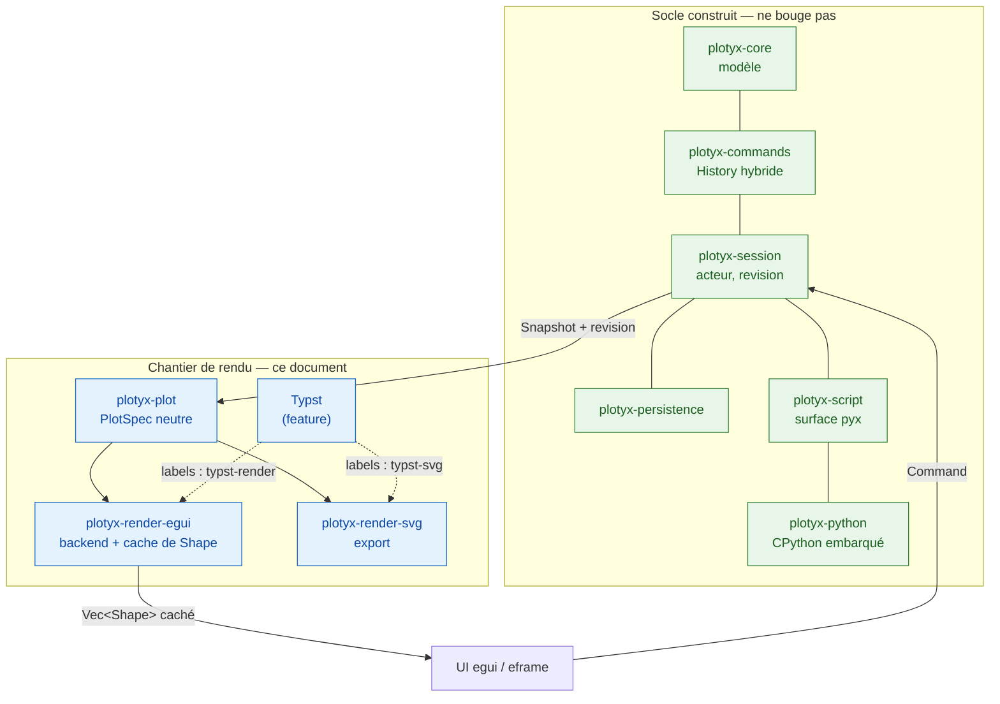

# Architecture retenue — rendu et interface (chantier hors socle)

Statut : **arrêtée le 2026-09-10.** Ce document **amende le §12 du
`cahier-des-charges-technique.md`** (« Hors périmètre — décisions déjà
prises pour la suite »), premier point : le renderer n'est plus Matplotlib.
Il ne touche à **aucune** des quatre décisions du §2 de ce cahier des
charges, et à aucune ligne du socle déjà construit.

Comme partout ailleurs dans ce dossier, les options écartées restent
écrites, avec leur raison : `options-explorees.md`. Le *quand* est dans
`roadmap-rendu.md` (séquencement « le contrat d'abord », arrêté le
2026-09-10) ; **ce document-ci fait foi** en cas de divergence entre les
deux.

---

## 1. Ce que cette bascule change — et ce qu'elle ne change pas

Le renderer était **déjà hors du socle**. La revue du 2026-09-08 (spec §2.5)
avait fait passer le plan de 9 à 7 crates en sortant `plot` et `render-mpl` :
les deux seuls crates qu'un changement de moteur de rendu aurait touchés
n'ont jamais été écrits.

**Intacts, sans une ligne à reprendre** — les huit crates construits sont
tous en amont du choix de rendu, et aucun ne nomme Matplotlib :

| Crate | Pourquoi il ne bouge pas |
|---|---|
| `plotyx-core` | modèle pur, zéro dépendance UI (vérifié par test) |
| `plotyx-commands` | historique hybride, ne connaît que `core` |
| `plotyx-session` | l'acteur, ne connaît pas Python et encore moins le rendu |
| `plotyx-persistence` | frontière `save`/`load` |
| `plotyx-python` | interpréteur embarqué, **ne connaît pas le modèle** |
| `plotyx-script` | surface `pyx`, écrit par le bus de commandes |
| `plotyx-cli`, `plotyx-app` | binaires ; `plotyx-app` est déjà sur `eframe` 0.36.2 |

**Ce qui change** : la case « renderer » du §12, jamais codée. Rien d'autre.

**Bénéfice de calendrier** : la fenêtre est celle où le socle est fini et le
chantier de rendu pas commencé. Elle ne se représentera pas.

---

## 2. Cahier des charges

- **Rendu 100 % Rust natif** — le moteur de tracé ne passe plus par Python
  (voir §2.1 pour ce que cela ne veut *pas* dire)
- Interaction souris complète : zoom, pan, sélection de points
- Fenêtres flottantes type OriginLab / ChemDraw (multi-panels)
- Undo/Redo robuste
- Rendu qualité publication, export vectoriel (SVG/PDF) — l'anti-aliasing
  écran n'est pas critique
- **Pas de gestion d'images** ; un peu de 3D à prévoir
- Volume : jusqu'à ~500 spectres de 600 points, fluide jusqu'à ~100 courbes
- Export prioritaire : SVG et PDF (PNG via conversion externe si besoin)
- Fitting traité séparément (hors scope)

### 2.1 Correction de prémisse — PyO3 reste, et l'argument contre lui était faux

Une version antérieure de ce document justifiait le « 100 % Rust » par
*« pas de Python embarqué — l'interpréteur externe posait problème pour le
Ctrl+Z / Ctrl+Y »*. **Cette prémisse est fausse pour PlotYx**, et il faut
qu'elle cesse de circuler avant qu'elle ne justifie une décision qu'elle ne
soutient pas.

Ce qui est construit n'est pas un interpréteur externe : c'est CPython
**dans le processus** (PyO3 0.29.2, ni sous-processus ni IPC), et les
écritures d'un script passent par **le même bus de commandes que l'UI**,
donc dans la même pile d'historique. C'est le critère de fin du socle, et
il est tenu et testé :

- `crates/plotyx-script/tests/script.rs:552` —
  `undo_depuis_python_defait_les_ecritures_puis_rend_false`
- `crates/plotyx-script/src/selftest.rs:340` — `step_edit_undo_redo`
- `crates/plotyx-script/src/surface.rs:179` — « Il n'y a **qu'une seule
  pile** dans la session : `pyx.undo()` annule aussi le `Ctrl+Z` »

Le problème invoqué est donc **déjà résolu, pas contourné**. L'objection
visait les wrappers Matplotlib *en sous-processus* (`plotpy`,
`rust-plotter`), à juste titre — mais elle ne s'applique pas ici.

**Conséquence.** PyO3 est conservé, et sa justification ne change pas : la
spec §2.3 avait déjà acté que PyO3 était passé de *conséquence du renderer*
à **objectif autonome**. Il tient par un contrat externe indépendant du
rendu — `cahier-des-charges-api-script.md` §8 fait de la compatibilité des
scripts déjà écrits et de l'accès à numpy un engagement.

Ce qui disparaît avec Matplotlib, c'est uniquement le **renderer** Python,
pas la console de script ni la surface `plotyx.api`.

---

## 3. Stack retenue

| Composant | Solution retenue | État |
|---|---|---|
| UI | egui + eframe | **déjà en place** (0.36.2) |
| Graphiques 2D/3D | **Plotters** + **backend egui écrit par nous** (§4) | à écrire |
| Fenêtres flottantes / multi-panels | Viewports natifs egui (`egui_tool_windows` en option pour des panneaux internes) | à écrire |
| Undo/Redo | **`plotyx-commands::History`** — déjà construit | **fait** |
| Notations scientifiques et texte riche | **Typst embarqué** via un `World` custom (crate `typst` 0.15.1), derrière un *feature flag* (§7) | à écrire |
| Export final | SVG natif de Plotters → PDF via `svg2pdf` 0.13.0 (§5) | à écrire |
| Mesure du texte | **une seule `epaint::Fonts`**, partagée écran + export, headless (§4.3) | à écrire |
| Script / numpy | **PyO3 conservé** (§2.1) | **fait** |
| Fitting | à définir séparément | — |

---

## 4. Le backend egui — écrit, pas importé

**Décision.** Écrire nous-mêmes l'implémentation de
`plotters_backend::DrawingBackend` sur egui, plutôt que dépendre
d'`egui-plotter`.

**Pourquoi.** Trois raisons, dans l'ordre de poids :

1. **`egui-plotter` ne compile pas avec notre egui.** `egui-plotter` 0.6.0
   dépend d'`egui` **0.32.1** ; le fork `egui-plotter-fork` 0.35.0 dépend
   d'`egui` **0.35**. `plotyx-app` est sur **0.36.2**. Aucun des deux ne
   passe en l'état, et figer egui à 0.35 serait une régression sur une
   machine où un défaut Wayland de `winit`/`eframe` est déjà documenté
   (spec §9).
2. **La surface à écrire est petite** (§4.1) — plus petite que le crate,
   parce qu'il porte des choses dont nous n'avons pas l'usage.
3. **Profil de risque.** Mono-mainteneur, en retard d'une version d'egui :
   c'est exactement le critère qui nous a fait écarter `latex-rust` et ReX
   pour le rendu mathématique. L'appliquer ici aussi.

### 4.1 La surface exacte du trait

`DrawingBackend` n'exige que **quatre** méthodes : `get_size`,
`ensure_prepared`, `present`, `draw_pixel`. Tout le reste a une
implémentation par défaut qui retombe sur la rasterisation pixel par pixel.
Pour un backend vectoriel, on en surcharge **huit**, et chacune tombe sur
une `egui::Shape` presque en un pour un :

| plotters | egui |
|---|---|
| `draw_line` | `Shape::LineSegment` |
| `draw_path` | `Shape::Path` |
| `draw_rect` | `Shape::Rect` |
| `draw_circle` | `Shape::Circle` |
| `fill_polygon` | `Shape::Path` fermé |
| `draw_text` | `Shape::Text` — `FontTransform` ne vaut que 0/90/180/270, `TextShape::angle` est un `f32` libre : la conversion est triviale |
| `estimate_text_size` | `Fonts::layout` (mais lire §4.3) |
| `blit_bitmap` | **laissée en défaut** — le cahier des charges dit « pas de gestion d'images » |

**Chiffrage.** Sur les 553 lignes de `backend.rs` du fork, ~208 sont des
newtypes `EguiBackendCoord`/`EguiBackendColor` avec huit surcharges
d'opérateurs, et ~70 le `bg_image`/`BgImageSize` dont nous n'avons pas
l'usage. Le dessin réel fait ~220 lignes. **Compter 250 à 300 lignes**
écrites pour nos besoins, contre ~1 000 lignes vendorisées à maintenir.

### 4.2 La décision de conception : un `Vec<Shape>`, pas un `Painter`

**Décision.** Le backend collecte dans un `&mut Vec<Shape>`. Il ne tient
**pas** de `Painter`.

**Pourquoi.** egui est en mode immédiat : il repeint à chaque mouvement de
souris. `egui-plotter` tient un `&'a Painter` et dessine dedans — donc tout
le pipeline Plotters (`ChartBuilder`, axes, ticks, 300 000 points) est
rejoué à **chaque frame**, même quand rien n'a changé. Avec un collecteur,
on met en cache, et une frame sans changement coûte
`painter.extend(cache.iter().cloned())`.

`epaint` bénit explicitement ce stockage, avec **une** exception
documentée dans sa source :

> *You should generally recreate your Shapes each frame, but storing them
> should also be fine with one exception: `Shape::Text` depends on the
> current `pixels_per_point` (dpi scale) and so must be recreated every
> time `pixels_per_point` changes.*

**D'où la clé de cache** : `(revision du Snapshot, rect, pixels_per_point)`.
La révision existe déjà — c'est le compteur monotone de `plotyx-session`,
et c'est son usage prévu (spec §6.1 : « un client sait si son instantané est
périmé en comparant la `revision` »). **Le renderer devient un client de
plus du même protocole**, au même titre que l'UI et le fil de script.

Effet de bord bienvenu : `ensure_prepared` et `present` deviennent des
no-ops, là où un backend à texture ferait de `present` un point d'upload.

**Le chiffre qui tranche** — 500 spectres × 600 points = 300 000 points :

| | mémoire | dépend de la résolution ? |
|---|---|---|
| cache `Vec<Shape>` | 300 k × `Pos2` (8 o) = **2,4 Mo**, + 500 × 64 o de `Shape` = 32 Ko | **non** |
| texture RGBA 1600×1200 | **7,7 Mo**, par vue et par graphe | oui |

(`Shape` fait 64 octets — `epaint` a une assertion de test dessus.)

Le cache vectoriel est ~3× moins cher **et** indépendant de la résolution.
Ce renversement enterre au passage les deux points de vigilance hérités du
plan Matplotlib (spec §12) : **le budget de 141 ms et la mise à jour
partielle de texture n'ont plus d'objet** — il n'y a plus ni buffer RGBA ni
upload.

**Limite assumée, à ne pas redécouvrir.** Cacher les `Shape` économise le
pipeline Plotters, **pas la tessellation** : egui retriangule à chaque
frame. Si cela coince à 300 k points, deux leviers, dans cet ordre :

1. **décimer avant de tracer** (LTTB) — c'est ce que `plotkit` offrait
   gratuitement et que ce choix nous fait perdre ; à écrire une fois ;
2. cacher un cran plus loin en `Shape::Mesh(Arc<Mesh>)` — mais ~14 Mo pour
   300 k points (600 k `Vertex` à 20 o + indices `u32`), donc **plus cher
   que la texture**. C'est un bouton, pas un défaut.

### 4.3 `draw_text` — le point de contact avec Typst, et le seul piège

Plotters appelle `draw_text` pour **chaque** tick, titre d'axe et entrée de
légende. Deux régimes, à séparer nettement :

- **texte ordinaire** (chiffres des ticks, noms de série) → `Shape::Text`
  via les fonts egui. Net, HiDPI, cohérent avec le reste de l'UI, gratuit.
  **Ne pas le faire passer par Typst** : ce serait une compilation Typst
  par tick ;
- **notation scientifique** (λ, indices, exposants, fractions) → Typst →
  `typst-render` en RGBA → texture → `Shape::Mesh`, caché par hash de
  formule **et** `pixels_per_point`.

> **Invariant non négociable.** `estimate_text_size` doit mesurer **par le
> même chemin que celui qui dessinera**. Un label parti chez Typst mais
> mesuré par `Fonts::layout` fait mal placer les axes par Plotters — et le
> défaut se manifeste comme un décalage de mise en page, jamais comme une
> erreur. C'est le seul endroit de ce chantier où un bug est silencieux ;
> il mérite un test dédié dès la première version.
>
> **Le mécanisme qui le tient** (précisé le 2026-09-10 après vérification
> dans la source) : **une seule instance d'`epaint::Fonts`, partagée par
> les deux backends**. `Fonts::new(TextOptions, FontDefinitions)` se
> construit sans `Context`, sans fenêtre et sans GPU — donc l'export
> headless (CLI, script) mesure exactement comme l'écran, non pas « de la
> même façon » mais **avec le même objet**. Ne pas tenter de réimplémenter
> la mesure avec un crate de fonts tiers : epaint 0.36 shape via `skrifa`
> + `harfrust`, et reproduire son résultat au pixel près n'est pas un
> exercice qu'on gagne.

### 4.4 Plotters sans ses fonts

Puisque tout le texte passe par egui ou par Typst, les fonts de Plotters
sont mortes :

```toml
plotters = { version = "0.3", default-features = false, features = ["all_series", "all_elements"] }
```

Cela élimine `font-kit`, `image`, `chrono`, `ttf-parser` — **et le scan des
fonts système**, que le choix Typst veut de toute façon désactiver
(`include_system_fonts(false)`) pour la reproductibilité.

> **Correction du 2026-09-10 — ce retrait n'est sûr que si les DEUX
> backends surchargent `estimate_text_size`.** Une première rédaction
> présentait `default-features = false` comme sans conséquence. C'est vrai
> du backend egui, qui surcharge la mesure. **C'est faux par défaut du
> backend SVG** : `plotters-svg` ne surcharge pas `estimate_text_size`, il
> retombe sur le défaut du trait, qui appelle `layout_box` — et sans la
> feature `ttf` ni `ab_glyph`, `layout_box` tombe sur
> `style/font/naive.rs` :
>
> ```rust
> let em = size / 1.24 / 1.24;
> // largeur ≈ em * 0.7 * text.len()
> ```
>
> Soit une largeur **monospace estimée sur le nombre d'octets UTF-8** :
> « λ » compte pour 2, « µm » pour 3, et « 111 » mesure comme « WWW ». Les
> marges réservées aux labels seraient fausses, donc la zone de tracé
> différente de celle de l'écran — **la figure exportée ne serait pas la
> figure vue**. La surcharge de `estimate_text_size` par l'`epaint::Fonts`
> partagé du §4.3 est donc **obligatoire dans `plotyx-render-svg` aussi**,
> pas seulement dans le backend egui. À cette condition, et seulement à
> elle, le retrait des fonts de Plotters est sûr.

---

## 5. Export SVG/PDF — un second backend, facile en mécanique, pas en fidélité

Le cahier des charges impose un export **depuis les données, pas depuis
l'écran**. Donc : même `PlotSpec`, backend différent.

- **SVG** : `plotters` a `svg_backend` nativement (feature `svg_backend`),
  ~800 lignes, même trait que le backend egui. `SVGBackend::with_string`
  rend la sortie dans une `String` qu'on possède — utile pour le §5.2.
- **PDF** : Plotters n'a **pas** de backend PDF. `svg2pdf` 0.13.0 fait le
  pont — et vient de l'organisation Typst, donc de la famille qu'on adopte
  déjà. Chemin retenu : `PlotSpec → SVGBackend → svg2pdf`.

### 5.1 Deux problèmes de fidélité, pas de mécanisme

Le mécanisme est gratuit ; la fidélité ne l'est pas. Deux défauts, tous
deux **silencieux** :

1. **La mesure du texte** — traitée en §4.4 : sans surcharge de
   `estimate_text_size`, l'export réserve les marges d'après une heuristique
   au nombre d'octets. Corrigé par l'`epaint::Fonts` partagé.
2. **`plotters-svg` n'outline pas le texte** : il émet
   `<text font-family="…">`, donc le SVG exporté **dépend de la font
   installée chez le lecteur**. Ouvert sur une autre machine (Inkscape
   ailleurs, la chaîne de production d'une revue), les glyphes sont
   substitués et la mise en page bouge. C'est le mode d'échec classique de
   l'export vectoriel pour publication.

### 5.2 Typst par-dessus — plus simple que prévu, et voici pourquoi

Vérifié dans la source de `typst-svg` 0.15.1 et de `plotters-svg` 0.3.7.
Le cauchemar habituel de la fusion de deux SVG (collision d'`id` entre
`<defs>`) **n'a pas lieu ici**, pour trois raisons indépendantes :

- **Typst nomme ses `<defs>` par hash de contenu**, pas par compteur :
  `DedupId(char, hash128)` où le hash porte sur le glyphe ou le tracé de
  découpe lui-même. Deux fragments Typst inlinés dans le même document ne
  se marchent donc pas dessus — un glyphe identique **se déduplique** au
  lieu d'entrer en collision, un glyphe différent reçoit un autre hash ;
- **`plotters-svg` n'émet aucun `id`, aucun `defs`, aucun `clipPath`** —
  surface de collision nulle du côté du graphe ;
- **Typst sort ses glyphes en contours** (`render_path_glyph` : *« a
  pre-scaled path glyph defined by an outline »*), donc le fragment Typst
  est **autonome et sans dépendance de font**.

**L'inversion à retenir** : dans l'export SVG, la partie difficile est le
**chiffre des graduations**, pas la formule. Les λ, indices et fractions
sortent parfaits et portables ; « 0,5 » sort en référence de font, mesurée
par une heuristique. C'est l'inverse de l'intuition.

> **Décision à prendre, pas encore tranchée** : soit faire passer **tout**
> le texte de l'export par le même chemin d'outline que Typst (cohérent,
> portable, mais il faut outliner soi-même les labels ordinaires), soit
> assumer l'asymétrie. Voir le point ouvert n°6.

**Ce qui reste réellement à faire pour la fusion**, et c'est mécanique :

1. envelopper chaque fragment Typst dans un `<g transform="translate() scale()">`
   ou un `<svg x y width height>` imbriqué — Typst travaille en points,
   Plotters en pixels ;
2. la taille du fragment doit être **celle que `estimate_text_size` a
   rendue**, sinon le label ne s'assied pas là où la place a été réservée ;
3. injecter dans la `String` produite par `SVGBackend::with_string` — le
   plus simple étant que le backend note des rectangles-témoins que l'on
   substitue après coup.

**Contrepartie à surveiller** : **trois** chemins de texte doivent
s'accorder (écran egui, SVG d'export, et la mesure du §4.3). Un test de
non-régression sur les positions d'axes entre les deux backends vaut d'être
écrit tôt, pas après le premier rapport d'utilisateur.

---

## 6. Interaction souris et 3D

- `egui-plotter` n'est pas repris, mais son `chart.rs` (375 lignes,
  `MouseConfig` : `pitch_scale`, `yaw_scale`, `zoom_scale`, transformation
  3D) est la bonne **référence à lire** avant de réécrire cette partie.
  C'est le morceau qui a de la valeur dans ce crate, pas le backend.
- **Sélection de points** : pas de fonctionnalité intégrée, mais le trait
  `ReverseCoordTranslate` (pixel → coordonnée logique) combiné à un
  `min_by_key` sur la distance suffit (~10-15 lignes).
- **3D** : Plotters le couvre (feature `surface_series`), en CPU. La
  contrainte de fluidité relâchée (fluide à ~100 courbes, ralentissement
  accepté jusqu'à 500) rend inutile tout GPU custom —
  cf. `options-explorees.md`.

---

## 7. Typst — derrière un *feature flag*, dès le premier jour

**Décision.** Le crate de rendu compile, teste et s'exécute **sans** Typst,
avec repli sur `Shape::Text` brut. Typst est une feature Cargo, absente de
`default`.

**Pourquoi.** C'est exactement la convention déjà tenue par
`plotyx-python` et `plotyx-script`, qui compilent **vides** sans la feature
`python` pour garder la CI verte sur une machine sans interpréteur
(spec §2.4). Appliquée à Typst, elle donne le droit d'**abandonner Typst
sans rien démonter** si la mesure de latence est mauvaise.

**Ce que coûte vraiment Typst** — pas le `World` custom (~100-150 lignes),
mais :

- le **cache** (texte de formule → sortie compilée), sans lequel la
  pipeline est trop lourde pour du zoom ou un curseur ;
- les **deux chemins de sortie** (`typst-render` pour l'écran, `typst-svg`
  pour l'export) ;
- la **latence de compilation par formule inédite**, à **mesurer avant**
  d'engager du code de production (c'est le point ouvert n°6 ci-dessous).

**Fonts** : décision inchangée — deux sets possibles, *Libertinus Serif +
Libertinus Math* (cohérence classique/scientifique ; Libertinus Math à
embarquer à la main, `typst-kit` n'embarque nativement que Libertinus
Serif) ou *Liberation Sans + Noto Sans Math* (look « Arial »). Fonts
embarquées uniquement, scan système désactivé.

---

## 8. Découpage en crates

Restaure proprement le 9 → 7 de la spec §2.5, en remplaçant `render-mpl` :

| Crate | Rôle | Dépend de | Dépendances lourdes |
|---|---|---|---|
| `plotyx-plot` | `PlotSpec` neutre (port de `plotyx.plot`) | `core` | **aucune** — même règle testée que `plotyx-core` |
| `plotyx-render-egui` | backend `DrawingBackend` + cache de `Shape` | `plot`, `session` | `plotters`, `egui` ; `typst` en feature |
| `plotyx-render-svg` | export SVG et PDF | `plot` | `plotters/svg_backend`, `svg2pdf` |

**La frontière qui compte** : `plotyx-plot` **ne dépend pas de
`plotters`**. C'est ce qui laisse changer de moteur de dessin plus tard
sans toucher au modèle de graphe — la même discipline que « aucun Qt dans
`core` », rendue vérifiable par le compilateur.

---

## 9. Schéma d'architecture



*Vert = construit et testé. Bleu = à écrire.* Le fil Python subsiste pour
le script (§2.1) ; il ne participe plus au rendu.

---

## 10. Points ouverts

Renumérotés et resserrés par rapport à la version du 2026-09-10 matin :
les points 1, 2 et 5 de cette version sont **clos** (protocole Core ↔
Plotter = `Snapshot` + `revision`, §4.2 ; granularité de l'undo = tranchée
par `plotyx-commands::History`, déjà construit et testé).

1. **Coût réel de la tessellation** à 300 k points — mesurer avant de
   décider si le LTTB du §4.2 est nécessaire dès la v1 ou plus tard.
2. **Latence de compilation Typst** par formule inédite, sur des cas réels
   de labels (cinétique chimique, notations spectroscopiques), avant
   d'engager du code de production.
3. **Choix de la lib de fitting** (`argmin`, `levenberg-marquardt`).
4. **Gestion des données** pour les spectres — question à reformuler : le
   modèle possède déjà ses buffers (`plotyx-core::Column`, contigus, jamais
   chunkés, spec §4.3), donc ni `ndarray` ni `polars` ne s'y substituent.
   La vraie question restante est celle des **structures de calcul
   intermédiaires**, pas du stockage.
6. **Texte de l'export : tout outliner, ou assumer l'asymétrie ?** Les
   labels Typst sortent en contours autonomes, les graduations de Plotters
   en `<text font-family>` dépendant de la machine du lecteur (§5.1).
   Trancher avant le premier export destiné à une publication.
7. **Mode « visualiseur léger »** — toujours reporté au chantier de l'UI
   réelle (spec §13), mais l'argument change : avec un backend egui natif,
   « un chemin rapide sans Python » n'est plus une exception à construire,
   c'est le cas nominal. Le point à trancher se réduit à : *l'acquisition
   live existe-t-elle comme besoin ?* (`questions-ouvertes.md` §6).
