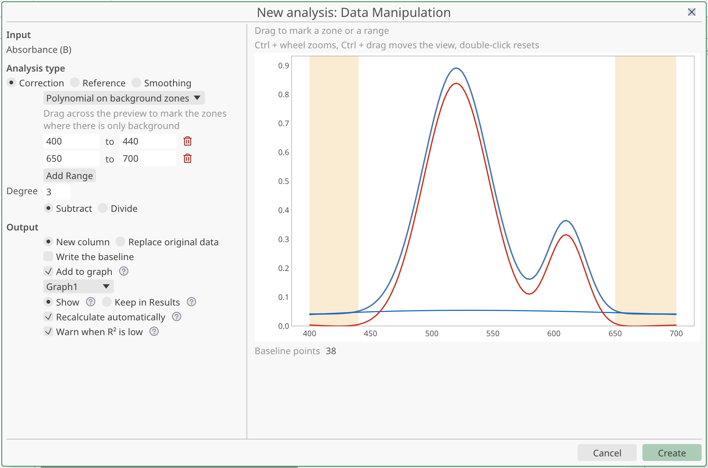
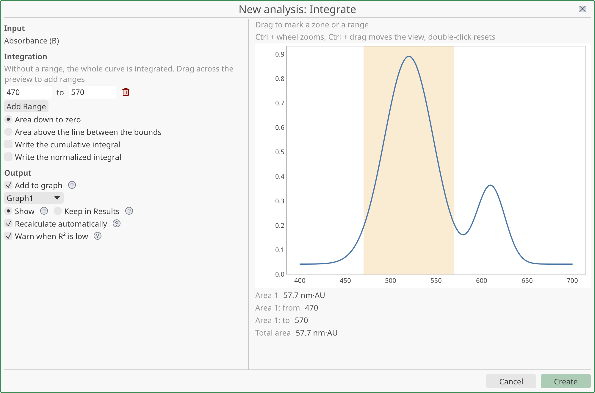
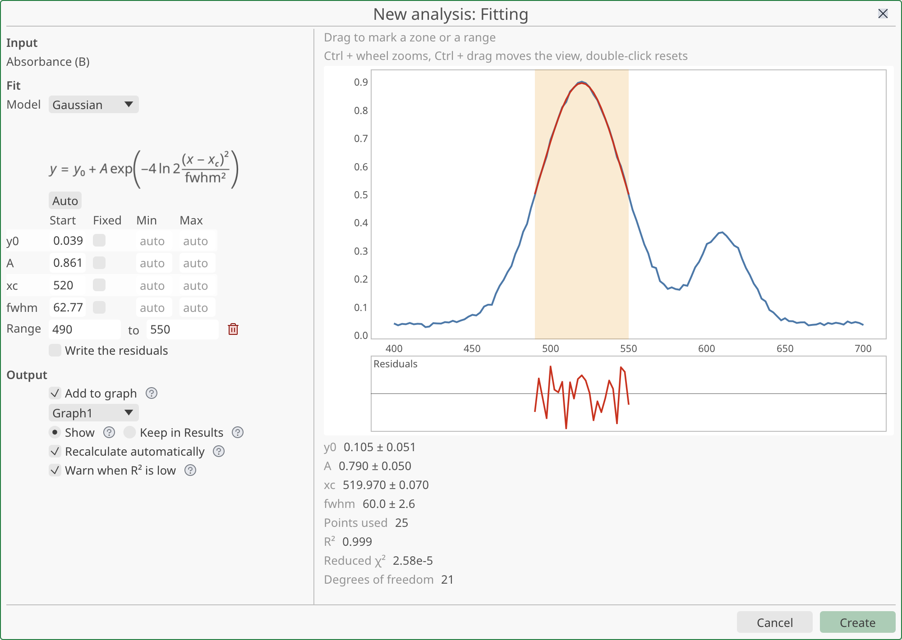
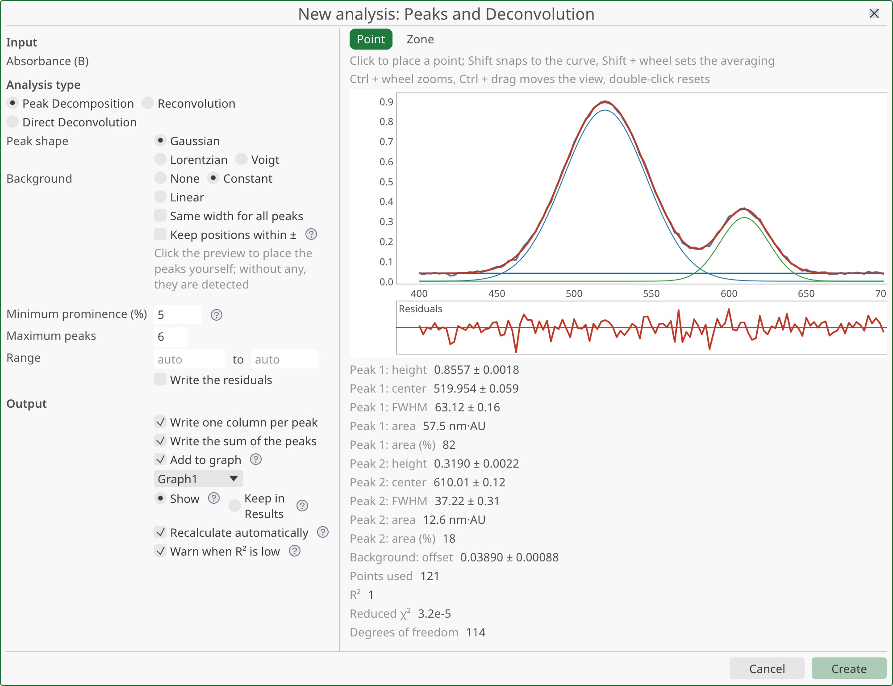

# Analysis

This page covers every analysis tool of StokesForge: corrections, smoothing, integration, curve fitting, peak decomposition and deconvolution. You will learn how to start an analysis, what each method computes, where the results go, and how to change or undo an analysis later.

All analyses work the same way. You pick a method, you adjust its settings in a window with a live preview, and you press **Create**. The result is written as new columns next to your data. The analysis is remembered, so you can edit it, recalculate it, or delete it.

## Starting an analysis

You can start an analysis from four places.

| From | Gesture |
|---|---|
| The menu bar | Select one or more Y columns in a sheet, then use **Analysis**. |
| A column | Right-click the column header, then **Analysis**. |
| A curve | In the Object Manager of a graph, right-click a curve or a group of curves, then **Analysis**. With a graph active, the **Analysis** menu of the menu bar also uses the selected curve or group. |
| A row | Select whole rows of a sheet, right-click, then **Analysis**. See [Analysing rows](#analysing-rows). |

The entries are grayed out until at least one Y column (or curve) is targeted. Select a column first if they are not available.

### The Analysis menu

The **Analysis** menu groups the methods in four categories.

| Entry | Methods |
|---|---|
| **Data Manipulation** | **Constant…**, **Linear…**, **Polynomial…**, **Anchor Points…** (baselines), **Reference Correction…**, **Adjacent Averaging…**, **Savitzky-Golay…**, **Rolling Median…** |
| **Fitting** | **Linear…**, **Polynomial…**, **Exponential…**, **Exponential with Plateau…**, **Two Exponentials…**, **Logarithm…**, **Power…**, **Gaussian…**, **Lorentzian…**, **Custom Model…** |
| **Peaks and Deconvolution** | **Decompose Peaks…**, **Reconvolution…**, **Direct Deconvolution…** |
| **Integrate…** | Opens the Integrate window directly. |

Below these, **Recalculate Out of Date** refreshes every analysis whose data changed. It is grayed out when everything is up to date.

At the bottom of the menu, the last three analyses you ran are listed. Click one to open the window with the same settings. <kbd>Ctrl</kbd>+click (<kbd>Cmd</kbd>+click on macOS) runs it at once on the current selection, without opening the window. For a correction that can replace the original data, the same shortcut replaces the original data of the selection. <kbd>Ctrl</kbd>+<kbd>Z</kbd> undoes it.

The right-click menus have an **Analysis** submenu with one entry per category: **Data Manipulation…**, **Fitting…**, **Peaks and Deconvolution…** and **Integrate…**. These entries open the window of the category, with the last method you used in it already chosen. You pick the method inside the window.

## The analysis window

The window title is **New analysis: ** followed by the category. The settings are on the left, in three blocks (**Input**, the method settings and **Output**). The preview of the curve with the result drawn on it is on the right, with the computed values underneath.

The preview updates as you change a setting. Long computations run in the background. While one runs, the old result stays visible and the text **Calculating…** appears.

**Create** is grayed out while something is missing, for example a reference column or a background zone. The reason is written in the window and in the button tooltip. When you edit an existing analysis, the button reads **Update**.

### Input

The **Input** block shows the curve being analysed. When you selected several columns or curves, the window works on a batch. The arrows  **Previous series** and  **Next series** move through the batch, and the text **Series 2 of 5** shows where you are. The settings apply to all series of the batch. The preview shows one series at a time.

When the window belongs to a category with several methods, the block **Analysis type** lets you switch between them: **Correction**, **Reference** and **Smoothing** for Data Manipulation, or **Peak Decomposition**, **Reconvolution** and **Direct Deconvolution** for Peaks and Deconvolution. The settings of each method are kept when you switch.

### Working in the preview

The preview is clickable. The gesture depends on the method.

| Gesture | Effect |
|---|---|
| Click (**Point** tool) | Places a point: an anchor, a baseline point or a peak position. |
| <kbd>Shift</kbd>+click | Snaps the point to the curve, using the mean of the nearest points. |
| <kbd>Shift</kbd>+wheel | Sets how many points the snapping averages. The default is 5. |
| Drag (**Zone** tool) | Marks a zone or a range on the X axis. |
| Right-click | Removes the marker under the pointer. |
| <kbd>Ctrl</kbd>+wheel | Zooms. Over an axis, only that axis zooms. |
| <kbd>Ctrl</kbd>+drag | Moves the view. |
| Double-click | Resets the view. |

The wheel alone does nothing. The method chooses the tool for you: zones for **Polynomial on background zones** and **Constant (zone mean)** baselines, integration ranges, fits and reconvolution; points for the others. Only **Decompose Peaks…** offers both tools, as the **Point** and **Zone** buttons. The same values can always be typed in the fields on the left.

### Computed values

Under the preview, the window lists the computed values: areas, fit parameters, R² and so on. A value is shown with its standard error, for example `12.346 ± 0.052`. Hover a value to see it with full precision. While the pointer is over a value, <kbd>Ctrl</kbd>+<kbd>C</kbd> copies the exact number, with a decimal point and without unit or uncertainty.

Warnings appear above the values. The warnings you may meet are:

| Warning | Meaning |
|---|---|
| The X step is not constant | The result may be inaccurate (Savitzky-Golay, deconvolution). |
| The fit did not converge | The model does not reach the data. Check the starting values. |
| N parameter(s) are not determined by the data | Those parameters get no uncertainty. |
| N negative points were set to zero | Richardson-Lucy deconvolution needs non-negative data. |
| The response is cut off above 1% of its peak | The lifetimes of a reconvolution may be biased. |
| The response has a different X step than the data | Check that the signal and the response use the same scale. |
| N point(s) were interpolated across an empty cell of the reference column | A hole in the reference was bridged. |
| N division(s) by zero were left empty | The corresponding cells stay empty. |
| The constrained polynomial was fitted on X values far from 0 | Precision may be low. Subtract the mean of X first. |

Rows without a valid X, Y or error value are ignored, and the window says how many (**N rows without a valid X, Y or error were ignored**).

## Output settings

The **Output** block decides what is written and how the analysis is kept.

| Setting | Effect |
|---|---|
| **New column** / **Replace original data** | Corrections and smoothing only. See [Replacing the original data](#replacing-the-original-data). |
| **Add to graph** | Plots the new columns on the graph that shows the curve, in the same undo step. Only shown when a graph plots the curve. If several graphs plot it, a list lets you choose. |
| **Show** / **Keep in Results** | **Show** writes the columns only. **Keep in Results** also keeps the computed values in the [Results pane](#the-results-pane). Each analysis remembers your last choice. An analysis you have never run starts on the choice set in **File ▸ Preferences… ▸ General ▸ Values**. |
| **Recalculate automatically** | Recalculates the columns whenever the source data change. When off, the columns are marked out of date instead. |
| **Warn when R² is low** | Opens a dialog after the calculation when the R² of a fit is below 0.6. |

**Recalculate automatically** is on by default, except for **Reconvolution**, **Direct Deconvolution** and batches of more than 20 series, because these are slow. For a large batch, the window reminds you that recalculating each change can be slow.

### Where the results go

Result columns are inserted in the same sheet, right after the Y column they come from. Their names follow a fixed pattern, with the long name of the source column when it has one.

| Method | Columns written |
|---|---|
| Baseline correction | `<name> (<column>-corr)`; optionally `Baseline of <column>` |
| Reference correction | `<name> (corrected)` |
| Smoothing | `<name> (smoothed)` |
| Integration | Optionally `Cumulative integral of <column>` and `Normalized integral of <column>` |
| Fit | `<name> (fit)`; optionally `<name> (resid.)` |
| Peak decomposition | `<name> (fit)`; optionally residuals, `Peak N of <column>`, `Background of <column>` and `Sum of peaks of <column>` |
| Reconvolution | `<name> (fit)`; optionally residuals |
| Direct deconvolution | `<name> (deconvolved)` |

The columns carry the unit of the source column. They are read-only, because the analysis owns them. To type in one, first detach it (see [Editing, recalculating and undoing](#editing-recalculating-and-undoing)).

## Data manipulation

### Baseline correction

A baseline correction removes a background from a curve. You describe the background in one of five ways, then choose what to do with it: **Subtract** (the corrected value is `y − baseline`) or **Divide** (`y / baseline`). A division by zero leaves the cell empty and is counted in a warning.

The window title of this family is **Correction**. Choose the shape of the background in the first row of the method settings.

| Shape | How you define it | Menu entry |
|---|---|---|
| **Constant (point)** | Click one point. <kbd>Shift</kbd> snaps it to the curve using the local mean. You can edit its X and Y in the fields. | **Constant…** |
| **Constant (zone mean)** | Drag one X range. The mean of Y in the range is the flat background. A new range replaces the previous one. | **Constant…** |
| **Straight line through two points** | Click two points on the preview. | **Linear…** |
| **Polynomial on background zones** | Drag across the zones where there is only background. A polynomial of the chosen **Degree** (1 to 9) is fitted on the points of these zones by least squares. Degree 1 is a straight line. | **Polynomial…** |
| **Curve through anchor points** | Click anchor points on the preview. A right-click removes one. **Segments** joins the anchors with straight segments. **Spline** draws a smooth natural cubic spline through them. | **Anchor Points…** |

Outside the first and last anchor, the curve is extended. Two anchors must not share the same X value. The polynomial needs enough points in the zones for its degree; if not, the window tells you to widen the zones or lower the degree.

Check **Write the baseline** to also write the baseline itself in a column. This helps to check the correction on a graph.

### Reference correction

A reference correction combines your data with a reference curve, such as a blank or the spectral response of a detector. The window title of this family is **Reference**.

1. Select the Y columns to correct and choose **Analysis ▸ Data Manipulation ▸ Reference Correction…**.
2. In **Reference column**, choose the column that holds the reference. The list shows the other Y columns of the workbook. If there are none, the window says so.
3. Choose the operation: **Divide** (`y / reference`), **Multiply** (`y × reference`) or **Subtract** (`y − reference`).
4. Press **Create**.

The reference is interpolated linearly on the X values of your data. Where your data lie outside the X range of the reference, the corrected cell stays empty: StokesForge does not extend a measurement it does not have. The window counts these points as **Points outside the reference**. An empty cell in the middle of the reference is bridged by interpolation and reported in a warning.

The analysis keeps its own copy of the reference values, shown as `copy of <name>`. The copy is taken when you create the analysis.

### Smoothing

Smoothing replaces each point by a value computed from its neighbours. Choose the method in the first row of the settings, or from the menu.

| Method | What it does |
|---|---|
| **Adjacent averaging** | Mean of the neighbours in the window. |
| **Savitzky-Golay** | Fits a polynomial over the window and keeps its central value. It keeps peak heights better than an average. |
| **Rolling median** | Median of the neighbours. It removes isolated spikes. |

Settings:

- **Width in points** or **Width in X units**: choose the unit of the window. In points, the field is **Width (points)**. It is odd, between 3 and 1001, and the field steps by 2. An even number is raised to the next odd one. In X units, the field is **Width (X units)**; the width is converted to points with the median X step.
- **Polynomial order** (Savitzky-Golay only): 2 to 5.

Neighbours are taken by rank after sorting by X, not by distance. At the ends of the curve, the data are mirrored, so the result has as many points as the input and no shrinking window. A window wider than the curve is reduced to fit. The window used is shown as **Width used (points)**.

Savitzky-Golay assumes a constant X step. If the step varies by more than 1%, a warning appears and the result is still computed.

The defaults are a window of 5 points for averaging and median, and 9 points with order 2 for Savitzky-Golay.

### Replacing the original data

For a baseline, a reference correction or a smoothing, the **Output** block starts with two choices: **New column** and **Replace original data**.

With **Replace original data**, the corrected values overwrite the Y column instead of creating a new one. The column keeps its length and its empty cells. The curves that plot it follow the new values. Instead of the usual output settings, the window says that the correction replaces the source values, that its settings remain in Results, and that Undo restores the original data.

Limits:

- The choice exists only when you create a correction. It is not offered when you edit one.
- It is disabled for columns that are themselves calculated or that hold a formula.
- When several curves use the same data, StokesForge asks for confirmation in a window titled **Replace original data**: they will all show the corrected values. Press **Replace** to go on.

Nothing is recalculated afterwards, because the replacement is not a live link: the settings do not reopen. A small mark in the column header says that the original data were replaced. Its tooltip points to the Results pane.

To go back, use <kbd>Ctrl</kbd>+<kbd>Z</kbd> right after the replacement, or later select the correction in the [Results pane](#the-results-pane) and press **Restore Original Data**. This puts back the values from before the correction and overwrites what you typed since. The button is grayed out when no original values were kept. A column corrected several times keeps one set of raw data, the one from before the first correction.

## Integration

**Analysis ▸ Integrate…** computes areas under the curve by the trapezoid method, in the X units as they are. A wavelength curve is integrated in wavelength, an energy curve in energy. There is no unit conversion.

The curve is sorted by increasing X first, so the area of a positive signal is positive whatever the direction of the recording.

Settings:

- **Range**: use **Add Range** or drag across the preview to add an X range. Each range has two bounds, separated by **to**, and a  **Remove** button. Leave a bound empty to take the end of the data. Without any range, the whole curve is integrated. A range that holds no point is refused.
- **Area down to zero** or **Area above the line between the bounds**. The first integrates down to Y = 0. The second subtracts the straight line that joins the curve at the two bounds, which gives the area of a peak above its local baseline.
- **Write the cumulative integral**: writes a column with the running integral.
- **Write the normalized integral**: writes the curve divided by the total area.

The values shown are **Area 1**, **Area 1: from**, **Area 1: to** and so on for each range, then **Total area**. The area carries the product of the units of X and Y when both columns have a unit. The edges of a range are interpolated on the curve.

## Fitting

**Analysis ▸ Fitting** fits a model to the curve by least squares. Pick a model from the menu, or from the **Model** list in the window.

| Model | Formula | Parameters |
|---|---|---|
| **Linear** | `y = intercept + slope · x` | `intercept`, `slope` |
| **Polynomial** | `y = c₀ + c₁x + … + cₙxⁿ` | `c0`, `c1`, … (**Degree** 1 to 9) |
| **Exponential** | `y = A · e^(−x/τ)` | `A`, `tau` |
| **Exponential with Plateau** | `y = y₀ + A · e^(−x/τ)` | `y0`, `A`, `tau` |
| **Two Exponentials** | `y = y₀ + A₁e^(−x/τ₁) + A₂e^(−x/τ₂)` | `y0`, `A1`, `tau1`, `A2`, `tau2` |
| **Logarithm** | `y = a + b · ln x` | `a`, `b` |
| **Power** | `y = a · x^b` | `a`, `b` |
| **Gaussian** | `y = y₀ + A · exp(−4 ln 2 · (x − xc)² / fwhm²)` | `y0`, `A`, `xc`, `fwhm` |
| **Lorentzian** | `y = y₀ + A / (1 + 4 (x − xc)² / fwhm²)` | `y0`, `A`, `xc`, `fwhm` |
| **Custom model** | Your expression | One per name in the expression |

For the Gaussian and the Lorentzian, `A` is the height above `y0` and `fwhm` is the full width at half maximum. The window shows the formula of the chosen model.

### Method

Linear, polynomial and logarithm models are linear in their parameters. They are solved directly by linear least squares. The other models, and any model with fixed or bounded parameters, are fitted by the Levenberg-Marquardt algorithm. It starts from your initial values and stops when the fit no longer improves. Lifetimes (`tau`) and widths (`fwhm`) are kept positive.

### Parameters

A table lists every parameter, with these columns.

| Column | Meaning |
|---|---|
| **Start** | Initial value. Leave it empty (`auto`) to let StokesForge estimate it. |
| **Fixed** | Check it to keep the parameter at its **Start** value instead of fitting it. |
| **Min**, **Max** | Bounds. Leave empty for no bound. |
| **Shared** | Shown for a batch. A shared parameter has one value for all series (global fit). |

The **Auto** button fills the **Start** column with an estimate computed from the data shown. For a difficult fit, good starting values matter more than anything else. A fit that does not converge is reported by a warning and still shows its best attempt.

If you fix every parameter, the fit is refused: free at least one. Inverted bounds are refused too.

### Custom model

Choose **Custom model** and write `y` as a function of `x`, for example `a*exp(-x/b)+c`. Every name other than `x`, `pi` and `e` becomes a parameter, in the order of its first appearance. Multiplication must be written with `*`: `2x` is not understood.

You can use `+ - * / ^`, parentheses and these functions: `exp`, `ln`, `log` (base 10), `log10`, `log2`, `logx(x, b)`, `sqrt`, `abs`, `sin`, `cos`, `tan`, `asin`, `acos`, `atan`, `sinh`, `cosh`, `tanh`, `erf`, `erfc`, `sign`, `floor`, `ceil`, `pow`, `min`, `max` and `atan2`. An error message tells you the position of a mistake in the expression.

### Range, weights and residuals

- **Range**: fits only the X range you give. Leave both bounds empty to fit all the data.
- **Weight by the error column**: shown when the series has an error column. The error is used as the standard deviation of each point. A missing, zero or negative error makes the fit stop with a message; fix it or turn weighting off.
- **Write the residuals**: writes the `data − fit` column.

### Goodness of fit

The values under the preview are the fit parameters with their standard errors, then:

| Value | Meaning |
|---|---|
| **Points used** | Number of points in the fit. |
| **R²** | Coefficient of determination. |
| **Reduced χ²** | Sum of squared residuals divided by the degrees of freedom. |
| **Degrees of freedom** | Points minus free parameters. |

R² is orange when it is below 0.95 and red when it is below 0.6. A very low R² also triggers a dialog titled **Low R²** after the calculation, unless you turned off **Warn when R² is low** in the **Output** block or in **File ▸ Preferences…**. A badge in the status bar counts the low-R² results.

## Peaks and deconvolution

### Peak decomposition

**Analysis ▸ Peaks and Deconvolution ▸ Decompose Peaks…** fits a sum of peaks to a curve, together with a background.

Settings:

- **Peak shape**: **Gaussian**, **Lorentzian** or **Voigt**.
- **Background**: **None**, **Constant** or **Linear**. It is fitted at the same time as the peaks.
- **Same width for all peaks**: forces one common width.
- **Keep positions within ±**: keeps each peak centre within the given distance of its starting position.
- **Range**: fits only an X range.

To place peaks yourself, switch to the **Point** tool and click the preview. Each peak appears in the list as **Peak 1 at**, with its position, and a  **Remove** button. If you place none, StokesForge detects them: it keeps the local maxima that stand out by at least **Minimum prominence (%)** of the data range, up to **Maximum peaks**. The defaults are 5% and 6 peaks; the maximum is 100. If detection finds nothing, the window asks you to place a peak or lower the prominence.

The values are listed for each peak: **Peak 1: height**, **center**, **FWHM**, **area** and **area (%)**. For a Voigt peak, the Gaussian and Lorentzian widths are given too. The background appears as **Background: offset** and **Background: slope**. The fit statistics are the same as for a fit.

The output block lets you add **Write one column per peak** (the peaks and the background) and **Write the sum of the peaks**. **Write the residuals** is in the method settings.

### Reconvolution

**Reconvolution** analyses a decay measured with an instrument response function (IRF), for example a fluorescence lifetime. It fits a sum of exponentials convolved with the response.

1. Choose **Analysis ▸ Peaks and Deconvolution ▸ Reconvolution…**.
2. In **Instrument response**, choose the column that holds the measured response.
3. Set the number of **Exponentials** (1 to 4).
4. Set the **Response shift** and check **Fit the shift** if it should be fitted.
5. Adjust the starting values in the table, then press **Create**.

The signal and the response must share the origin of the X axis. The response is normalised to a sum of 1 and resampled on the signal grid. The model is the sum `Σ Aᵢ e^(−t/τᵢ)` convolved with the response shifted by `shift`, plus the constant background `bkg`. The parameters are `bkg`, `A1`, `tau1`, `A2`, `tau2`, … and `shift`. You can fix them, bound them, or leave them to the automatic start, as in a fit.

Beyond the usual statistics, the window gives **τ (amplitude-weighted)** and **τ (intensity-weighted)**. If the response is cut off above 1% of its peak at the chosen shift, a warning tells you the lifetimes may be biased.

### Direct deconvolution

**Direct Deconvolution** recovers the signal before the instrument response, without a model. Choose the **Instrument response** column, then an algorithm.

| Algorithm | Setting |
|---|---|
| **Richardson-Lucy** | **Iterations**, 1 to 5000 (50 by default). It keeps the signal positive. |
| **Wiener** | **Noise ratio**. Leave it empty (`auto`) to estimate it from the spectrum of the signal. The value used is reported as **Noise ratio**. |

Set the **Response shift** if the response and the signal are offset. The output is one column, `<name> (deconvolved)`. The method refuses a signal whose mean is not positive or whose X steps are too uneven.

## Analysing rows

Analyses work on columns. To analyse a row, for example a spectrum recorded across several columns, StokesForge transposes it first.

1. Make sure the columns of the sheet have an **x'** value. This is the value that goes on the X axis for a row, such as a time or a wavelength. If you cannot see it, right-click the sheet and tick **Show x' Row**.
2. Select the whole rows and right-click.
3. Choose **Analysis** and a category.

StokesForge adds a linked sheet named like the source with a `ᵀ` suffix. It holds the x' values and one column per row, called **Row N**. The analysis then runs on those columns like on any other. If you cancel the analysis window, nothing is added.

Only numeric columns can be transposed. A message names the column, by its letter, when it has no x' value or contains text.

The transposed sheet shows a banner **Transposed from** followed by the source name. It is a snapshot, not a live view. The banner shows **Out of date** when the source changed, and **Values edited** when you typed in the linked columns. Press **Recalculate** to refresh the sheet from its source. After you edited values, the button is **Relink**: it also erases your edits, and asks for confirmation first. Undo brings them back.

## Analysing curves of a graph

You can analyse the curves of a graph without going back to the sheet.

- Right-click a curve or a group in the Object Manager of the graph, and choose **Analysis**. Or select it and use the **Analysis** menu of the menu bar.
- The window keeps the X and Y columns of each curve. It does not re-pair the columns by their position in the sheet. A group opens a batch.
- The window also keeps the log scales and inverted axes of the graph in its preview.
- **Add to graph** is on at the start. The new columns join the layer and the group of their source curve.
- All the curves must be of one kind: all drawn from columns, or all drawn from rows. Otherwise the entry is grayed out with the message **Analysis needs curves of one kind: all drawn from columns, or all from rows**.
- Data in a hidden workbook can still be analysed.

### Handles on the graph

When you select a curve that comes from an analysis, or choose its row in the Results pane, handles appear on the graph: the anchor points of a baseline, the bounds of zones and ranges, and the positions of peaks. Drag a handle to change the analysis. The new result is drawn while you drag. When you release, one history step is added. The handles never appear in an export.

### Out-of-date curves

When the data behind a curve change and the analysis is not recalculated, the curve turns gray and a warning triangle appears above its last point. The checkbox **Warn about out-of-date data** in the graph properties turns this off. Exporting or copying a figure that shows such a curve asks first: **Export Anyway**, **Export Without Warning**, **Recalculate and Export** or **Cancel**.

## Editing, recalculating and undoing

An analysis is not a one-shot action. Its settings are kept, and you can come back to them.

### Right-click on a result column

Right-click the header of a column written by an analysis.

| Entry | Effect |
|---|---|
| **Edit Calculation…** | Reopens the window with the saved settings. The window title is **Edit calculation:** followed by the method. Press **Update** to rewrite the columns. The method itself cannot be changed. |
| **Recalculate** | Refreshes the columns from the current data. Grayed out when the analysis is up to date. |
| **Detach from Calculation** | Keeps the columns as ordinary columns and removes the analysis. You can then edit their cells. |
| **Delete Calculation…** | Asks what to do with the columns: **Delete** keeps them as ordinary columns, **Delete with Columns** removes them too. |

Deleting a column that an analysis uses opens a confirmation, **Column in use**, which lists the affected analyses.

### Out-of-date results

When a source column changes and **Recalculate automatically** is off, the result columns are marked out of date: the header is tinted, with a warning icon (), and the column is grayed out. Its tooltip gives the reason: the source data changed, a source column was deleted, or the last recalculation failed. Use **Recalculate** on the column, or **Analysis ▸ Recalculate Out of Date** for all of them at once.

### Undo

Creating, editing and deleting an analysis are steps of the history. <kbd>Ctrl</kbd>+<kbd>Z</kbd> undoes them. The entries read, for example, **Add Fit Calculation**, **Edit Fit Calculation** and **Delete Fit Calculation**. A recalculation is not a step of its own: it follows the data.

## The Results pane

When an analysis was created with **Keep in Results**, or when original data were replaced, a **Results** pane appears under the sheet. It is collapsed by default, as a banner with the count, for example **Results (3)**. Use the arrow ( **Show the results**,  **Hide the results**) to show or hide it.

When open, the pane has a list of analyses on the left and the detail on the right. The detail has one row per series and one column per value. The buttons **This sheet** and **Workbook** choose whether the list shows the current sheet or the whole workbook.

Each row of the list names the method and the place where it ran. An out-of-date analysis is marked `(out of date)`. For the selected analysis, the pane has **Edit Calculation…**, **Recalculate** and **Delete Calculation…**, which do the same as the column menu. For a correction that replaced original data, it shows the settings, the reference used (**Reference: …**) and the button **Restore Original Data**.

If nothing is kept yet, the pane says **No kept results here. Run a calculation from the Analysis menu**.

## Scripting

Every analysis of this page is also available from the script console. See [The pyst API](../scripting/api.md).
