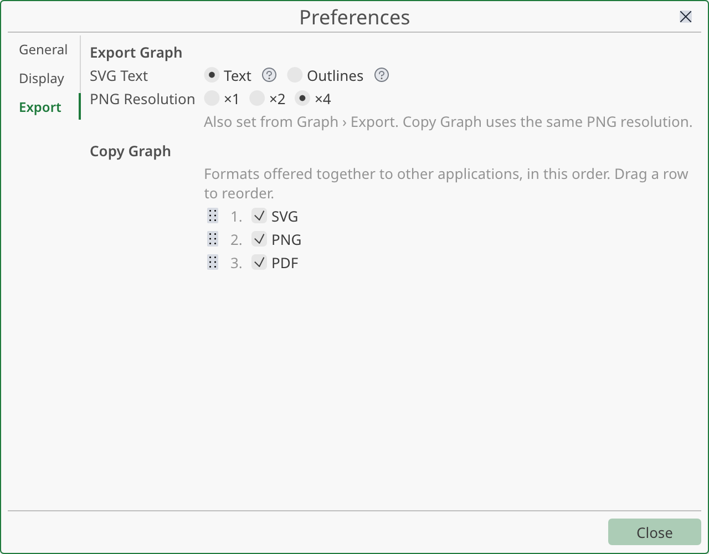

# Exporting and copying

This page shows how to get a graph out of StokesForge: as a file (SVG, PDF or PNG), or copied to the clipboard so you can paste it into a document or a slide. It also covers copying cells and copying objects between projects.

## Export a graph to a file

1. Bring the graph window to the front.
2. Choose **Graph ▸ Export ▸ Export Graph…**, or press <kbd>Ctrl</kbd>+<kbd>E</kbd> (<kbd>Cmd</kbd>+<kbd>E</kbd> on macOS). You can also right-click the plot area and use **Export ▸ Export Graph…**, or use the export button of the toolbar.
3. In the dialog **Export Graph**, pick a folder and a file name. The dialog starts in the default folder set in **File ▸ Preferences… ▸ Folders**, then in the last folder you exported to. The dialog offers the filters **SVG**, **PDF** and **PNG**.
4. Confirm. The status bar shows "Graph exported to" followed by the path.

The format comes from the **extension** of the file name: `.svg`, `.pdf` or `.png`. Any other extension is refused with a message that lists the three valid ones. If you type a name with no extension, StokesForge adds `.svg` and asks before replacing a file of that name.

The suggested file name is the name of the graph in the project.

### What the file contains

The export shows what you see:

- **The current zoom.** If you zoomed in on a peak, the file shows that zoomed view. Use **Reset Zoom** first if you want the full range.
- **Everything drawn in the graph:** curves, symbols, axes, ticks, grid, legend, titles, free texts and shapes.
- **Titles and texts set as on screen**, including scientific notation and the formulas you typed between `$` signs.

The export does not depend on the size of the window. The page is the size of the graph itself (see [Graph size](graphs.md#graph-size)): 480 × 360 points (about 17 × 12.7 cm) for a new graph. A graph exports identically whether its window is small, large or detached. To change the proportions of the text against the curves, change the font sizes and line widths in the graph settings.

If the graph has no background color (the "no color" choice), the file has a transparent background.

### SVG

SVG is a vector format. It stays sharp at any size and opens in vector editors such as Inkscape or Illustrator.

Text in an SVG can be written in two ways. Choose it in **Graph ▸ Export ▸ SVG Text**, or in **File ▸ Preferences… ▸ Export**:

| Choice | What it does | Use it when |
|---|---|---|
| **Text** | Keeps text as editable SVG text. The font must be installed on the computer that opens the file. | You want to edit the labels in a vector editor. |
| **Outlines** | Draws text as outlines. The file looks the same everywhere. | You send the file to someone else, or the journal asks for outlined text. |

**Text** is the default. StokesForge remembers your choice for the next sessions. It applies to SVG files only.

### PDF

The PDF is a vector page with selectable text. The fonts StokesForge needs are embedded, so the PDF looks the same on every computer. Use it for LaTeX, for journals that accept PDF figures, or to print.

### PNG

PNG is a bitmap. Choose its size in **Graph ▸ Export ▸ PNG Resolution**, or in **File ▸ Preferences… ▸ Export** (**×1**, **×2** or **×4**). StokesForge remembers it for the next sessions.

The sizes below are those of a graph of 480 × 360 points; a bigger or smaller graph gives a bigger or smaller image.

| Choice | Size of the image |
|---|---|
| **×1** | 480 × 360 px |
| **×2** | 960 × 720 px |
| **×4** | 1920 × 1440 px |

The menu shows the exact size next to each choice. **×4** is the default. For a figure printed 16 cm wide, it gives about 300 dpi, which suits most publications.

The PNG is drawn with outlined text, so it does not depend on the fonts installed. The resolution goes back to **×4** each time you start StokesForge.

### Calculations that are out of date

If the graph shows a calculation whose source data changed, StokesForge asks before it exports. The window **Out-of-date data** tells you how many calculations are out of date and offers these choices:

| Button | Result |
|---|---|
| **Export Anyway** | Exports the graph as shown, with grey curves and a warning mark. |
| **Export Without Warning** | Exports the graph with normal colors and no warning mark. |
| **Recalculate and Export** | Brings the calculations up to date first, then exports. |
| **Cancel** | Exports nothing. |

The same window appears when you copy the graph.

### If the export fails

The status bar names the cause: the file could not be written (a read-only folder, a full disk), the fonts could not be loaded, or the PNG size is invalid. Fix the cause and export again. An export never changes your project.

## Copy a graph to the clipboard

To paste a graph into a word processor, a presentation or a vector editor, copy it instead of exporting a file:

- Choose **Graph ▸ Export ▸ Copy Graph**, or right-click the plot area and use **Export ▸ Copy Graph**; or
- click an empty part of the graph so that no object is selected, then press <kbd>Ctrl</kbd>+<kbd>C</kbd> (<kbd>Cmd</kbd>+<kbd>C</kbd> on macOS).

The shortcut copies the whole graph only when **no object is selected** in the graph (no curve, text, shape, title or legend) and no text field has the focus. With an object selected, use the menu.

The copy has the same content, zoom and size as an export.

### Which formats are offered

StokesForge puts several versions of the same figure on the clipboard at once: **SVG**, **PNG** and **PDF**. The program you paste into chooses the one it prefers. As a rule:

| You paste into | You usually get |
|---|---|
| A word processor or slides | The PNG, or the SVG if the program supports it. |
| A vector editor | The SVG, which you can edit. |
| A program that only accepts PDF | The PDF. |

Programs differ, so try your own. If a program pastes a version you do not want, change the offered formats as described below, or export a file instead.

The SVG on the clipboard always keeps its text as text (the **Text** choice). The PNG uses the resolution chosen in **Graph ▸ Export ▸ PNG Resolution** (or in **Preferences ▸ Export**).

### Choose the formats and their order

1. Choose **File ▸ Preferences…** and open the **Export** page.
2. In the section **Copy Graph**, tick the formats to offer. At least one format must stay ticked.
3. Drag a row to change the order. The order tells the receiving program which format you prefer, but the program has the last word.

The change applies right away.

### Notes by system

| System | What to know |
|---|---|
| Linux, Wayland | Copy from the StokesForge window, with the key or the menu. The desktop accepts a copy only from the window that has the focus, right after you act. |
| Linux, X11 | The copy stays available while StokesForge is running and is lost when you close it. A very large format (about 16 MB or more) is left out; the others are still offered. |
| Windows | SVG, PNG and PDF are offered as separate clipboard formats. |
| macOS | The same, through the system pasteboard. |

If your system cannot receive the copy, the status bar says so ("This display cannot receive a copied graph") or gives the cause. Export a file instead.

## Copy cells

In a sheet, select cells and use **Copy** in the right-click menu, or press <kbd>Ctrl</kbd>+<kbd>C</kbd>. The cells go to the clipboard as tab-separated text. You can paste them into a spreadsheet program, a text editor or another sheet.

- **Copy with Header** copies the values and the column header.
- **Paste** puts the cells starting from the selected cell.
- **Paste in Place** puts them at the position they were copied from. It needs a copy made in the grid.
- What does not fit in the sheet is left out, and the status bar tells you how many columns or header fields were not pasted.

StokesForge has no command that writes a sheet to a CSV file. To get your data out, copy the cells and paste them into a spreadsheet program or a text file.

## Copy objects between projects

You can copy workbooks, graphs, notes and folders, and paste them in a folder of the same project or of another project.

1. In the Project Manager, select the objects.
2. Right-click and choose **Copy**, or use **Edit ▸ Selection ▸ Copy**.
3. In the Project Manager of the destination project, select the folder.
4. Right-click the folder and choose **Paste**, or use **Edit ▸ Selection ▸ Paste**.

What to expect:

- A copy gets a new name when the name is already used in the folder ("copy 1", "copy 2"…).
- A graph pasted into **another** project brings the data it plots, in a hidden workbook. Choose **Show Data** in the **Graph** menu to open it. A graph pasted in the **same** project keeps pointing at the original columns.
- Analysis calculations are not carried over. The copied columns become ordinary columns.
- A paste is one step in the history: a single **Undo** removes all the pasted objects.
- If the clipboard does not hold StokesForge objects, the status bar says so.

To make a copy in the same folder, use **Duplicate** instead.
