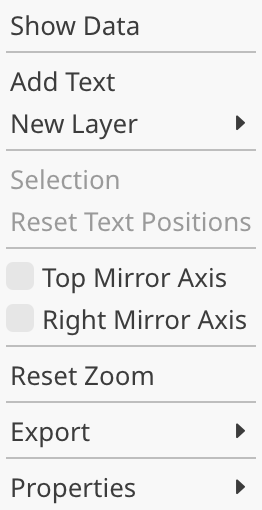
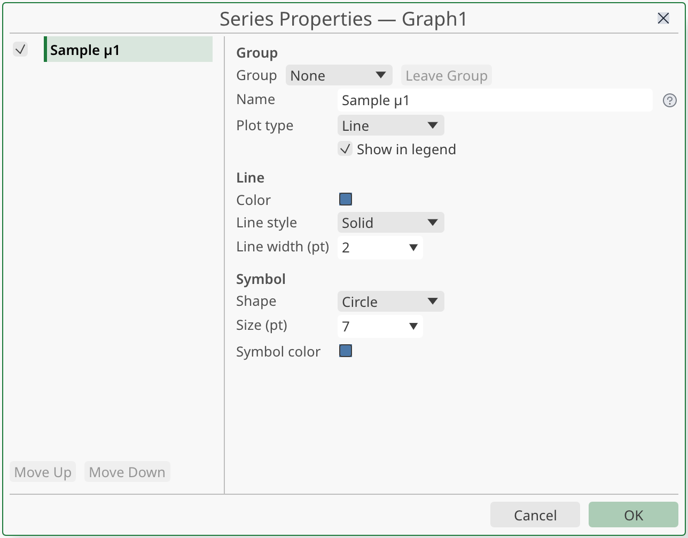
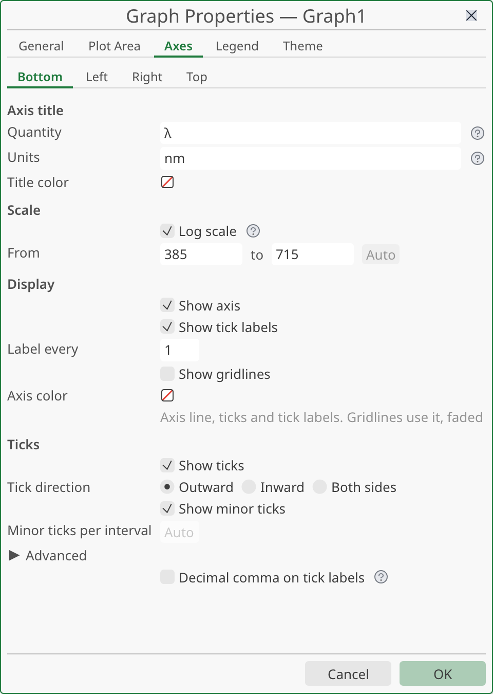
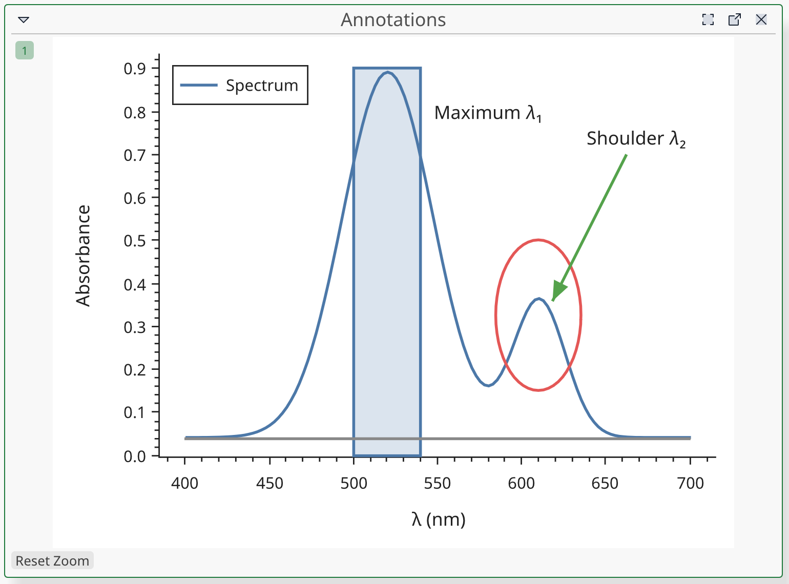
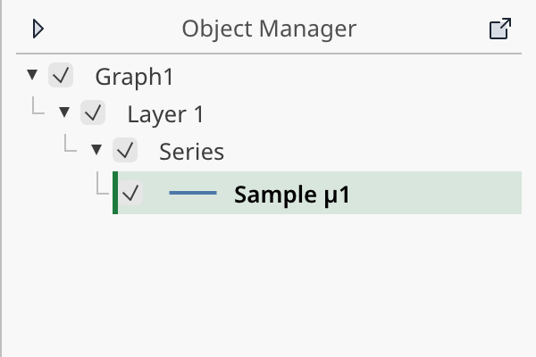

# Graphs

This page covers how to create a graph, add data to it, and change how it looks. You also learn to write titles with subscripts, superscripts and Greek letters, to place text on the figure, and to zoom and pan.

To save a graph as an image or paste it into another application, see [Exporting and copying](export.md).

## Vocabulary

- A **graph** is a window that shows your data as a figure.
- A **layer** is one plot area with its axes. A graph has one layer to start with. You can add layers on top of it (see [Overlay layers](#overlay-layers)).
- A **series** is one curve: a Y column drawn against an X column.
- A **series group** is a set of series added together. You can style a group as a whole.

## Create a graph

There are two ways to start.

### Plot columns from a workbook

1. In a workbook, select the columns you want to plot. Click a column letter, or use <kbd>Ctrl</kbd>+click to add more columns.
2. Right-click a selected column letter and choose **Plot**, then a plot type. You can also use the **Plot** entry of the **Workbook** menu.
3. The new graph opens in its own window.

When a workbook is in front, the **Tools** toolbar also has three buttons for the same job: **Line**, **Scatter** and **Bar**. Their tooltip reads "Plots the selected columns in a new graph".

The plot types of the **Plot** menu are:

| Type | What it draws |
|---|---|
| **Line** | Points joined by a line |
| **Scatter** | Symbols only, no line |
| **Line + Symbol** | A line with a symbol on each point |
| **Bar** | One bar per point |

Two more types, **Histogram** and **Line + Error Bars**, are available in the series settings (see [Change a series](#change-a-series)).

#### How columns become series

StokesForge follows the column roles of the sheet:

- Each column with the **Y** role becomes a series.
- Its X values come from the nearest **X** column to its left. That X column does not need to be selected.
- A Y column with no X column to its left is plotted against the row number.
- Columns with any other role never make a series on their own.
- If your selection holds no Y column, no graph is created. The status bar says "No Y column selected. Select a Y column to plot".

Columns with the roles **Y2**, **Y3** and **Y4** are paired with the nearest **X2**, **X3** or **X4** to their left. Each pair goes to its own overlay layer, with its own axes (see [Overlay layers](#overlay-layers)).

If you select several Y columns at once, the new series form one series group.

### Start from an empty graph

Choose **File ▸ New ▸ Add Graph**, or click **Add Graph** in the **File** toolbar. You get an empty graph with one plot area. Then add data as described next.

## Add data to a graph

You can add series to a graph that is already open in three ways.

### Drag columns onto the graph

1. In a workbook, select whole columns.
2. Point at the left or right edge of the selection, below the row of letters. The cursor becomes a hand.
3. Drag the edge and drop it on the graph. The border of the graph window turns light blue to show that the graph accepts the drop.

Press <kbd>Esc</kbd> during the drag to cancel. The new series take the plot type of the last series in the layer. In an empty layer they are lines. They go into the active layer (see [The active layer](#the-active-layer)).

Dragging works inside one window. To reach a graph in a detached window, use the next method.

### Send columns to a graph

1. Select whole columns in a workbook.
2. Right-click, then choose **Send to** followed by the graph name. You can also use the **Workbook** menu.

With three or more open graphs, the entries are grouped under **Send to Graph**. If no graph is open, the entry is absent. This method works for graphs in the main window and for detached graphs.

Undo (<kbd>Ctrl</kbd>+<kbd>Z</kbd>) removes the added series in one step.

### Plot rows

A sheet can hold an **x'** row, a number above the long name of each column. Choose **Workbook ▸ Show x' Row** to see it. When at least one column has an x' value, you can plot whole rows:

1. Select whole rows by clicking the row numbers.
2. Right-click and choose **Plot**, or **Send to** a graph.

One row makes one series, named "Row 1", "Row 2" and so on. If you send rows to a graph that already has an X axis, the dialog **Plot Rows** asks where to draw them:

- **Create Axis** adds a layer with its own X axis, scaled by the x' values.
- **Use Present Axis** draws the rows against the X axis of the active layer.

## Remove series

1. Click the curve in the figure, or its row in the Object Manager.
2. Press <kbd>Del</kbd>, or right-click and choose **Delete**.

To remove a whole group, select the group in the Object Manager and press <kbd>Del</kbd>. This deletes the group and all its series. To keep the series and only dissolve the group, choose **Ungroup** instead.

To hide a series without deleting it, clear its visibility box in the Object Manager, or right-click it and choose **Hide**. A hidden series is left out of the legend and of the automatic axis limits.

Deleting a series never deletes the columns of the workbook.

## Open the graph settings

The settings of a graph are in the **Graph Properties** window. It has these tabs: **General**, **Plot Area**, **Axes**, **Legend** and **Theme**. The series have their own window, **Series Properties**.

You can open them in several ways:

- Double-click an axis, a curve or a shape on the figure. For an axis, double-click its numbers (the tick labels), just outside the plot area, or its line (the edge of the plot area). A double-click on the plot area itself resets the zoom.
- Right-click a part of the figure and choose **Properties…**. The window opens on the page for that part.
- Use the **Graph** menu, then **Properties**. It lists **Graph Properties…**, **Plot Area…**, **Axes…**, **Series…**, **Legend…** and **Theme…**.
- Double-click a row in the Object Manager.

While the window is open, your changes show on the graph at once. Click **OK** to keep them as a single undo step. Click **Cancel**, or press <kbd>Esc</kbd>, to go back to how the graph was. The rest of the application is locked while the window is open.

### The tabs

| Tab | What you set |
|---|---|
| **General** | **Title**, **Title color**, **Background**, **Warn about out-of-date data** |
| **Plot Area** | **Layer title**, vertical and horizontal **Gridlines** |
| **Axes** | One axis at a time: title, scale, range, ticks, color |
| **Legend** | **Show legend**, **Position** |
| **Theme** | **Light** or **Dark** theme, and **Global colors** |

A new graph has no background color: the figure is transparent when exported, and white on screen. Choose a dark background and the automatic text turns white.

## Change a series

Double-click a curve, or choose **Graph ▸ Properties ▸ Series…**.

The settings of the selected series:

- **Name**. If you leave it empty, the series uses the name of its column.
- **Plot type**: **Scatter**, **Line**, **Line + Symbol**, **Bar**, **Histogram** or **Line + Error Bars**.
- **Show series** and **Show in legend**.
- **Line**: **Color**, **Line style** and **Line width (pt)**. Line styles are **None**, **Solid**, **Dashed**, **Dotted** and **Dash-dot**.
- **Symbol**: **Shape**, **Size (pt)** and **Symbol color**. Shapes are **None**, **Circle**, **Square**, **Triangle**, **Diamond**, **Plus (+)** and **Cross (×)**.

Move a series up or down in the list to change the drawing order. The shortcuts are <kbd>Ctrl</kbd>+<kbd>↑</kbd> and <kbd>Ctrl</kbd>+<kbd>↓</kbd>.

### Colors

Every color field is a small swatch. Click it to open the color picker. It offers a palette, **Auto** when the color can follow the theme, your saved colors, and a hexadecimal field (`#RRGGBB`, or `#RRGGBBAA` with opacity). Tick **Custom color** to see the full picker.

Use **Save Color** to keep a color in the project or for yourself. Right-click a saved color to remove it.

### Error bars and histograms

- **Histogram** counts the values of one column and draws the counts as bars. In **Series Properties**, the **Bins** field sets the number of bars, from 1 to 65536.
- **Bar** draws one bar per point. The **Width (X units)** field sets the width of the bars in the units of the X axis. It shows **Auto** with the computed width in gray until you type a value; empty the field, or type `auto`, to go back to it.
- When the series is in a group and the scope is **Whole group**, **Bins** and **Width (X units)** are copied to the members that have the matching type.
- **Line + Error Bars** draws a whisker above and below each point. The error values must come from columns that you give with a script, using the `x_error` and `y_error` options of `pyst.plot`. See [The pyst API](../scripting/api.md). The plot menus do not set them.

### Series groups

Series added together form a group. In **Series Properties**, the **Group** section lets you:

- Choose **None**, an existing group or **New group** for the selected series.
- Click **Leave Group** to detach the series. It keeps its style.
- Give the group a **Name**.
- Use **Move Group Up** and **Move Group Down**.
- Use **Ungroup** to turn the members back into single series.
- Use **Delete Group** to delete the group and all its series.

The **Edit** choice decides what a change applies to:

- **Whole group (n series)**: the default. Line style, line width, symbol shape and symbol size are copied to every member.
- **This series only**: only the selected series changes.

Name, plot type, visibility and colors always stay per series. With the whole group selected, the colors are hidden and a **Color gradient** takes over. Pick one of the gradients (**Blue to Red**, **Viridis**, **Plasma** and others), or choose **Custom** and add your own colors with **Add Color**. A gradient spreads its colors over the series in list order. You can save a custom gradient in the project or for yourself.

## Axes

Open the **Axes** tab and pick the axis at the top of the page: **X (bottom)**, **Y (left)**, and the others when the layer uses them. Or double-click an axis on the figure.

### Axis title

The **Axis title** section has two fields:

- **Quantity**: the name or symbol, for example `Wavenumber`.
- **Units**: shown after the quantity, in parentheses.

With "Absorbance" and "a.u." you get "Absorbance (a.u.)". Both fields accept formulas (see [Titles and formulas](#titles-and-formulas)).

You can also double-click an axis title on the figure to edit it in place.

### Scale and range

In the **Scale** section:

- Tick **Log scale** for a base-10 logarithmic axis. Without it the axis is linear. Zero and negative values are not drawn on a log axis.
- Type two values in **From** and **to** to fix the range. The order is free: if the first value is larger than the second, the axis is reversed. This is useful for spectra plotted in wavenumbers.
- Click **Auto** to let the range follow the data again. The axis keeps its direction.

While the range is automatic, the two fields show the range StokesForge computed.

### Display and ticks

The **Display** section has these options:

- **Show axis**
- **Show gridlines**
- **Show tick labels**
- **Show ticks**
- **Show minor ticks**, with **Minor ticks per interval**
- **Decimal comma on tick labels**, which writes 1,5 instead of 1.5 on every axis of the graph. New graphs start with the choice set in **File ▸ Preferences… ▸ Display ▸ New**

The **Ticks** section sets the **Tick direction** (**Outward**, **Inward** or **Both sides**) and **Label every**. The last field writes only one tick label out of the number you give. Open **Advanced** for tick lengths, tick width and tick color.

**Axis color** sets the line, the ticks and the tick labels. Gridlines use the same color, faded.

### Mirror axes

To repeat a scale on the opposite side of the plot, choose **Graph ▸ Top Mirror Axis** or **Graph ▸ Right Mirror Axis**. A mirror axis repeats the scale of the opposite axis and has no title. You can also tick **Show mirror axis** in the **Axes** tab.

## Legend

The **Legend** tab has **Show legend** and **Position**: **Top left**, **Top right**, **Bottom left** or **Bottom right**.

Each entry shows the name of its series. To rename a series, double-click its entry in the legend and type the new name. An empty name goes back to the column name.

Drag the legend to move it anywhere on the figure. Right-click it and choose **Reset Position** to put it back. A series with **Show in legend** cleared does not appear.

## Titles and formulas

The title of the graph, the title of a layer, the axis titles and the series names accept formulas. You write them in Typst markup. Text between dollar signs is math. Everything else is plain text.

Next to each of these fields, a small help icon () shows the most common forms when you hover over it. You can hide these icons in **File ▸ Preferences… ▸ Display ▸ Interface**.

If a formula is not valid, the field shows a message after you leave it. The graph shows your text as typed until you fix it.

### Examples

| You type | You get |
|---|---|
| `$lambda$` and `$Delta$` | the Greek letters λ and Δ |
| `$x_2$` | x with subscript 2 |
| `$"Ru(bpy)"_3$` | Ru(bpy) with subscript 3, in upright letters |
| `$x^2$` | x squared |
| `$"cm"^(-1)$` | cm with superscript −1 |
| `$"L mol"^(-1)$` | L mol with superscript −1 |
| `$Delta H = sum_i n_i$` | an equation with several terms |
| `*bold*` | bold text |
| `_italic_` | italic text |

### Rules to remember

- **Upright text in math**: put it in double quotes. `$"cm"^(-1)$` writes "cm" upright. Without quotes, `cm` would be read as math.
- **Several characters in an exponent or index**: put them in parentheses. `$"cm"^(-1)$` raises `-1`, not just `-`.
- **Greek letters**: type their English name. `alpha`, `beta`, `mu`, `pi`, `theta`, `sigma` give lowercase letters. A capital first letter gives the capital: `Delta`, `Omega`.
- **Special characters**: write `\$` for a dollar sign, `\_` for an underscore, `\*` for a star and `\#` for a hash. In plain text, `_`, `*`, `#` and `$` have a meaning in Typst.
- **Series names**: a series name that you leave empty uses the column name exactly as written, so characters like `_` and `#` in the column name are safe. A name that you type is read as a formula.

### Axis titles with units

Put a formula in the **Units** field to get a superscript:

| Quantity | Units | Result |
|---|---|---|
| `Wavenumber` | `$"cm"^(-1)$` | Wavenumber (cm⁻¹) |
| `Absorbance` | `a.u.` | Absorbance (a.u.) |
| `$lambda$` | `nm` | λ (nm) |

The tick labels are numbers and never go through this.

### Format toolbar

The **Text format** toolbar has a row of its own and is always shown; its buttons are greyed out until a graph is in front. It edits the text you have selected on the graph or are editing. It has **Bold**, **Italic**, **Subscript**, **Superscript** and **Math** buttons. It also has **Font**, **Size** and **Text color**. Titles and the legend only take a font and a size.

## Edit and move titles

- **Edit**: double-click a title, an axis title or a legend entry. Press <kbd>Enter</kbd> or click elsewhere to confirm. Press <kbd>Esc</kbd> to cancel.
- **Move**: drag the title or the legend. The position stays tied to the data, so it follows the zoom. The move is saved with the project and is used in exports.
- **Reset one**: right-click the title and choose **Reset Position**.
- **Reset all**: choose **Graph ▸ Reset Text Positions**.

## Text on the graph

You can place free text on the figure, for example to label a peak. The text is tied to a point in the data, so it moves with the data when you zoom or pan.

1. Right-click in the plot area and choose **Add Text**. You can also click **Text** in the **Tools** toolbar and click the plot area, or use **Graph ▸ Add Text**.
2. Type the text. It accepts the same formulas as the titles. Press <kbd>Enter</kbd> or click elsewhere to confirm.
3. To change it later, double-click the text, or right-click it and choose **Edit Text**.

While you edit, a small bar above the text gives the color, the **Font size (pt)** and the **Rotation (°)**. When the text is selected, it has an outline. Drag the text to move it. Press <kbd>Del</kbd> to remove it.

## Shapes

The **Tools** toolbar also has **Rectangle**, **Ellipse**, **Line** and **Arrow**. Click the tool, then drag in the plot area. A click without a drag places a shape of default size. The head of an arrow is where you release the mouse.

After you draw a shape, the tool goes back to **Pointer** and the shape is selected:

- Drag the shape to move it.
- Drag a handle to resize it. Hold <kbd>Shift</kbd> to keep the proportions.
- Press <kbd>Del</kbd> to remove it.
- Right-click it for **Bring to Front** and **Send to Back**.

The toolbar shows the format of the selected shape: **Line color**, **Fill color** (or **No fill**) and **Line width (pt)**.

## Zoom and pan

The wheel alone does nothing on a graph. A plain drag with the **Pointer** tool does not move the view either. This avoids moving the view by accident.

| Gesture | Effect |
|---|---|
| <kbd>Ctrl</kbd>+wheel on the plot area | Zooms around the pointer |
| <kbd>Ctrl</kbd>+wheel on an axis | Zooms that axis only |
| <kbd>Ctrl</kbd>+drag, or middle-button drag, on the plot area | Pans the view |
| <kbd>Ctrl</kbd>+drag, or middle-button drag, on an axis | Pans that axis only |
| **Zoom** tool, then drag a rectangle | Zooms in on the rectangle |
| Double-click an empty part of the plot or the margin | Resets the view |

A pinch gesture on a trackpad also zooms.

To go back to the original view, use any of these:

- Double-click an empty area of the graph.
- Choose **Graph ▸ Reset Zoom**.
- Click **Reset Zoom** under the figure.

Zoom and pan only change what you see. They are not part of the graph settings and do not change the range you typed in the **Axes** tab. An exported figure uses the current view.

For all mouse actions, see [Mouse gestures](../reference/gestures.md).

## Overlay layers

An overlay layer draws a second set of curves on top of the first, with its own axes. Use it when two series share X values but have very different Y scales.

Choose **Graph ▸ New Layer** and pick one:

- **Top X (Linked Y)**: a new X axis at the top. The Y scale follows the active layer.
- **Right Y (Linked X)**: a new Y axis on the right. The X scale follows the active layer.
- **Top X, Right Y**: both new axes.

A graph can hold up to three overlay layers. After that, **New Layer** is disabled.

### The active layer

Additions go to the **active layer**. A small numbered badge for each layer sits at the top left of the graph window. Click a badge to make that layer active. The layer also becomes active when you click or right-click in its plot area, or select one of its objects.

These actions use the active layer: dropping columns, **Send to**, **Add Text** and **New Layer**.

Zoom and pan act on all the layers that share a plot area, so the ticks stay aligned.

## The Object Manager

The Object Manager lists the content of the active graph as a tree: layers, series groups, series, axes and free objects. Set it up from the **View ▸ Object Manager** menu.

In the tree you can:

- Click a row to select the matching object on the figure.
- Double-click a row to open its settings.
- Clear the visibility box to hide a series, a group or a layer.
- Press <kbd>F2</kbd> to rename a series or a group in place.
- Drag a row to reorder it.
- Right-click a row for the same menu as a right-click on the figure: **Select Members**, **Rename**, **Move Up**, **Move Down**, **Ungroup**, **Hide**, **Delete**, **Properties…**.

The menu **View ▸ Object Manager** also has **Show Axes**, **Show Objects**, **Expand by Default** and **Reset Settings**. **Show Axes** lists the axes in the tree, but does not hide them on the graph.

If no graph is active, the panel says "No graph is active. Click a graph to see its objects".

## Detached graph windows

A graph normally lives in the main window. You can move it into a window of its own, for example onto a second screen.

- Click **Detach into a separate window** in the title bar of the graph, or drag the title bar outside the application.
- To bring it back, click **Reattach to the main window**.

A detached graph has the same menus, right-clicks, zoom and pan as a docked one. **Send to** works for it too. Drag and drop from a workbook does not cross from one window to another, so use **Send to** instead.

While **Graph Properties** is open, you cannot change a detached window. Click **OK** or **Cancel** first.

## Common tasks

| I want to… | Do this |
|---|---|
| Plot two columns | Select them, right-click the letters, then **Plot ▸ Line** |
| Add a curve to a graph | Drag the edge of the selected columns onto it, or right-click ▸ **Send to** |
| Change a curve color | Double-click the curve, then use the color in the **Line** section |
| Write cm⁻¹ in a title | Type `$"cm"^(-1)$` |
| Use a log axis | Double-click the axis, then tick **Log scale** |
| Reverse an axis | Double-click the axis, then type the larger value in **From** and the smaller in **to** |
| Zoom in | <kbd>Ctrl</kbd>+wheel, or the **Zoom** tool and a rectangle |
| Reset the zoom | Double-click an empty part of the plot |
| Label a peak | Right-click the plot area ▸ **Add Text** |
