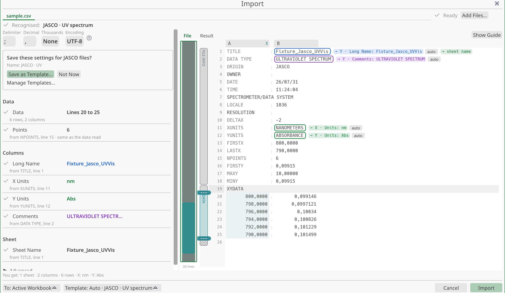
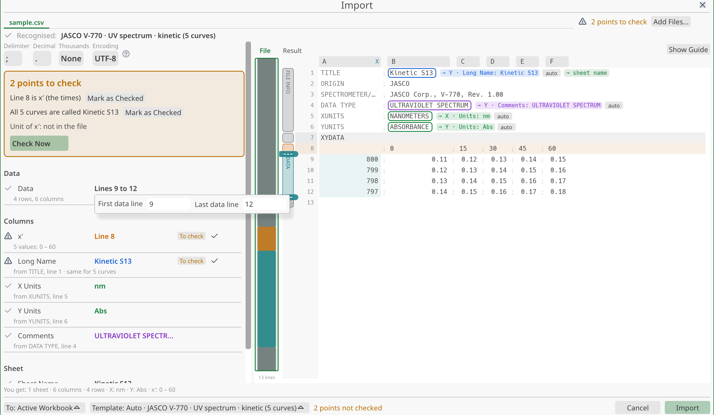
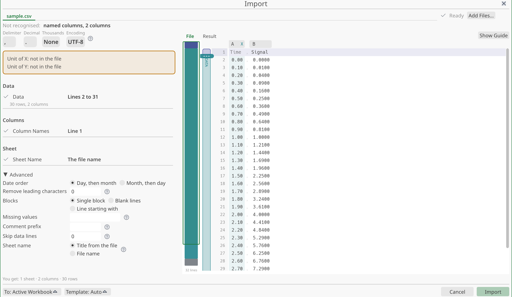
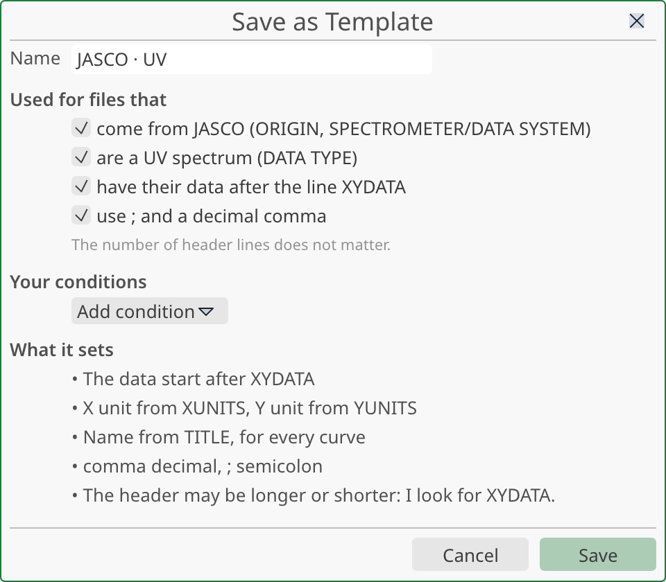
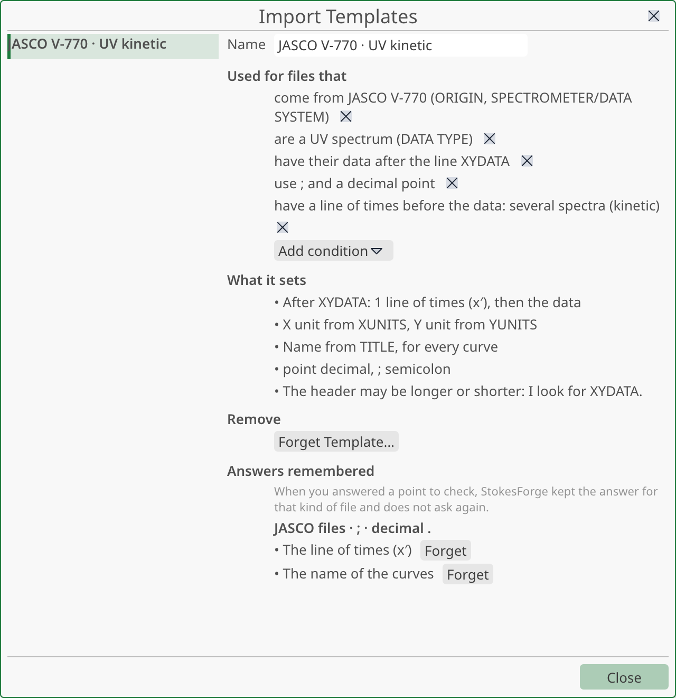
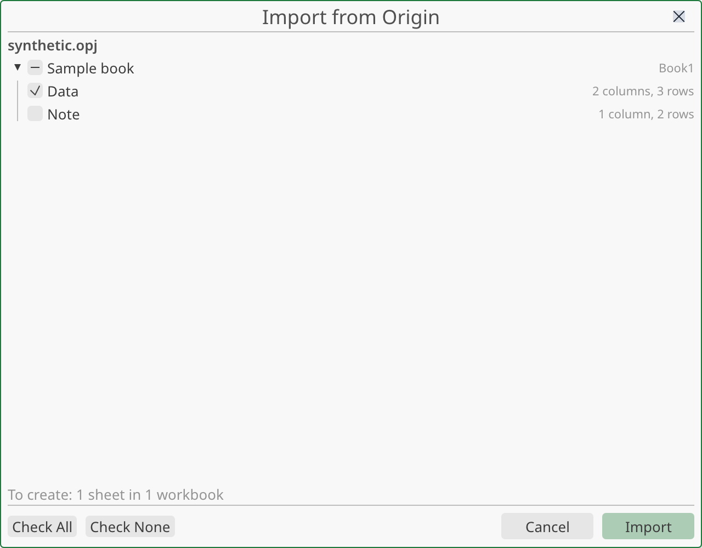

# Importing data

This page explains how to bring instrument files into a project. You open the **Import** window, a single screen. StokesForge reads the file, tells you what it recognised, and shows the file as a grid. You only act where it is not sure, or where you want something different.

You can import several files at once. You can also save your settings as a template and reuse it for every file from the same instrument.

## What you can import

StokesForge reads **delimited text files**: CSV, TXT, ASC, and any other text export from an instrument, and **JCAMP-DX** files. It looks at what the file contains, never at its extension. The file picker shows all files.

A few things to know:

- Files can be encoded in UTF-8, UTF-16 or Windows-1252. StokesForge detects this.
- **NMR is not supported.** A file that holds NMR data (JCAMP-DX) is refused with the message "This file holds NMR data (JCAMP-DX). StokesForge does not read NMR spectra." If a file mixes an NMR block with other spectra, the other spectra are read and a point to check says that the NMR blocks were left out.
- A binary file is refused: "This file is not text (the format of the device software). Export it as CSV or TXT from that software, then import that file."
- An empty file is refused, and so is a file with no line of numbers.
- A refused file never stops the others: in a batch, it is marked **Refused** on its tab, skipped, and listed in the message at the end.
- A column that mixes numbers and text is **not** an error. StokesForge keeps it, with the type **Mixed**.
- Origin projects (`.opj`) are not text files. They open their own window, described in [Origin projects (.opj)](#origin-projects-opj).
- Project files (`.stf`) are never imported. If you drop one on the window, it opens as a project in a new window.

## Open the Import window

### From the menu

1. Choose **File ▸ Import ▸ Import…**.
2. Click **Add Files…** and pick one or more files.
3. Look at what was recognised, deal with the points to check if you want to, then click **Import**. If none of the files can be read, **Import** is greyed out ("None of these files can be read").

The shortcut is <kbd>Ctrl</kbd>+<kbd>"</kbd>. On an AZERTY keyboard, press <kbd>Ctrl</kbd>+<kbd>3</kbd> (the key that types `"`). On a QWERTY keyboard, press <kbd>Ctrl</kbd>+<kbd>Shift</kbd>+<kbd>'</kbd>.

**Cancel**, <kbd>Esc</kbd> or the close cross closes the window without importing. <kbd>Enter</kbd> runs **Import**.

### By dropping files

Drag files from your file manager onto the main window. The border of the window that receives the files turns light blue. Only one window is lit at a time.

- StokesForge reads each file with the saved template that recognises it (see [Templates](#templates)), and otherwise with what it detected in the file.
- **If nothing needs a look, the window does not open.** The files are imported straight away, and a message in the status bar names the templates used.
- **If one file has a point to check** (or cannot be read), nothing is imported yet: the window opens on **all** the dropped files, each with its own settings, so you can look at it.
- A point you already answered for a kind of file is not raised again for the next file of that kind (see [Answers remembered](#answers-remembered)), so the window does not open for nothing.

Where the data goes depends on where you drop:

- On an open workbook (its own border is lit): one new sheet per file, in that workbook.
- Anywhere else (a graph, a note, a matrix, the Project Manager; the outline of the main window is lit): a new workbook.

A drop always creates new sheets. It never replaces or extends a sheet. If the window is already open, dropped files are added to its list.

### Reopen the last import

Choose **File ▸ Import ▸ Reopen Last Import…**. The window opens again with the same files, each with its own settings, so you can adjust and rerun.

If that import is still the last thing you did, StokesForge undoes it first. If you have done other work since, the previous import stays in place. This entry is greyed out until you have finished an import.

## The screen

The window has two halves.

- At the **left**: what StokesForge understood about the file, in sentences. First the format (**Delimiter**, **Decimal separator**, **Thousands separator**, **Encoding**), then the points to check, then **What was found**, then the **Advanced** fold.
- At the **right**: the file as a grid, with the **File** and **Result** tabs. **File** shows the lines of the file with their numbers. **Result** shows the worksheet that will be created. Under the grid, a line starting with "You get" sums it up (how many sheets, columns and rows).

Above them, one tab per file. With many files, the strip stays usable: filter the files by name, move with **Previous file** and **Next file**, and the tabs that do not fit are folded in a "+ n more" button. A tab says **Ready** or **Refused**.

At the bottom, two menus and two buttons: **To:** (where the data goes), **Template:** (which template is used), **Cancel** and **Import**. **Import** is never greyed out because of a doubt: when points are left to check, the footer says "n points not checked", and you import anyway if you accept them.

### What was found

The groups **Data**, **Columns** and **Sheet** list what StokesForge read, each row with the line it comes from: the lines of data, the number of points, the column names, the x' line (the times of a kinetic), the Long Name, the units of X and Y, the Comments, the footer, and the name of the sheet. A sheet takes the name of the file, or the value of a title key such as `TITLE` when the file has one.

Hover a row, and its line is framed in the grid. A long value is cut with "…": hover it to read it whole. Click a value to correct it: a small window lets you pick another line, or another key of the file.

### Give a line a role

You do not need a dialog to say what a line is. In the grid:

- Click a **line number**. A small bar offers the role of the line: **Long Name**, **Units**, **x'**, **Data starts here**, **Data ends here**, or **Clear role**. The bar closes by itself when the pointer leaves it or when the grid scrolls.
- Click a **value** to use it, for example `NANOMETERS` as the units of X.
- Click a **column letter** to give a column a role (X, Y, error…) or to read it as **Text**.
- Drag the two **data handles** at the left of the grid to move the first and the last line of data.
- The small **auto** tag beside an automatic choice takes the choice back. It never deletes it.

### The first-use guide

Over the grid, a short guide explains the three gestures above: click a line number, click a value, hover a sentence on the left. It stays small, and never blocks the grid. It shows every time you open the window, until you click **Don't show again**. **Show Guide** (top right of the grid) brings it back.

## Points to check

When StokesForge is not sure, it says so in an orange frame titled "n points to check". The doubt is a sentence, for example "Line 8 is x′ (the times)" or "All 5 curves are called Kinetic S13". The detector also raises its own doubts: text lines inside the data, several blocks of numbers in one file, a comma that may be a decimal, a JCAMP-DX table it cannot read fully, or two templates that fit the file equally. StokesForge never picks one of several blocks of numbers silently.

- **Click the sentence** (or the **To check** tag of a row): the file shows where it comes from. This settles nothing.
- **Mark as Checked**: you looked, and you accept the point as it is. The recipe is not changed.
- **Check Now**: goes through the doubts one at a time, with the choices for each.
- A point of the kind "two templates fit" offers a button to use the other template. Your choice is remembered for that kind of file: later files of the kind use the template you picked, and **Reopen Last Import** keeps it (**Manage Templates** lists it under **Answers remembered**, with **Forget**).

Where the file gives nothing (a unit, for example), the frame says "not in the file". When the file does give it but the template in use has no role for it, the sentence says so ("the file gives nm (XUNITS, line 11), but this template does not use it"). You can fill it in by marking a line in the grid.

### Answers remembered

Every answer you give (checked, marked, corrected) is remembered for that **kind of file** (the instrument that wrote it, and how it writes numbers). The same point does not come back for the next file of the same kind. This is also what keeps the drop of many files from opening the window every time.

You see these answers, and take them back, in **Manage Templates…** under **Answers remembered**: **Forget** brings the point back.

## Advanced

The rare settings are in the **Advanced** fold at the bottom of the left panel, closed by default:

| Setting | Effect |
|---|---|
| **Date order** | **Day, then month** (default) or **Month, then day**, for dates such as `03/04/2026`. |
| **Remove leading characters** | Removes this many characters at the start of every data line. |
| **Blocks** | **Single block** (default), **Line starting with** a text (for example `TITLE`), or **Blank lines**: each block becomes its own sheet. |
| **Missing values** | A comma-separated list of words read as empty cells, such as `--, n/a, *, NaN`. |
| **Comment prefix** | Data lines that start with this text (`#`, `;`, `//`) are skipped. |
| **Skip data lines** | Ignores this many lines at the start of the data. |
| **Sheet name** | **Title from the file** (default): the sheet takes the title written in the file when it has one, and the name of the file otherwise. **File name**: the sheet always takes the name of the file, even when the file has a title. Saved with a template. |

A setting that is not at its default value also appears as a sentence under **Advanced settings in use**, below the fold, so nothing set there stays hidden.

## Where the data goes

The **To:** menu sets the destination:

| Choice | Result |
|---|---|
| **New Workbook** | One new workbook holds all the files. |
| **One Workbook per File** | Each file gets its own new workbook. |
| **Active Workbook** | The data goes into the workbook in front. Greyed out if no workbook is open. |

With **Active Workbook**, **In active workbook** adds four modes: **New sheet** (default), **Replace active sheet**, **Add columns to active sheet** and **Add rows to active sheet** (column *j* of the file extends column *j* of the sheet).

When you import more than one file, **Multiple files** offers **One sheet per file** (default), **One sheet, side by side (X Y X Y…)** and **One sheet, X of first file shared**. Use the second or third to plot several spectra from one sheet.

With **One Workbook per File** and **One sheet per file**, or a single file imported into **New Workbook**, each workbook takes the title of the file (else its name) and holds one sheet called **Raw Data**. The sheet keeps that name as long as no value of an imported column changes. As soon as you type or paste a value, clear a cell, add, delete or sort rows, change the type of a column, change an x′ value, put a formula on an imported column or delete one, the sheet renames itself **Sheet1** (or **Sheet2** if that name is taken), in the same step: **Undo** gives back **Raw Data** and the old value. Editing a header (**Long Name**, **Units**, **Comments**), a role or a display format, moving columns or adding a calculated column beside the data does not count. A sheet you renamed yourself is never renamed again, and **Refresh from Source** keeps the current name. The other destinations name the sheet after the title or the file.

The whole import is a single entry in the history: one **Undo** removes it.

## Templates

A template stores the settings of an import under a name, together with the **conditions** a file must meet to be read with it. StokesForge has no built-in template: you save your own.

- The **Template:** menu lists **Auto** first (StokesForge decides), then your templates. It also holds **Save as Template…** and **Manage Templates…**.
- A template that fits a file is applied at once, and its name is shown ("Auto · name"). When two fit, the one that meets the most conditions is used, and a point to check offers the other.
- After the first import of a kind of file, the window offers "Save these settings for JASCO files?" with **Save as Template…** and **Not Now**.

### Save as Template

The window proposes a **Name** (type your own) and shows **Used for files that**: the conditions found in the file, each with a check box (the instrument written in the file, the data type, the line the data come after, how numbers are written, a line of times before the data). Uncheck a condition you do not want. Under **Your conditions**, **Add condition** lets you add:

- **Number of columns**: *equals* or *at least* (a way to tell a two-column spectrum from a kinetic of many curves);
- a **header line** (pick a key such as `ORIGIN`) that equals or contains a value;
- **File name contains** a text;
- **Extension**.

**What it sets** lists in words what the template will do. The number of header lines does not matter: a template looks for the marker line (such as `XYDATA`), so a header of another length still fits. At least one condition must stay: without one, **Save** is greyed out ("Keep at least one condition"). When points are still to check, an orange line under the name says how many and that they are saved as they are now; **Save** stays possible.

### Manage Templates

**Manage Templates…** (also in the offer) opens the **Import Templates** window. Pick a template to rename it, remove or add its conditions, read what it sets, or **Forget Template…** (after a confirmation; the files it recognised go back to **Auto**; you cannot undo it). Under **Answers remembered** you see the points already answered per kind of file, each with **Forget**.

Templates saved with earlier versions (before 1.1) are kept and listed here, but they are **no longer applied automatically**. Their old Auto-select criteria (extensions, name contains, file start contains) became conditions, and these conditions are not active: a file that fits them is read with what StokesForge detects in it, not with the old template. The reason is that those criteria were broad (for example "a `.csv` file that starts with `ORIGIN;JASCO`" fits every JASCO file) and an old template could silently misread a file of another shape, such as a kinetic whose x′ line it read as data. An old template shows **Not automatic** in this window. You can still choose it from the **Template:** menu. To let StokesForge use it by itself again, pick it and click **Use Automatically**: its conditions become active, and you can then edit them like those of any template. A template you save from the Import window is automatic.

The command line (`stokesforge-cli import`) and the `pyst.import_file` scripts use the same templates and the same detector as the window, and the same rule for old templates (a template you name with `--recipe` or `recipe=` is always used). In the command line, a file that cannot be read is skipped and listed.

## Import progress

An import runs in the background. For long files, the status bar shows "Importing… *k* of *n* files" with a **Stop** button. If you stop it, nothing is imported.

A message at the end tells you how many files were imported. If some failed, the message gives the reason for each. Files that did import are kept. You cannot start a second import while one is running.

## Refresh from the source files

Each imported column remembers the file it came from and the settings used. When the file changes, for example after a new measurement run, you can read it again:

1. Click a sheet with imported columns.
2. Choose **File ▸ Import ▸ Refresh from Source**.

The values are rewritten in place. The columns keep their identity, so graphs that use them stay valid. The number of rows follows the longest of the new contents. It shrinks only if all the columns of the sheet are refreshed; a column you typed by hand is never cut.

**Limit.** Refresh from Source reads the file again with the **stored settings as they are**, without detecting anything again. It does not promise to give the same result from one version of StokesForge to the next: a newer version may read the same settings a little differently. The entry is greyed out when no column of the sheet comes from a file. The entry is also greyed out for a sheet imported from an Origin project.

## Origin projects (.opj)

StokesForge reads the **workbooks** of an Origin project saved as `.opj`. Graphs and matrices of the project are left out.

An `.opj` never goes through the text import. Drop it on the window, choose it with **Add Files…** in the **Import** window, or choose **File ▸ Import ▸ Import…**: the **Import from Origin** window opens instead. If the **Import** window is open, the file moves to the new window and the **Import** window closes when nothing else is left in it.

### The Import from Origin window

The window lists each file, then each Origin workbook of the file, then the sheets of each workbook, with the number of columns and rows of each sheet. Several files dropped together are listed together.

- Check the sheets you want. A check box on a workbook checks or unchecks all its sheets; it shows a dash when only some are checked.
- By default, the sheet called `Data` is checked in each workbook. When a workbook has no `Data` sheet, all its sheets that have columns are checked.
- A sheet with no column is greyed out: there is nothing to import.
- **Check All** checks every sheet that has columns. **Check None** unchecks everything.
- The line under the list says what Import will create, for example "To create: 3 sheets in 2 workbooks".
- **Import** is greyed out while nothing is checked, and says why. **Cancel** closes the window and creates nothing.

**Import** creates one workbook for each Origin workbook that has a checked sheet, named after its Origin long name (its short name when there is no long name), with one sheet for each checked sheet. If a name is already used or not allowed, the workbook or sheet keeps its automatic name. The new workbooks open in the workspace, and the whole import is a single step in the history: one **Undo** removes it.

### What is kept

- The column names, long names, units and comments, and the X and Y roles.
- The information of a Horiba file, when the workbook holds some, goes into the metadata of the columns.

These columns do not remember a source file, so **Refresh from Source** does not apply to them.

### Reopen the last import

**File ▸ Import ▸ Reopen Last Import…** brings the **Import from Origin** window back on the same files, with the same sheets checked, so you can change your choice and import again. If the import is still the last thing you did, StokesForge undoes it first.

### `.opju` files

Files saved as `.opju` (Origin 2018b and later) are not read yet. Save the project as `.opj` from Origin 2018 to 2022b, or open it in the free Origin Viewer and save it as `.opj`.

### From the command line and scripts

`stokesforge-cli import` and `pyst.import_file` read an `.opj` without a window: they import the `Data` sheets of each workbook (all the sheets that have columns when a workbook has no `Data` sheet), one workbook per Origin workbook.

## Common problems

### A column is read as text

A column becomes **Mixed** or **Text** when some values are not numbers. Check these, in this order:

1. **Decimal separator.** Look at the format line at the left: if the file writes `1,5`, the decimal must be the comma. Click it to change it.
2. **Delimiter.** If the delimiter is wrong, whole lines end up in one column. Click **Delimiter** and choose the right one.
3. **Missing values.** If the file writes `n/a` or `--` for a missing value, list it in **Missing values** under **Advanced**.
4. **Header lines.** If a header line is counted as data, click its line number and give it a role (**Long Name**, **Units**), or move the first **data handle** below it.
5. **Role of the column.** Click the column letter: the column may be set to **Text**.

### Everything is in one column

The delimiter is wrong. Click **Delimiter** and choose another one.

### The column names are the first row of data, or the units are missing

Click the line number of the names line and give it a role (**Long Name**), and the same for the units line (**Units**). If the file writes them as `KEY;value` lines, click the value (for example `NANOMETERS`) to use it.

### The data stops too early, or does not stop

Drag the last **data handle**, or click a line number and choose **Data ends here**. A line that is no longer a number ends the data; a footer is shown as "End of file" and kept as file info if you want.

### Accented characters look wrong

Click **Encoding** and choose **Windows-1252** or **UTF-8**.

### The file is refused

"This file is not text" means the file is binary: StokesForge cannot import binary formats, so export a text version from the instrument software. "StokesForge does not read NMR spectra" means the file is NMR: it is not supported.
