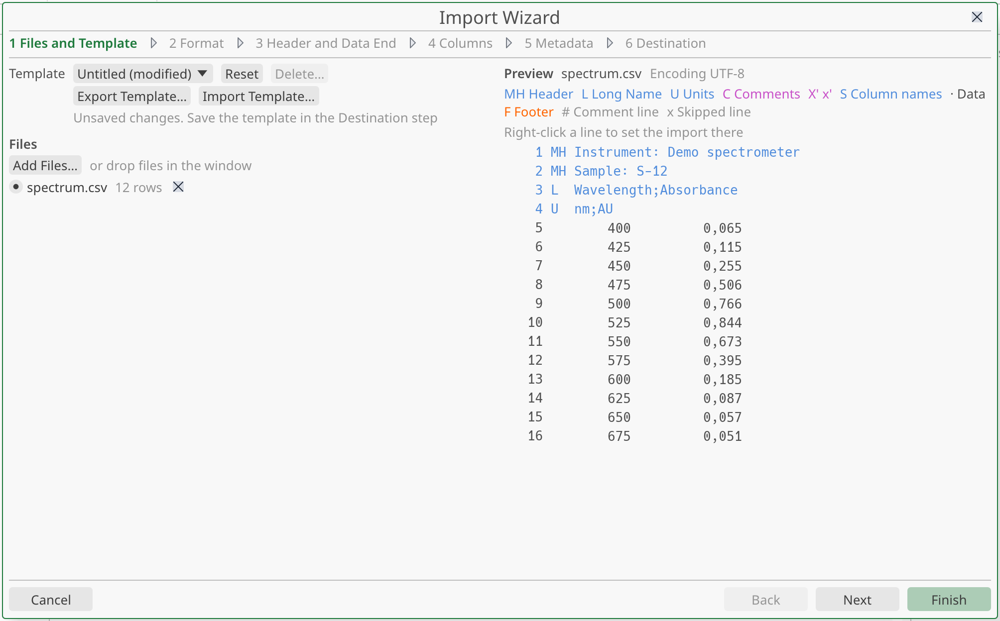
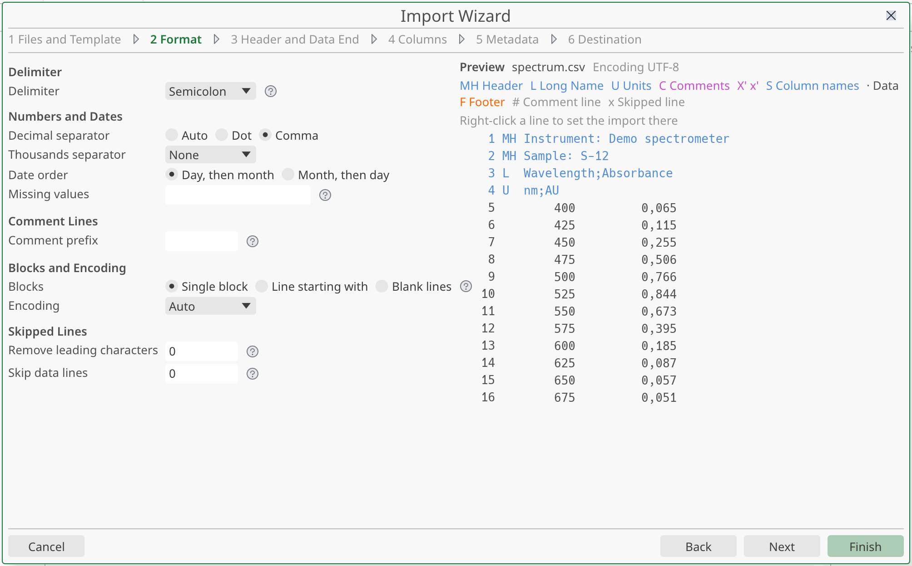
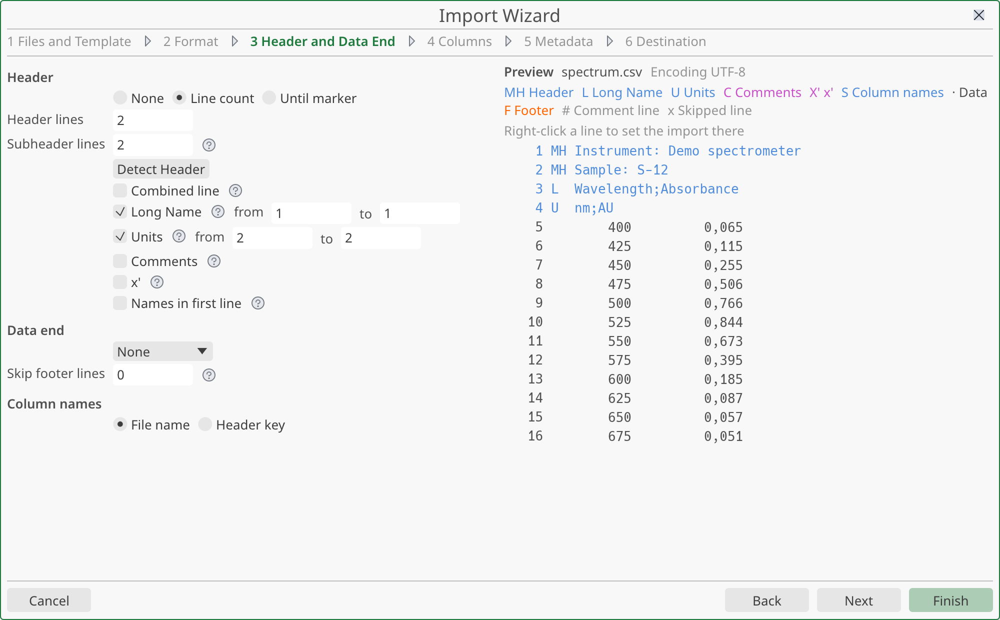
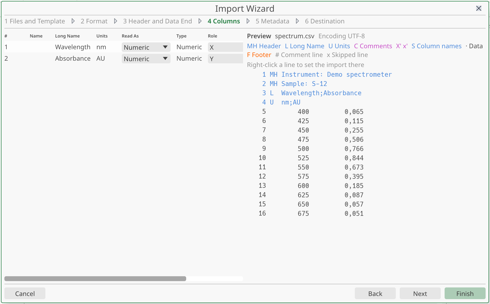
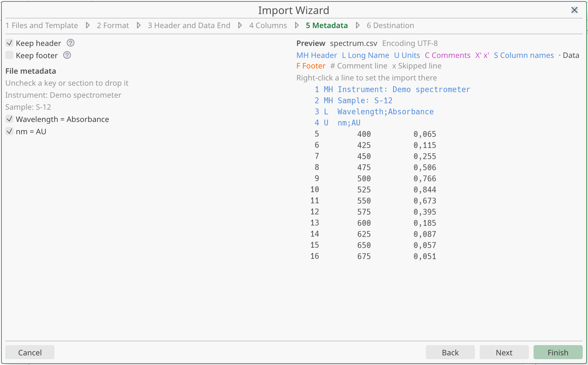
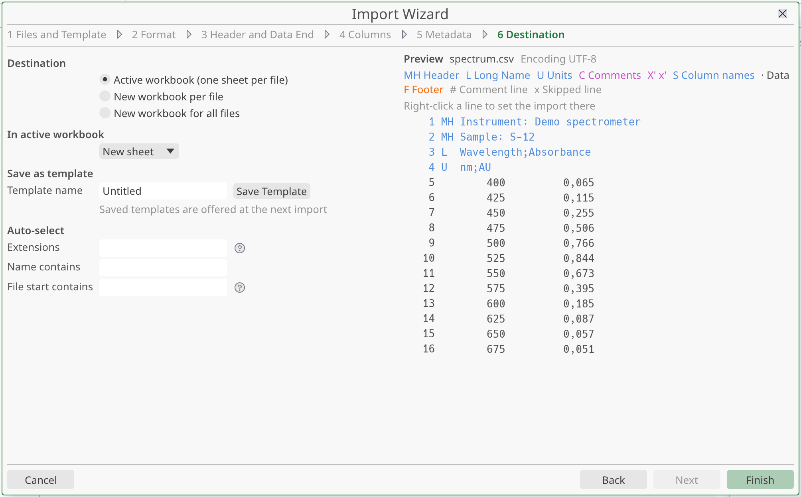

# Importing data

This page explains how to bring instrument files into a project. You use the **Import Wizard** to tell StokesForge how a file is laid out: delimiter, decimal separator, header lines, columns. A live preview shows the result as you change each setting.

You can import several files at once. You can also save your settings as a template and reuse it for every file from the same instrument.

## What you can import

StokesForge reads **delimited text files**: CSV, TXT, ASC, and any other text export from an instrument. The file extension does not matter. The file picker shows all files.

It does not matter which instrument wrote the file. You describe the layout with the wizard settings. StokesForge has no built-in template for a given instrument. You save your own (see [Templates](#templates)).

A few things to know:

- Files can be encoded in UTF-8, UTF-16 or Windows-1252. The default **Auto** setting detects this.
- A binary file is refused with the message "The file is not readable text".
- An empty file is refused with "The file is empty".
- A column that mixes numbers and text is **not** an error. StokesForge keeps it, with the type **Mixed**.
- Project files (`.stf`) are never imported. If you drop one on the window, it opens as a project in a new window.

## Open the Import Wizard

You have three ways to start an import.

### From the menu

1. Choose **File ▸ Import ▸ Import…**.
2. In the first step, click **Add Files…** and pick one or more files.
3. Check the preview, adjust the settings if needed, then click **Finish**.

The shortcut is <kbd>Ctrl</kbd>+<kbd>"</kbd>. On an AZERTY keyboard, press <kbd>Ctrl</kbd>+<kbd>3</kbd> (the key that types `"`). On a QWERTY keyboard, press <kbd>Ctrl</kbd>+<kbd>Shift</kbd>+<kbd>'</kbd>.

### By dropping files

Drag files from your file manager onto the main window.

- StokesForge picks a template for each file. It uses the saved template that recognizes the file (see [Let a template pick itself](#let-a-template-pick-itself)). Otherwise it uses the template of the last import in this session. Otherwise it uses the default settings.
- The wizard does not open. The files are imported straight away.
- A message in the status bar names the template used.
- If a file gives no numeric value with these settings, the wizard opens instead, with the file already added, so you can fix the settings.

Where the data goes depends on where you drop:

- On an open workbook: one new sheet per file, in that workbook.
- Anywhere else (a graph, a note, a matrix, the Project Manager): a new workbook.

A drop always creates new sheets. It never replaces or extends a sheet.

If the wizard is already open, dropped files are added to its list.

### Reopen the last import

Choose **File ▸ Import ▸ Reopen Last Import…**. The wizard opens again with the same files and settings, so you can adjust and rerun.

If that import is still the last thing you did, StokesForge undoes it first. If you have done other work since, the previous import stays in place.

This entry is greyed out until you have finished an import.

## The wizard at a glance

The wizard is a window with six steps. The file preview stays on the right at every step.

| Step | What you set |
|---|---|
| 1. **Files and Template** | The files, and the template to start from |
| 2. **Format** | Delimiter, numbers, comments, blocks, encoding, skipped lines |
| 3. **Header and Data End** | Header lines, subheader lines, where the data stops, column names |
| 4. **Columns** | The role and the type of each column |
| 5. **Metadata** | The header and footer information to keep |
| 6. **Destination** | Where the data goes, and saving a template |

Use **Back** and **Next** to move between steps. **Cancel**, <kbd>Esc</kbd> or the close cross closes the wizard without importing.

**Finish** imports with the settings as they are. You do not have to visit every step. For a file format you already know, a template makes it two clicks: pick the file, click **Finish**. <kbd>Enter</kbd> also runs **Finish**.

## The live preview

The preview lists the lines of the file. Each line is coloured by its role, and a legend names the roles:

- **Header**: lines skipped or used for names, units and so on.
- **Data**: lines that become cells.
- **Footer**: lines after the end of the data.
- **Comment line**: lines that start with your comment prefix.
- **Skipped line**: data lines you chose to skip.

The preview updates as you change a setting. A line under the preview tells you how many data lines it shows, out of how many the file has.

If you add several files, each one appears in the list of step 1 with its number of rows, or with the reason it cannot be read. Select a file with its radio button to preview it. Click the cross to remove it.

### Set the import from the preview

You can right-click a line in the preview to set the import at that place. The menu offers:

- **Start Data Here**: the line becomes the first data line. The lines above it become the header.
- **Use as Units Line**: the line becomes the units line.
- **End Data Here**: the data stops at that line.
- **Disable Auto Data End**: turns off the automatic end of data.

**End Data Here** is available only on a data or footer line. **Disable Auto Data End** is available only while the automatic end is on.

These entries change the same settings you find in the steps below.

## Step 1: files and template

### Choose files

Click **Add Files…** and pick one or more files. You can also drop files into the window. **Recent Files…** lists the files you imported lately.

### Choose a template

The **Template** list holds the templates you saved. When the wizard opens, it starts on the first saved template. If you have saved none, it starts on a template called "Untitled" with permissive settings.

When you change a setting, the template name shows "(modified)", and a note says "Unsaved changes. Save the template in the Destination step".

| Button | What it does |
|---|---|
| **Reset** | Restarts from the default settings. Your files stay in the list. |
| **Delete…** | Deletes the saved template, after a confirmation. You cannot undo it. Available only for a saved template. |
| **Export Template…** | Saves the template to a JSON file you can give to a colleague. |
| **Import Template…** | Loads a template from a JSON file. |

## Step 2: format

### Delimiter

The **Delimiter** is the character that separates the values on a line.

| Choice | Use it when |
|---|---|
| **Auto** | StokesForge detects the delimiter from the first data line. This is the default. |
| **Comma** | Values are separated by `,`. |
| **Semicolon** | Values are separated by `;`. |
| **Tab** | Values are separated by a tab. |
| **Whitespace** | Values are separated by one or more spaces. |
| **Other** | Another character. Type it in the field that appears (for example `|` or `:`). |
| **Fixed width** | Columns have a set number of characters. Type the width of each column except the last, for example `10,8,8`. The last column takes the rest of the line. |

### Numbers and dates

| Setting | Choices |
|---|---|
| **Decimal separator** | **Auto**, **Dot**, **Comma** |
| **Thousands separator** | **None**, **Space**, **Comma**, **Dot**, **Apostrophe** |
| **Date order** | **Day, then month** (default), **Month, then day** |
| **Missing values** | A comma-separated list of words read as empty cells, such as `--, n/a, *, NaN` |

Some points to keep in mind:

- On a new template, **Decimal separator** starts on **Dot**. If your file writes `1,5`, choose **Comma** or **Auto**.
- With **Auto**, the decimal separator is a comma when a comma appears between two digits and the columns are separated by something else (a semicolon or a tab). Otherwise it is a dot.
- **Date order** matters for dates such as `03/04/2026`. Dates written `2026-04-03` are not affected.
- Without **Missing values**, a word like `n/a` makes the column **Mixed**. With it, the cell stays empty and the column stays numeric.
- **Whitespace** cannot be combined with **Space** as the thousands separator. A number such as `1 234,5` would be cut in two. The wizard shows a message. Choose another delimiter or another thousands separator.

### Comment lines

**Comment prefix** is a text such as `#`, `;` or `//`. Data lines that start with it are skipped. Leave it empty if the file has no comment lines.

### Blocks and encoding

**Blocks** is for a file that holds several data blocks, such as several spectra one after the other, each with its own header.

| Choice | Meaning |
|---|---|
| **Single block** | The whole file is one block. This is the default. |
| **Line starting with** | A new block starts at each line that begins with the text you type (for example `TITLE`). |
| **Blank lines** | Blocks are separated by empty lines. |

Each block is read with the same settings, header included. Each block becomes its own sheet, or is spread according to the choice in [Several files](#several-files). The preview shows the first block and tells you how many blocks there are.

**Encoding** is **Auto** by default. Choose another value only if accented characters look wrong: **UTF-8**, **Windows-1252**, **ISO 8859-1**, **UTF-16 LE** or **UTF-16 BE**.

With **Auto**, a file that is almost UTF-8 is read as UTF-8, and each invalid byte is read as Windows-1252. In rare cases, a Windows-1252 file contains two bytes that look like a UTF-8 letter, and shows `é` instead of `é`. Choose **Windows-1252** to fix it.

### Skipped lines

| Setting | Effect |
|---|---|
| **Remove leading characters** | Removes this many characters at the start of every data line. Some instruments write a fixed prefix. |
| **Skip data lines** | Ignores this many lines at the start of the data, after the header. |

## Step 3: header and data end

### Header

The header is the group of lines at the top of the file that is not data. Choose how StokesForge finds it with **Header**:

| Choice | Meaning |
|---|---|
| **None** | The file has no header. The data starts on the first line. |
| **Line count** | The header has a fixed number of lines. Set **Header lines**. |
| **Until marker** | The header ends at the line equal to the **Marker** text you type. That line is skipped too. |

Click **Detect Header** to let StokesForge count the header and subheader lines from the file. It needs a file in the list.

### Subheader lines

A subheader is the last part of the header: the lines that give a name, units or comments for each column. When you choose **Line count**, set **Subheader lines**. These lines are counted in the header lines.

Then tell StokesForge what each subheader line holds. Each of these roles has a checkbox and a range of lines, **from** and **to**, counted inside the subheader block:

| Role | The lines give… |
|---|---|
| **Long Name** | The long name of each column |
| **Units** | The units of each column |
| **Comments** | The comments of each column |
| **x'** | The x' value of each column, such as the time of a spectrum in a kinetic series |

Check **Combined line** when the long name and the units share one line, written like `Absorbance (a.u.)`. The text in parentheses becomes the unit, and the rest becomes the long name. The **Units** role then disappears, because the **Long Name** line carries both.

### Names in first line

Check **Names in first line** when the first data line gives the column names. Those names become the column names.

### Column names

If **Names in first line** is not checked, you choose where the name of each series comes from:

- **File name**: the name of the file, without its extension. This is the default.
- **Header key**: a value read from the header. Type the **Key**. StokesForge looks for a header line of the form `KEY<delimiter>VALUE` and uses the value.

This section is greyed out while **Names in first line** is checked. Your choices are kept for later.

### Data end

**Data end** tells StokesForge where the data stops. The lines after it form the footer. They are not imported as data, but you can keep them as metadata.

| Choice | The data stops… |
|---|---|
| **None** | At the end of the file. This is the default. |
| **Auto** | At the first line whose X value is not a number (see below). |
| **First blank line** | At the first empty line. |
| **End marker** | At the first line equal to the text you type. That line is excluded. |
| **Lines after header** | After the number of data lines you type. |
| **Lines before end** | Before the last lines of the file. You type how many. |

**Auto** starts counting once it has met a first numeric X value. It stops at the first line where X is not a number, empty lines included. Text lines before the first number are kept, and text in a Y column does not stop it.

**Auto** is not the default for a reason. A single missing measurement such as `n/a` in the X column stops the reading, and all the lines after it are lost. Use **Auto** only for a device that writes a footer.

**Skip footer lines** removes a fixed number of lines at the end of the file. It applies before **Data end**.

## Step 4: columns

This step shows the result, column by column: what StokesForge read from the header, how it reads the values (**Read As**), what it found (**Type**, **Numeric** or **Mixed**), the **Role** of the column and a few sample values.

By default, the first column is **X** and the following ones are **Y**. Choose **None** to leave a column out of the import.

Use **Read As** to force how a column is read:

- **Numeric**: numbers. A value that is not a number is kept as text, and the column becomes **Mixed**.
- **Text**: every non-empty value is kept as is, even if it looks like a number. Use it for sample codes and identifiers.
- **Date/Time**: values are read as dates and times. A value that is not a date stays text.

If the table is empty, the step says "Choose a file in step 1". Add a file first.

## Step 5: metadata

A file often starts with information about the measurement: the date, the instrument, the sample. StokesForge can keep it as metadata of each imported column.

- **Keep header**: keeps the header lines. This is on by default.
- **Keep footer**: keeps the footer lines. This is off by default.

The **File metadata** list shows every key and section found in the file. Uncheck a key or a section to drop it.

## Step 6: destination

### Where the data goes

Choose the **Destination**:

| Choice | Result |
|---|---|
| **Active workbook (one sheet per file)** | The data goes into the workbook in front. Greyed out if no workbook is open. |
| **New workbook per file** | Each file gets its own new workbook. |
| **New workbook for all files** | One new workbook holds all the files. |

When you choose the active workbook, **In active workbook** adds four modes:

| Mode | Result |
|---|---|
| **New sheet** | A new sheet is added. This is the default. |
| **Replace active sheet** | The content of the active sheet is replaced. |
| **Add columns to active sheet** | The columns are added after the existing ones. |
| **Add rows to active sheet** | The rows are added below. Column *j* of the file extends column *j* of the sheet. |

By default, the sheet takes the name of the file, without its extension. With a **Header key**, it takes the value of that key.

The whole import is a single entry in the history: one **Undo** removes it.

### Several files

When you import more than one file, **Multiple files** appears:

| Choice | Result |
|---|---|
| **One sheet per file** | Each file gets its own sheet. This is the default. |
| **One sheet, side by side (X Y X Y…)** | All files in one sheet, each with its own X and Y columns. |
| **One sheet, X of first file shared** | One X column from the first file, then the other columns of every file. |

Use the second or third choice to plot several spectra from one sheet.

### Save as template

To reuse your settings, save them as a template:

1. Type a **Template name**.
2. Click **Save Template**.

Saved templates are offered at the next import, in the **Template** list of step 1.

### Let a template pick itself

The **Auto-select** section lets StokesForge choose this template for a file that matches every criterion you fill in:

| Criterion | Example |
|---|---|
| **Extensions** | `csv, txt, asc` |
| **Name contains** | `uvvis` |
| **File start contains** | A signature near the top of the file, such as `ORIGIN;JASCO` |

Leave a criterion empty to ignore it. If you leave all three empty, the template is never chosen automatically.

This is what makes drag and drop work well. Save a template for each instrument with a signature, and any file of that kind imports with the right settings.

## Templates

A template stores all the settings of the wizard under a name. To sum up the actions:

- **Create**: set up the wizard, then **Save Template** in step 6.
- **Reuse**: pick it in the **Template** list of step 1.
- **Update**: change its settings, then save it again under the same name.
- **Share**: **Export Template…** writes a JSON file. A colleague loads it with **Import Template…**.
- **Delete**: **Delete…** in step 1.

StokesForge has no built-in template. The first time you import a file from an instrument, set the wizard up, then save it.

## Import progress

An import runs in the background. For long files, the status bar shows "Importing… *k* of *n* files" with a **Stop** button. If you stop it, nothing is imported.

A message at the end tells you how many files were imported. If some failed, the message gives the reason for each. Files that did import are kept.

You cannot start a second import while one is running.

## Refresh from the source files

Each imported column remembers the file it came from and the settings used. When the file changes, for example after a new measurement run, you can read it again:

1. Click a sheet with imported columns.
2. Choose **File ▸ Import ▸ Refresh from Source**.

The values are rewritten in place. The columns keep their identity, so graphs that use them stay valid. The number of rows follows the longest of the new contents. It shrinks only if all the columns of the sheet are refreshed.

The entry is greyed out when no column of the sheet comes from a file.

## Common problems

### A column is read as text

A column becomes **Mixed** or **Text** when some values are not numbers. Check these, in this order:

1. **Decimal separator.** If the file writes `1,5`, the decimal separator must be **Comma** or **Auto**. With **Dot**, `1,5` is not a number.
2. **Delimiter.** If the delimiter is wrong, whole lines end up in one column. Look at the preview and choose the right one.
3. **Thousands separator.** If the file writes `1 234.5`, set **Thousands separator** to **Space**. Use a delimiter other than **Whitespace**.
4. **Missing values.** If the file writes `n/a` or `--` for a missing value, list it in **Missing values**.
5. **Header lines.** If the header lines are counted as data, they make the column **Mixed**. In step 3, set the header with **Line count** or **Until marker**, or click **Detect Header**.
6. **Read As.** Check that the column is not set to **Text** in step 4.

### Everything is in one column

The delimiter is wrong. In step 2, choose the right **Delimiter**. If the file uses `,` as the decimal separator and `;` between columns, choose **Semicolon**.

### The column names are the first row of data

In step 3, check **Names in first line**, or set the header so the name line is part of it.

### Units and long names are missing

In step 3, set **Header** to **Line count**, set the **Subheader lines**, and check the **Long Name** and **Units** roles with their line numbers.

### The data stops too early

Look at **Data end** in step 3. With **Auto**, one non-numeric X value ends the data. Choose **None**, or **End marker** with the text that really closes the data.

### The data does not stop

The footer is read as data. In step 3, choose **First blank line**, **End marker** or **Auto**. Or right-click the first footer line in the preview and choose **End Data Here**.

### Accented characters look wrong

In step 2, set **Encoding** to **Windows-1252** or **UTF-8**.

### "No data found after the header"

The header takes more lines than the file has data. Check the number of header lines in step 3.

### The file is refused

"The file is not readable text" means the file is binary. StokesForge cannot import binary formats. Export a text version from the instrument software.
