# The main window

This page describes the main window of StokesForge: its zones, how its windows behave, how to undo a mistake, and how to change the interface language and the other preferences.

Everything you do in a project (workbooks, graphs, notes) appears in this window. You can also move panels and windows out into separate windows, for example to use a second screen.

## The zones of the window

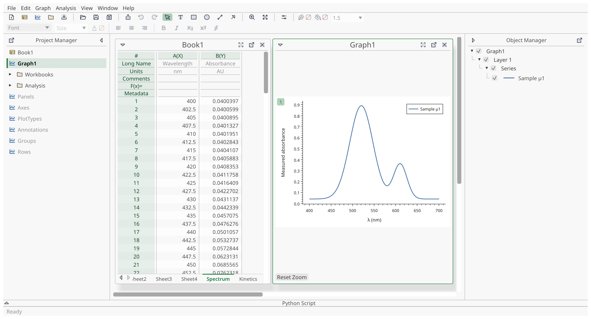

| Zone | What it does |
|---|---|
| Menu bar | All commands, grouped in menus |
| Toolbars | Icon buttons for common commands |
| **Project Manager** | Tree of the folders and windows of the project |
| Workspace | Your open workbooks, graphs and notes |
| **Object Manager** | Objects of the active graph |
| **Python Script** | Script console |
| Status bar | Last message, progress of long work |

The title bar of the application window shows the name of the project. A dot after the name (**My project • — StokesForge**) means the project has changes that are not saved. A new project is called **Untitled project**.

### Menu bar

| Menu | Content |
|---|---|
| **File** | **New** (**New Project**, **Add Workbook**, **Add Graph**, **Add Folder**), **Import**, **Open…**, **Save**, **Save As…**, **Language**, **Preferences…**, **Quit** |
| **Edit** | **Undo**, **Redo**, **Select All**, **Selection** |
| **Workbook** | Commands for the active workbook: sheets, columns, plot, header rows. Shown only when a workbook is in the foreground |
| **Graph** | Commands for the active graph. Shown only when a graph is in the foreground |
| **Analysis** | Baselines, fits, peaks and other calculations (see [Analysis](analysis.md)) |
| **View** | Display settings of the Object Manager |
| **Window** | **Maximize Window**, **Detach Project Manager** |
| **Help** | **Keyboard Shortcuts…**, **About StokesForge** |

A menu entry that cannot be used now is greyed out. Hover over it to read the reason.

When one menu is open, move the pointer over another menu title to open that one without clicking.

The **Workbook** menu is covered in [Projects and workbooks](projects-and-workbooks.md), the **Graph** menu in [Graphs](graphs.md), and the **Analysis** menu in [Analysis](analysis.md).

### Toolbars

The toolbars sit under the menu bar. Their content and place are fixed: you cannot move or hide them. Hover over a button to see its name, its shortcut and a short description. A button that cannot be used now is greyed out; hover over it to read the reason.

#### File toolbar

| Icon | Button | What it does |
|---|---|---|
| 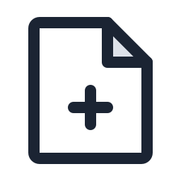 | **New Project** | Creates an empty project in this window |
| 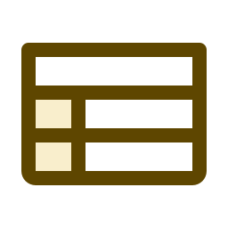 | **Add Workbook** | Adds a workbook with X and Y columns |
|  | **Add Graph** | Adds an empty graph with one plot area |
| 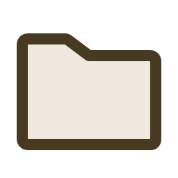 | **Add Folder** | Adds an empty folder, then lets you name it |
|  | **Import…** | Reads instrument files into sheets |
|  | **Open…** | Opens a project |
|  | **Save** | Saves the project |
|  | **Save As…** | Saves the project under another name |
|  | **Export Graph…** | Exports the graph in SVG, PDF or PNG, at the current zoom. Available when a graph is in the foreground |

#### Edit toolbar

| Icon | Button | What it does |
|---|---|---|
| 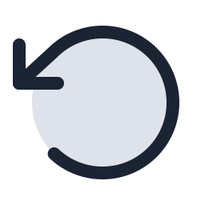 | **Undo** | Undoes the last change. The tooltip names it, for example **Undo Edit Cells in Column A** |
|  | **Redo** | Does it again. The tooltip names the change |

#### Tools toolbar

This toolbar follows the window in the foreground. With a graph in the foreground:

| Icon | Button | What it does |
|---|---|---|
|  | **Pointer** | Moves and resizes texts and objects |
|  | **Text** | Click in the plot area to add a text |
|  | **Rectangle** | Drag in the plot area to draw a rectangle |
|  | **Ellipse** | Drag in the plot area to draw an ellipse |
|  | **Line** | Drag in the plot area to draw a line |
|  | **Arrow** | Drag in the plot area to draw an arrow; the head is where you release |
|  | **Zoom** | Drag a rectangle to zoom in on it |
|  | **Reset Zoom** | Returns to the original axis ranges |
|  | **Graph Properties…** | Edits the title and background |

At the right of these, three controls format the selected object, and stay greyed out until you select one:  **Line color**,  **Fill color** (for a rectangle or an ellipse) and the field **Line width (pt)**.

With a workbook in the foreground:

| Icon | Button | What it does |
|---|---|---|
| 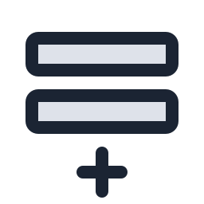 | **Add Sheet** | Adds a sheet to the workbook |
| 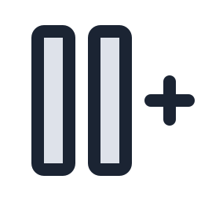 | **Add Column** | Adds a column to the sheet |
|  | **Line** | Plots the selected columns in a new graph |
|  | **Scatter** | Plots the selected columns in a new graph |
| 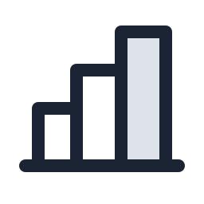 | **Bar** | Plots the selected columns in a new graph |

The three plot buttons are greyed out until you select columns in the sheet.

#### Text format toolbar

Its buttons format the text of a graph. They are greyed out until a text is selected or being edited.

| Icon | Button | What it does |
|---|---|---|
| | **Font** | Sets the font of the whole text box (a list) |
| | **Size** | Sets the size, in points, of the selected text (a list) |
|  | **Text color** | Sets the color of the text |
|  | **Left** | Aligns the text to the left of its box |
|  | **Center** | Centers the text in its box |
|  | **Right** | Aligns the text to the right of its box |
|  | **Bold** | Makes the selected text bold; press again to remove it |
|  | **Italic** | Makes the selected text italic; press again to remove it |
|  | **Subscript** | Lowers the selected text |
|  | **Superscript** | Raises the selected text |
|  | **Math** | Writes the selected text as math |

### Project Manager

The **Project Manager** shows the folders and windows of your project: workbooks, graphs, matrices and notes. Each kind has its own icon, which you meet again in other lists:

| Icon | Kind |
|---|---|
|  | Folder |
|  | Workbook |
|  | Graph |
| 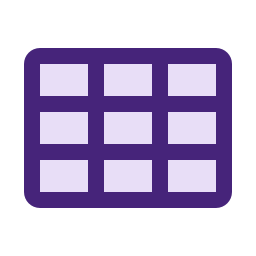 | Matrix |
|  | Note |

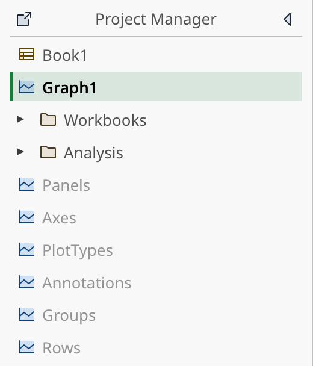

- Click a window to open it, or to bring it to the front if it is already open.
- A window that is closed is shown dimmed. Click it to open it again.
- Click a folder to select it and open it. Double-click it, or click its triangle, to close it.
- <kbd>Ctrl</kbd>+click adds or removes an entry from the selection. <kbd>Shift</kbd>+click selects a range.
- <kbd>↑</kbd> and <kbd>↓</kbd> move the selection. <kbd>Enter</kbd> opens the selected windows.
- Right-click an entry for **Open**, **Close**, **Copy**, **Paste**, **Rename**, **Duplicate** and **Delete**. These are also in **Edit ▸ Selection**.
- <kbd>F2</kbd> renames the selected entry. <kbd>Ctrl</kbd>+<kbd>D</kbd> duplicates it.

Clicking a window in the workspace also selects it in the Project Manager.

See [Projects and workbooks](projects-and-workbooks.md) for how to create, rename and delete these objects.

### Object Manager

The **Object Manager** lists what the active graph contains: layers, series, axes and free objects. It follows the graph in the foreground. When no graph is active it says so. See [Graphs](graphs.md) for what you can do there.

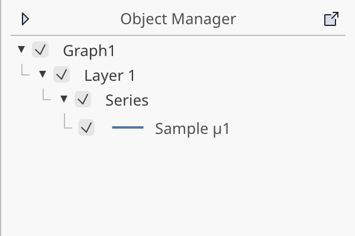

Its display can be adjusted in **View ▸ Object Manager**:

- **Show Axes** lists the axes of each layer. They are not listed by default.
- **Show Objects** lists the free texts and shapes. They are listed by default.
- **Expand by Default** sets whether new groups start open. It has one check box per kind of group: **Graph**, **Layers**, **Plot groups**, **Axes** and **Objects**. Groups you have already opened or closed keep their state.
- **Reset Settings** restores the defaults.

You can also right-click the empty background of the Object Manager to reach the same settings.

### Python Script panel

The **Python Script** panel at the bottom is the script console. You write a script, then click **Run**; **Stop** interrupts it. See [The script console](../scripting/console.md).

### Status bar

The status bar shows the last message: what was saved or loaded, a warning, or an error. An information message disappears after a few seconds; a warning or an error stays until the next message. **Ready** is shown when there is no message.

Click the status bar to open the list of the last 50 messages.

During long work (an import, a recalculation), the status bar shows its progress and a **Stop** button.

When some calculations fit the data poorly, a badge such as **⚠ 3 low R²** appears at the right end. Click it to list them.

## Windows in the workspace

Workbooks, graphs and notes open as windows inside the workspace. Each window has a title bar:

- Drag the title bar to move the window. Drag an edge or a corner to resize it.
- The arrow at the left of the title ( **Hide the graph contents** or **Hide the workbook contents**) collapses the window to its title bar. The same arrow, pointing right (), shows it again.
- The icons at the right maximize the window (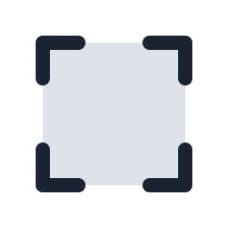 **Maximize the window**), detach it ( **Detach into a separate window**), or close it ( **Close the window**).
- A new window opens slightly offset from the previous one.

Closing a window does not delete anything. The workbook, graph or note stays in the project, and you reopen it from the Project Manager.

The position and size of your windows are saved in the project file.

The workspace has a fixed size. If the main window is smaller, the workspace scrolls.

### Maximize and restore

Click  **Maximize the window** in a window's title bar, or choose **Window ▸ Maximize Window**, to make the active window fill the workspace. The panels stay visible.

To go back, choose **Window ▸ Restore “…”** (it shows the name of the window).

## Panels

The Project Manager, the Object Manager and the Python Script panel are fixed to the left, right and bottom of the window. They cannot be moved to another side. You can change each panel in two ways, with the small icons in its header.

You can drag the inner edge of a panel to change its width (side panels) or its height (console).

### Collapse a panel

Click the arrow icon (   **Collapse the panel**) to reduce a panel to a thin band. The arrow points toward the edge where the panel goes. Click the arrow again (**Expand the panel**) to open it. A collapsed panel keeps its content and keeps working: a script that is running goes on.

### Detach a panel into its own window

Click  **Detach into a separate window** in the header of a panel to move it to its own window. Use this to put the Project Manager or the Object Manager on a second screen. The panel must be expanded to show this icon.

The detached window can be moved and resized like any other window of your system. It has one button,  **Reattach to the main window**. Closing the window also reattaches the panel.

StokesForge remembers your panels for the next launch: which ones are collapsed, which ones are detached, and the size and position of the detached windows. A detached panel comes back in its window only if your computer has the same number of screens as when you closed StokesForge. Otherwise it comes back attached to the main window, so that a window is never left on a screen that is gone. On Wayland, an application cannot choose where a window opens: the detached window comes back with its size and your system places it.

You can detach the Project Manager from the menu too: **Window ▸ Detach Project Manager**, then **Window ▸ Reattach Project Manager**.

A detached panel stays up to date with the project and works as before. The Object Manager follows the graph in the foreground, also when that graph is itself detached.

## Detach a workbook, graph or note

Click  **Detach into a separate window** in the window's title bar to move that window out of the main window into its own window. This is useful for a graph on a second screen while you edit data on the first.

The detached window has the same content and the same menus as before. Use its  **Reattach to the main window** icon to put it back. If you close it, the window is closed like any other and you reopen it from the Project Manager.

You can detach several windows at the same time.

What follows a detached window:

- The data and the undo history stay the same: you work on the same project. Undo and redo apply to the whole project, wherever the change was made.
- A cell or a text being edited in a detached window is its own input. Confirm it before you reattach the window.
- The toolbars and the menu bar remain in the main window.
- Which windows are detached is not saved. When you open the project again, its windows are back in the main window.

Dropping files on a detached workbook imports them into that workbook.

## Undo and redo

Every change to the project can be undone: editing a cell, adding or deleting a column, a sheet or a window, changing a graph, running an analysis, an import.

- **Edit ▸ Undo** or <kbd>Ctrl</kbd>+<kbd>Z</kbd> undoes the last change.
- **Edit ▸ Redo**, <kbd>Ctrl</kbd>+<kbd>Y</kbd> or <kbd>Ctrl</kbd>+<kbd>Shift</kbd>+<kbd>Z</kbd> does it again.

On macOS, use <kbd>Cmd</kbd> in place of <kbd>Ctrl</kbd>.

The menu entry and the toolbar tooltip name the action: for example **Undo Edit Cells in Column A**. When nothing can be undone, the entry is greyed out with the reason **Nothing to undo**.

An action made of several steps, such as an import or a paste, is undone in one go.

Some settings are not part of the history: the width of a column and everything in **Preferences**.

Because deleting is undoable, StokesForge does not ask for confirmation before deleting a sheet, a column or a window. Press <kbd>Ctrl</kbd>+<kbd>Z</kbd> if you did not mean it.

The history is not saved in the project file. It starts empty when you open a project.

## Language and preferences

### Change the interface language

StokesForge speaks English and French.

1. Choose **File ▸ Language**.
2. Pick **English** or **Français**.

The whole interface changes at once and the choice is remembered. You can also set it in **File ▸ Preferences… ▸ General**.

### Preferences

Choose **File ▸ Preferences…** to open the **Preferences** window. It sets the application, not the project. The settings apply as soon as you change them. Close the window when you are done.

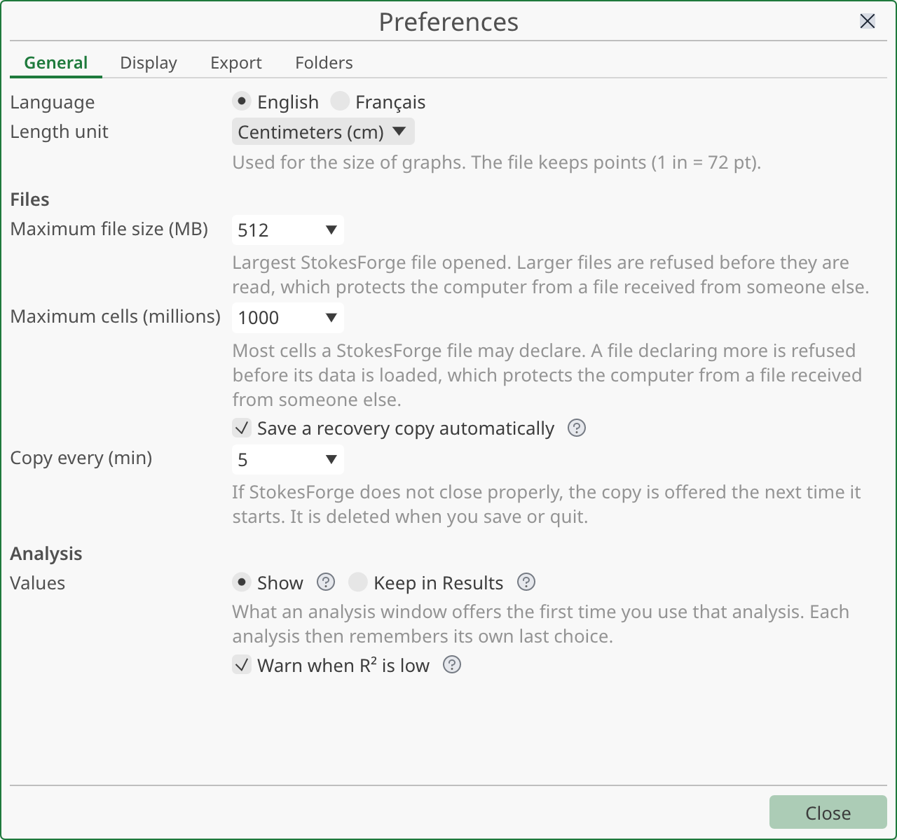

The rubrics (**General**, **Display**, **Export** and **Folders**) are listed across the top of the window:

- **General**
  - **Language**.
  - **Length unit**: **Centimeters**, **Millimeters**, **Points** or **Inches**, used for the size of graphs (see [Graph size](graphs.md#graph-size)). Files keep points whatever you choose.
  - **Maximum file size (MB)** and **Maximum cells (millions)**: the largest project StokesForge agrees to open. A bigger file is refused before it is read, which protects your computer from a file you received. Raise a limit here if you must open a large project.
  - **Save a recovery copy automatically** and **Copy every (min)**: see [Recovery copies](projects-and-workbooks.md#recovery-copies).
  - **Analysis**: **Values** sets whether an analysis window starts on **Show** or on **Keep in Results** the first time you use that analysis (see [Analysis](analysis.md)). **Warn when R² is low** opens a dialog after a calculation when R² is below 0.6.
- **Display** has three tabs listed at the left of its page:
  - **Interface**: **Show formula syntax help** shows or hides the small help icon next to the text fields that accept a formula. It is shown by default. If the field has its own hint, a plain **?** icon stays.
  - **Object Manager**: the same settings as **View ▸ Object Manager** (see [Object Manager](#object-manager)): **Show Axes**, **Show Objects**, the groups to expand by default and **Reset Settings**.
  - **New**: what a **new** workbook or graph starts with. **Show Metadata Row** and **Show x' Row** set the header rows of new workbooks (see [Header rows](projects-and-workbooks.md#header-rows)). **Decimal comma on tick labels** makes new graphs write 1,5 instead of 1.5. Each graph can then change its own, and graphs that already exist do not change.
- **Export**
  - **SVG Text** and **PNG Resolution**: the same choices as in **Graph ▸ Export** (see [Export](export.md)). The resolution is remembered for the next sessions.
  - **Copy Graph**: the formats (SVG, PNG, PDF) offered together when you copy a graph to another application, and their order. Drag a row to reorder.
- **Folders**
  - **Configuration folder**: where StokesForge keeps your settings, saved colors and import templates. **Open Folder** shows it in your file manager (and creates it if it does not exist yet), and the list names the files it holds. Your projects are not stored there.
  - **Recovery copies**: the folder of the recovery copies, which is outside the configuration folder.
  - **Default folders**: **Open and Save**, **Import files** and **Export graphs**. Type a path and press <kbd>Enter</kbd>, or click **Browse…**. Leave a field empty to keep the old behavior.

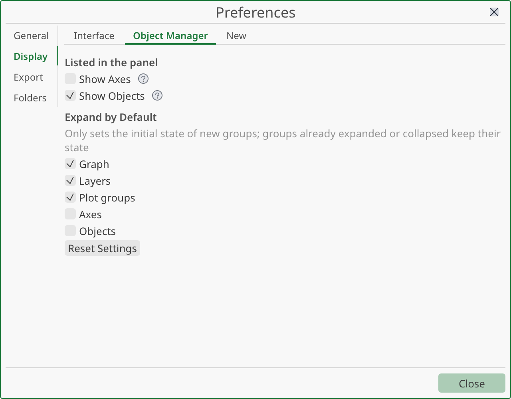

#### Default folders

A file window starts in the default folder of its kind the first time you use it in a session. After that it starts in the last folder you used for that kind. The next time you start StokesForge, it starts again from the default.

- **Open and Save** serves **File ▸ Open…** and **File ▸ Save As…**. **Save As** of a project that already has a file starts in that file's own folder.
- **Import files** serves the wizard's **Add Files…** and the export and import of templates. Without a default, it starts in the folder of the last file you imported.
- **Export graphs** serves **Graph ▸ Export ▸ Export Graph…**.

Only the file windows count. Dropping a file or opening one from a list of recent files does not change the last folder. If you change a default during a session, the last folder of that kind is forgotten and the next window opens in the new default.

If a folder no longer exists, StokesForge uses the last folder instead, without a message. The page shows **Folder not found** under the field so that you can fix it.

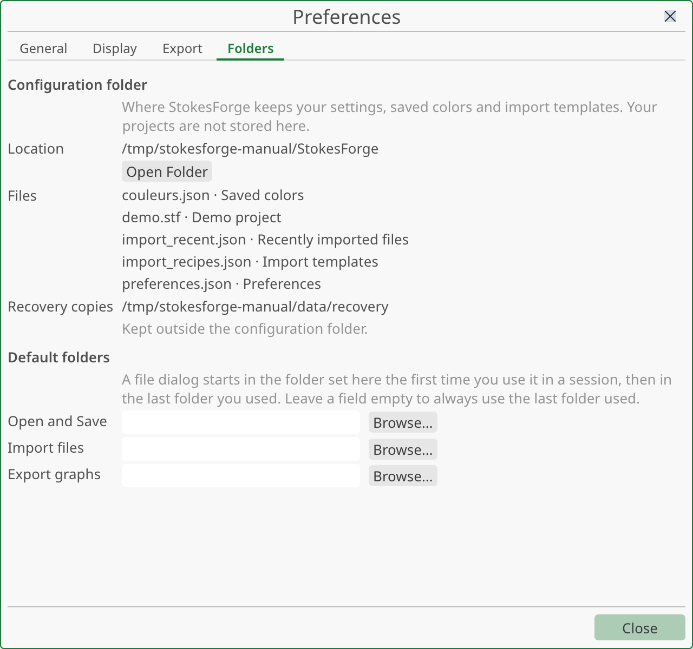

## Keyboard shortcuts

Choose **Help ▸ Keyboard Shortcuts…** to list the shortcuts of the application; the full list is on the [Shortcuts](../reference/shortcuts.md) page. The main ones:

| Action | Shortcut |
|---|---|
| New project | <kbd>Ctrl</kbd>+<kbd>N</kbd> |
| Open a project | <kbd>Ctrl</kbd>+<kbd>O</kbd> |
| Save | <kbd>Ctrl</kbd>+<kbd>S</kbd> |
| Save as | <kbd>Ctrl</kbd>+<kbd>Shift</kbd>+<kbd>S</kbd> |
| Export the graph | <kbd>Ctrl</kbd>+<kbd>E</kbd> |
| Undo | <kbd>Ctrl</kbd>+<kbd>Z</kbd> |
| Redo | <kbd>Ctrl</kbd>+<kbd>Y</kbd> or <kbd>Ctrl</kbd>+<kbd>Shift</kbd>+<kbd>Z</kbd> |
| Run the script | <kbd>Ctrl</kbd>+<kbd>Enter</kbd> |
| Rename in a manager | <kbd>F2</kbd> |
