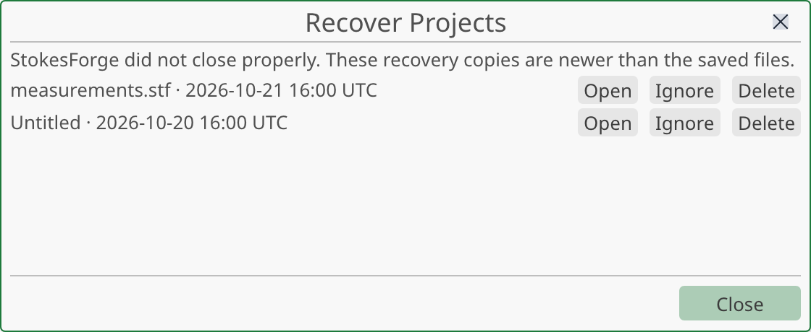
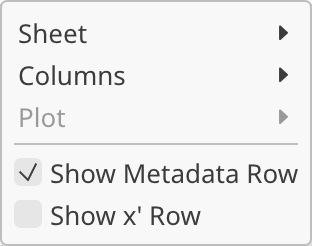
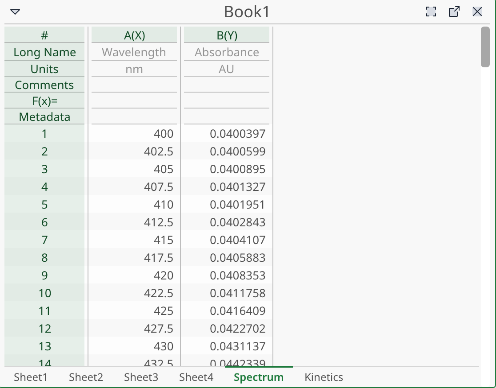
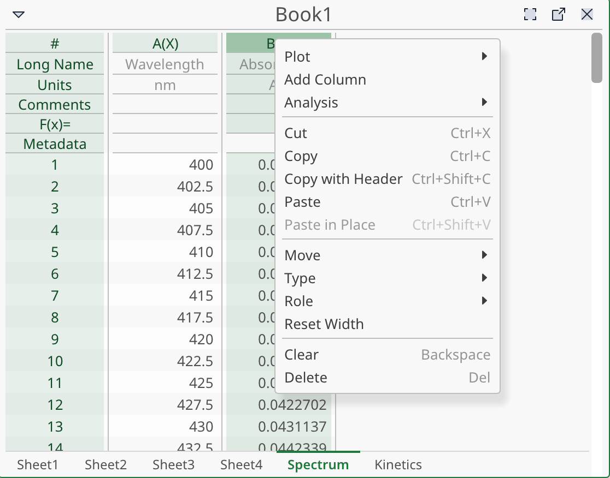
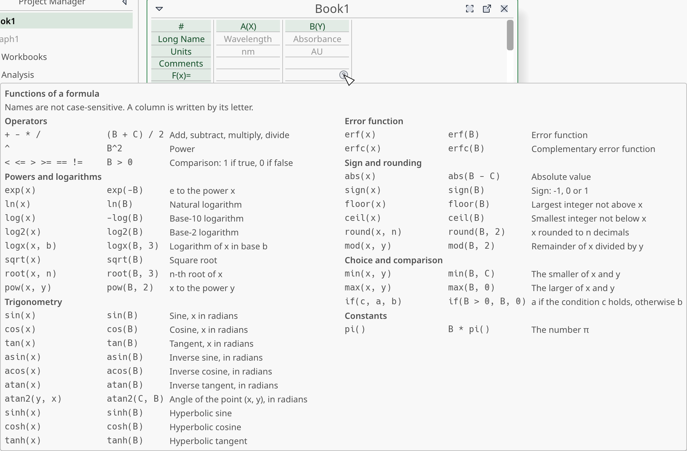

# Projects and workbooks

This page covers the project file, how to organise it with folders, and how to work with workbooks: sheets, columns, cells, copy and paste, and columns computed by a formula.

To bring instrument files into a workbook, see [Importing data](import.md).

## Projects

A project holds everything you work on: workbooks, graphs, notes, folders and the results of your analyses. It is saved as one file with the extension `.stf`. One StokesForge window holds one project.

### Create a new project

Choose **File ▸ New ▸ New Project** or press <kbd>Ctrl</kbd>+<kbd>N</kbd>. The current project is replaced by an empty one in the same window.

If the current project has unsaved changes, StokesForge asks what to do:

- **Save** saves the project, then goes on.
- **Discard Changes** goes on and loses the changes since the last save.
- **Cancel** (or <kbd>Esc</kbd>) keeps the project open.

A project that is still empty is replaced without a question.

### Open a project

Choose **File ▸ Open…** or press <kbd>Ctrl</kbd>+<kbd>O</kbd>, then pick a `.stf` file. The window starts in the default folder set in **File ▸ Preferences… ▸ Folders** the first time, then in the last folder you used. The project replaces the current one, after the same question about unsaved changes.

You can also drop a `.stf` file on the StokesForge window. It opens in a new StokesForge window and leaves your current project as it is.

If the file cannot be opened, a message says so and your current project stays unchanged.

StokesForge refuses to open a very large file, to protect your computer. The limits are set in **File ▸ Preferences… ▸ General** (**Maximum file size (MB)** and **Maximum cells (millions)**). The message names the setting to raise.

### Save a project

- **File ▸ Save** or <kbd>Ctrl</kbd>+<kbd>S</kbd> saves the project in its file. The first time, you choose where to save.
- **File ▸ Save As…** or <kbd>Ctrl</kbd>+<kbd>Shift</kbd>+<kbd>S</kbd> saves under a new name. If the file exists, StokesForge asks before it replaces it.

The title bar shows a dot after the project name while there are unsaved changes. If saving fails, a message explains why and your changes are kept.

**Save** is not available while a script is running.

The project file does not keep the undo history. See [The main window](interface.md#undo-and-redo).

StokesForge has no list of recent projects. Use **File ▸ Open…**.

### Recovery copies

By default, StokesForge writes a recovery copy of your project every 5 minutes while it has unsaved changes. The copy goes to a separate recovery folder. It never overwrites your file.

If StokesForge does not close properly (a crash, a power cut), the next start offers the copies that are newer than the saved file in a **Recover Projects** window. For each copy:

- **Open** opens the recovery copy. The list stays open for the others. Save the project to keep it.
- **Ignore** keeps the copy. It is offered again at the next start.
- **Delete** removes the copy. It asks for confirmation.

The copy is deleted when you save or quit normally.

To change this, choose **File ▸ Preferences… ▸ General**: **Save a recovery copy automatically** turns it on or off, and **Copy every (min)** sets the period.

## The Project Manager and folders

The **Project Manager** at the left shows the content of the project as a tree. See [The main window](interface.md#project-manager) for how to select and open entries.

Create objects from the **File ▸ New** menu or the **File** toolbar:

| Command | Creates |
|---|---|
| **Add Workbook** | A workbook with one sheet, with an X column and a Y column |
| **Add Graph** | An empty graph with one plot area |
| **Add Folder** | An empty folder at the root of the project |

A new workbook is named `Book1`, `Book2`… A new window opens in the foreground.

To create a folder inside another folder, right-click the folder in the Project Manager and choose **Add Folder**. The new folder opens with its name ready to edit.

Folders contain workbooks, graphs and other folders. Names must be unique inside a folder.

### Rename, duplicate and delete

Select one or more entries in the Project Manager, then use the right-click menu or **Edit ▸ Selection**:

| Command | Shortcut | What it does |
|---|---|---|
| **Rename** | <kbd>F2</kbd> | Edits the name in place. <kbd>Enter</kbd> confirms, <kbd>Esc</kbd> cancels. With several entries selected, you name them one after the other |
| **Duplicate** | <kbd>Ctrl</kbd>+<kbd>D</kbd> | Makes a copy named `… copy 1`, `… copy 2`… A copied graph keeps using the original data |
| **Delete** | <kbd>Del</kbd> | Removes the entries and closes their windows |
| **Copy** / **Paste** | <kbd>Ctrl</kbd>+<kbd>C</kbd> / <kbd>Ctrl</kbd>+<kbd>V</kbd> | Copies the entries, also to another project open in another window |

An empty name is refused and the previous name is kept.

A folder cannot be copied or duplicated; those entries are greyed out for a folder. To paste into a folder, select only that folder and choose **Paste**.

**Delete** asks no confirmation. If graphs used the deleted data, the status bar says so. Undo brings everything back. Undo does not reopen the windows.

## Sheets

A workbook holds one or more sheets. Click a sheet tab to show that sheet.

When there are more tabs than fit, **<** and **>** buttons appear at the left of the strip to show the hidden tabs.

| To… | Do this |
|---|---|
| Add a sheet | Click **Add Sheet** in the sheet tabs, or right-click the empty strip, or use **Workbook ▸ Sheet** |
| Rename a sheet | Double-click its tab, or right-click it and choose **Rename**. <kbd>Enter</kbd> confirms, <kbd>Esc</kbd> cancels |
| Duplicate a sheet | Right-click its tab and choose **Duplicate**, or press <kbd>Ctrl</kbd>+<kbd>D</kbd>. The copy is named `… copy 1` and is shown |
| Delete a sheet | Right-click its tab and choose **Delete** |

The same commands are in **Workbook ▸ Sheet**.

A sheet name cannot be empty and must be unique inside the workbook. A workbook always keeps at least one sheet: **Delete** is greyed out on the last one.

Deleting a sheet can be undone. If a graph plotted columns of that sheet, the status bar names it.

**Reset Column Widths** (in the same menu) puts every column of the sheet back to its default width.

## Columns

Each column has a letter (A, B, … Z, AA, AB…), a type and a role. The header above the data has four rows to describe the column.

### The column header

| Row | Content |
|---|---|
| Letter | The position of the column, followed by its role: `A(X)`, `B(Y)` |
| **Long Name** | A description of the column, for example `Wavelength` |
| **Units** | The unit of the values, for example `nm` |
| **Comments** | Free text |
| **F(x)=** | A formula that computes the column (see [Columns computed by a formula](#columns-computed-by-a-formula)) |

Double-click a header field, or select it and press <kbd>F2</kbd>, to edit it. <kbd>Enter</kbd> confirms.

Click a label at the left of the header (for example **Long Name**) to select that field for every column of the sheet.

#### Header rows

Two more rows can be shown above these four:

- **Metadata**: a summary of the information read from the imported file. Click it to list the keys (**File Metadata**).
- **x'**: a number attached to each column, for example the time of a measurement. It is used to plot rows.

Choose **Workbook ▸ Show Metadata Row** or **Workbook ▸ Show x' Row** to show or hide them in the active workbook. These choices apply to this workbook until you close StokesForge. The setting for new workbooks is in **File ▸ Preferences… ▸ Display ▸ New**.

### Add a column

Choose **Workbook ▸ Columns ▸ Add Column**, click **Add Column** in the **Tools** toolbar, or right-click the empty space at the right of the last column and choose **Add Column**. The new column goes at the end of the sheet. You can move it afterwards.

Pressing <kbd>Tab</kbd> in the last column of a row adds a new column and moves to it.

### Select columns

- Click the column letter to select the column.
- <kbd>Ctrl</kbd>+click adds or removes a column. <kbd>Shift</kbd>+click selects a range.
- Click the **#** cell at the top left, or press <kbd>Ctrl</kbd>+<kbd>A</kbd>, to select the whole sheet. Click it again to clear the selection.

*Right-click a column letter to open this menu. The other column commands below are in it.*

### Move columns

Select one or more columns, then choose **Move** in **Workbook ▸ Columns** or in the right-click menu of the column letter:

| Command | Effect |
|---|---|
| **Move to First** | Moves the selected columns to the start of the sheet, keeping their order |
| **Move Left** | Moves each selected column one place left |
| **Move Right** | Moves each selected column one place right |
| **Move to Last** | Moves the selected columns to the end of the sheet |

A command that would change nothing is greyed out. Columns move inside their sheet only.

Graphs that are already plotted do not change when you move a column. A formula keeps reading the same columns, and its letters in the **F(x)=** row follow the moved columns.

### Delete columns

Select the columns and right-click a letter, then choose **Delete**. Undo brings the columns back with their values.

### Column type

A column has a type. The grid shows it by alignment: numbers on the right, text on the left.

| Type | Holds |
|---|---|
| **Numeric** | Numbers. A cell may be empty |
| **Mixed** | Numbers, text and empty cells, each cell by itself |
| **Date/Time** | Dates and times, kept as numbers |

When you type text that is not a number into a **Numeric** column, the column becomes **Mixed**: the text is kept and the other numbers stay numbers. Undo restores the type and the value together. If you then overwrite all the text, the column returns to **Numeric**.

To change a type by hand, select the columns and choose **Type** in the right-click menu of the letter (or **Workbook ▸ Columns ▸ Type**), then **Numeric** or **Mixed**.

Converting to **Numeric** erases the cells that are not numbers. Undo brings them back.

### Column role

The role says what the column is used for when you plot. Select the columns, then choose **Role** in the right-click menu of the letter or in **Workbook ▸ Columns ▸ Role**:

- **X**, **Y**: the main X and Y.
- **X2**, **Y2**, **X3**, **Y3**, **X4**, **Y4**: the columns of the extra layers of a graph.
- **Z**.
- **X Error**, **Y Error**: error bars.
- **Label**.
- **None**.

The role is shown after the letter, for example `A(X)`. See [Graphs](graphs.md) for how the roles are used when you plot.

### Column width

Drag the right edge of a column letter to change the width. The width stays with the column when you add, delete or move other columns, and it is saved in the project.

To restore the default, right-click the letter and choose **Reset Width**. Changing a width cannot be undone.

## Cells

### Edit a cell

1. Click a cell to select it.
2. Type the new value, or press <kbd>F2</kbd> or double-click to edit the current value.
3. Press <kbd>Enter</kbd> to confirm, or <kbd>Esc</kbd> to cancel.

Use the arrow keys to move between cells. <kbd>Tab</kbd> moves to the next column. <kbd>Enter</kbd> on the last row of a column adds a row.

A decimal comma is accepted: `1,5` is read as 1.5. The status bar tells you when it did so. An empty cell is a missing value. Dates and times are read when the column is **Date/Time**.

### Select cells

- Drag to select a block.
- <kbd>Shift</kbd>+click extends the last block.
- <kbd>Ctrl</kbd>+click adds or removes a cell, and <kbd>Ctrl</kbd>+drag adds a block.
- Click a row number to select the whole row. Click a column letter to select the whole column.

### Clear and delete

| Key | Effect |
|---|---|
| <kbd>Backspace</kbd> | Clears the selected cells |
| <kbd>Del</kbd> | Clears the selected cells. Press it a second time on the same selection to delete them and move the cells below up |

The right-click menu has **Clear** and **Delete and Shift Up**. **Delete and Shift Up** acts at once. It is offered for a single block of cells.

### Copy and paste

| Command | Shortcut | What it does |
|---|---|---|
| **Cut** | <kbd>Ctrl</kbd>+<kbd>X</kbd> | Copies, then clears |
| **Copy** | <kbd>Ctrl</kbd>+<kbd>C</kbd> | Copies the selected cells |
| **Copy with Header** | | Copies the values and the column header |
| **Paste** | <kbd>Ctrl</kbd>+<kbd>V</kbd> | Pastes at the selected cell |
| **Paste in Place** | <kbd>Ctrl</kbd>+<kbd>Shift</kbd>+<kbd>V</kbd> | Pastes at the position the cells were copied from |

<kbd>Ctrl</kbd>+<kbd>Shift</kbd>+<kbd>C</kbd> copies the whole columns that the selection touches.

Copied cells are placed on the system clipboard as tab-separated text. You can paste them into a spreadsheet or a text editor, and paste from a spreadsheet into StokesForge.

A few rules:

- **Paste** needs a single block of cells or a run of contiguous columns as its target.
- **Copy** and **Cut** work on several blocks only if they share their rows (side by side) or their columns (stacked). Otherwise they are greyed out.
- Pasting over a **Mixed** column that ends up with only numbers turns it back to **Numeric**.
- If part of the pasted data does not fit, the status bar says how many columns or header fields were left out.

A paste is one action for Undo.

On macOS, use <kbd>Cmd</kbd> in place of <kbd>Ctrl</kbd>.

## Columns computed by a formula

A column can compute its values from other columns of the same sheet. Type the formula in the **F(x)=** row of the column.

For example, to fill column C with the sum of A and B, double-click the **F(x)=** cell of column C, type `A+B` and press <kbd>Enter</kbd>.

While you type, a small **?** icon appears just right of the cell, over the next column. Click it to open the **Formula Functions** window: the operators and functions you can use, one family at a time (pick the family in the tabs at the left), each with its signature, an example and what it does. Press <kbd>Esc</kbd> or **Close** to leave it.

If you misspell a function name, the message proposes the nearest one (`sqr(A)` gives "Did you mean sqrt?"), and a wrong number of values names the function to write instead (`log(B, 2)` gives "Use logx instead"). You can hide the icon in **Preferences ▸ Display ▸ Interface** (**Show F(x)= help**).

### Formula syntax

- Columns are written with their letters: `A`, `B`, `AA`. Capitals or lowercase both work.
- Numbers: `2`, `0.5`, `1e-3`.
- Operators: `+`, `-`, `*`, `/`, `^` (power), and a minus sign in front of a value (`-A`).
- Parentheses: `(A+B)/2`. `^` is done first, then `*` and `/`, then `+` and `-`. `^` reads from the right (`2^3^2` is 512) and binds tighter than a minus sign (`-2^2` is -4).
- Comparisons: `<`, `<=`, `>`, `>=`, `==`, `!=`. They give 1 when true and 0 when false, and are done last.
- Most functions work on one row at a time. Write the name, then the values in parentheses, separated by commas: `sqrt(A)`, `round(B, 2)`. A few give one value for a whole column: see [Values of a whole column](#values-of-a-whole-column).

Do not start the formula with `=`.

A name followed by `(` is a function, in capitals or lowercase (`EXP(B)` is `exp(B)`). A name on its own is a column (`b/2` is column B divided by 2). The number π is written `pi()`. There is no implicit multiplication: write `A*(B/C)`, not `A(B/C)`.

| Family | Functions |
|---|---|
| Powers, logarithms | `sqrt(x)`, `root(x, n)` (`root(-8, 3)` is -2), `exp(x)`, `ln(x)`, `log(x)` (base 10, same as `log10(x)`), `log2(x)`, `logx(x, b)` (base `b`), `pow(x, y)` |
| Absolute value, sign | `abs(x)`, `sign(x)` |
| Trigonometry | `sin`, `cos`, `tan`, `asin`, `acos`, `atan`, `atan2(y, x)`, `sinh`, `cosh`, `tanh`, `pi()` |
| Rounding | `round(x, n)` (half away from zero, `n` may be negative: `round(1234, -2)` is 1200), `floor(x)`, `ceil(x)`, `mod(a, b)` (sign of `b`: `mod(-7, 3)` is 2) |
| Two values | `min(a, b)`, `max(a, b)` (row by row; with one column or three values, see below) |
| Whole column | `at(B, x)`, `max(B)`, `min(B)`, `mean(B)`, `sum(B)`, `std(B)`, `integral(B)`, and their range forms: see below |
| Conditions | `if(condition, a, b)`: `a` when the condition is true (not 0), otherwise `b` |
| Others | `erf(x)`, `erfc(x)` |

Examples: `-log(B)` (absorbance from a transmittance), `sqrt(A)`, `if(B<0, 0, B)`, `A*pi()`.

In `if`, only the chosen value is read: an empty cell in the other one does not matter.

### Values of a whole column

Some functions read a whole column and give **one value**, the same on every row, which you can use in a formula that works row by row. The classic use is normalizing a spectrum:

| Formula | Result |
|---|---|
| `B / at(B, 340)` | B divided by its value at X = 340 (1 on the 340 row) |
| `B / max(B, 330, 350)` | B divided by its peak between 330 and 350 |
| `B / integral(B)` | B divided by its area |
| `B - mean(B)` | B centered on its mean |
| `(B - mean(B)) / std(B)` | B centered and scaled |

- `at(B, x)` is the value of B at X = `x`, by straight-line interpolation between the two neighboring points. Outside the X values the cell is empty (no extrapolation). `x` can be a column: `at(B, A)` reads `x` row by row. `at(B, x, D)` reads the X values in column D.
- `max(B)`, `min(B)`, `mean(B)`, `sum(B)` and `std(B)` are computed over the whole column. `std` is the sample standard deviation (divided by n − 1) and needs two values.
- `integral(B)` is the area under B by the trapezoid method, the same result as [Integration](analysis.md#integration) without a baseline.
- **Range**: add two X values, in any order, to keep only the points between them: `max(B, 330, 350)`, `mean(B, 400, 500)`, `integral(B, 300, 400)`. The bounds can be columns: `max(B, D, E)` takes, on each row, the points whose X is between D and E of that row. Three values are always a range (`max(B, D, E)` is not the maximum of three columns); `max(B, C)` stays the row-by-row maximum of two columns, and `max(max(B, D), E)` the maximum of three.
- The first value of these functions is a **column letter**, not a calculation: `max(B*2)` is refused. Compute the new column first, then read it.

The X is the column of role X nearest to the **left** of B, the same rule as the graph. `at`, `integral` and the range forms need it; `max(B)` and the other whole-column statistics do not. If B has no X, the formula is kept, its cells show `---` and its **F(x)=** cell is framed in red with the reason; it computes as soon as an X appears (change a column role, or move the X to the left of B). Rows whose X is empty or text are ignored. Empty cells, text and infinite values in B are ignored too.

When there is no point to compute from (an empty column, an empty range, a value outside the X values), the cell is empty, for `sum` and `integral` as well (never 0). If the whole result column is empty for that reason, the **F(x)=** cell is framed in red.

The value is computed once for the whole column, not once per row, so `B / max(B)` stays fast on long columns. It is recalculated when B, its X, or the bounds change, and also when you change the role of a column or move one so that B has another X.

A formula reads columns of its own sheet only.

If you need functions of the data, you can use a script (see [The pyst API](../scripting/api.md)), or use the [Analysis](analysis.md) tools.

### How a formula works

- The formula is calculated row by row (the whole-column functions above are computed once, then used on every row). An empty cell in a source gives an empty cell in the result.
- A result that has no value (`ln(-1)`, `sqrt(-1)`, `mod(a, 0)`, `root` of a negative number with an even `n`) is an empty cell, shown as a failed calculation. Dividing by zero is not an error: `1/0` is infinity.
- The values of the column are read-only. To change them, edit the formula.
- The formula keeps its columns even if you add, delete or move others. The letters in the **F(x)=** row follow the columns.
- If a column the formula reads is deleted, the formula shows `#REF` in red. Replace `#REF` with a column letter.
- The result is recalculated when its source data change.

### Messages

StokesForge refuses a formula, and leaves the field open, when:

- a letter names no column in the sheet;
- the formula uses the column that holds it;
- the text still contains `#REF`;
- a name followed by `(` is not a function;
- a function gets the wrong number of values;
- a column letter is followed by `(` (`A(B/C)`): write `A*(B/C)`;
- the column of a whole-column function is an expression: `max(B*2)`, `at(B, 1, A+1)`;
- `pi` is written alone and the sheet has no column PI: write `pi()`.

Two formulas that read each other in a loop are reported as an error. A formula with a syntax error is kept and the column has no values until you fix it.

### Keep the values, remove the formula

To turn a computed column into ordinary data, right-click its letter and choose **Remove Formula, Keep Data**. It is also in **Workbook ▸ Columns**. Emptying the **F(x)=** field removes the formula and the values with it.

When you use **Copy with Header** on a formula column, StokesForge asks whether to copy its **Values** or its **Formulas**.

## Linked sheets

Some sheets are created for you from another sheet.

When you analyse the rows of a sheet (see [Analysis](analysis.md)), StokesForge creates a transposed sheet named after its source, for example `Sheet1ᵀ`. It holds the x' values and one column per row analysed.

A band at the top of this sheet tells you where it comes from. It is a snapshot of the source, not a live link:

- **Out of date** appears when the source has changed since.
- **Values edited** appears when you changed a value of the linked columns.
- **Recalculate** rewrites the linked columns from the source. If you have edited values, the button is **Relink** and asks for confirmation, because it erases your edits. Undo brings them back.

Only the columns with the role **Y** are transposed. A Y column needs an x' value and no text. If a column does not meet this, StokesForge names the column by its letter.

If you delete the source or the transposed sheet, the other one becomes an ordinary sheet.

Columns produced by an analysis are also linked to their calculation. See [Analysis](analysis.md).
